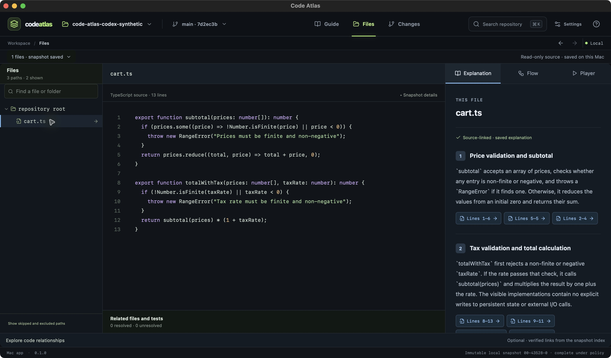

# Code Atlas

Code Atlas is an in-progress Mac-first desktop app for understanding a codebase from its actual files. The intended guide explains eligible files individually, links claims to captured source, and lets readers pause, inspect code, and choose when to continue. A repository overview is an orientation layer, not a substitute for file explanations.

The project currently runs from a source checkout; this repository does not provide a signed and notarized installer or a user download. Start with the [first-session guide](docs/GETTING_STARTED.md) for the native app workflow and its limits.



The native workspace now puts a file explorer, real source, and Explanation / Flow / Player controls together. Codex opens directly with remembered settings; local source review and consent remain explicit. See the [workspace review and remaining design work](docs/acceptance/2026-10-16-code-workspace.md).

The current design direction has three primary destinations: Guide, Files, and Changes. The older Atlas / Code Lens / Walkthrough concept board is retained as a historical reference. These design images are proposals, not screenshots of the running app. Product behavior and release goals are described in the [blueprint](docs/PRODUCT_BLUEPRINT.md); they are not proof that every acceptance gate has passed.

## What the current source contains

**Current delivery: Codex first, without a mandatory API key.** The user deferred automatic Claude support to later work (`8gqw`). Codex has source adapters for file chapters, overviews, section repairs, exact code selections, PR Guides, hunks and bounded reading plans. Building/testing and a small synthetic installed-account validation are now authorized; source wiring alone does not establish accepted support. Claude generation stays unavailable behind its empty qualification registry. Full multi-backend support remains open. See [required operations](docs/AGENT_OPERATION_PARITY.md), [agent setup](docs/AGENT_GENERATION.md) and [the current Codex gate](docs/kata-tasks/45-agent-first-generation.md).

- A Tauri desktop shell with Guide / Files / Changes navigation, local repository selection, bounded snapshot capture, immutable source browsing in Files, an optional relationship map, and a Rust index for a bounded Rust, TypeScript/TSX, and JavaScript subset. These are partial structural capabilities, not language qualification; see the [language capability matrix](docs/LANGUAGE_CAPABILITIES.md).
- Local file-by-file coverage, Chapter Studio editing and review, immutable JSON chapter revisions, and a manually paced Walkthrough with source-linked citations and typed visual hotspots.
- A **Compare local revisions** project tool for bounded, read-only comparisons of commits already present in a local Git repository. It shows file classifications, exact changed-line ranges, diff hunks, parser-backed declarations where all available source revisions parse cleanly, and distinct base/head commit and blob identities. A separate PR Guide panel defaults to Codex with a ChatGPT account and also offers explicitly selected Gemini, OpenAI, or Anthropic APIs after exact request review and consent; generated claims must cite the correct base/head hunk, and accepting or rejecting appends separate local PR Guide history. Each eligible text hunk also has a transient **Explain hunk** flow: it reviews and sends only that hunk, returns locally validated base/head citations, and writes neither PR Guide history nor Git state. These local comparison flows never fetch, check out, or write Git state.
- The Guide reader can export one self-contained HTML file from selected accepted revisions. Its preview reports audio availability per section and pairs included cached tracks with their reviewed transcript; it also previews paths and excerpts and supports section navigation and supported typed diagrams. Live local Files destinations are unavailable offline.
- Direct Gemini, OpenAI, and Anthropic API paths for file chapters, optional repository orientation, selective section updates, PR Guides, and transient single-hunk PR change explanations. A reviewed request sends only the selected captured context after explicit confirmation; persisted chapter/PR Guide content remains unaccepted until the user reviews it.
- A Codex account route for file chapters and an overview of 1–12 selected captured files: managed app-server over stdio, browser sign-in, runtime model/reasoning choices, reviewed source, progress/cancellation, and locally validated unaccepted drafts. One-section stale repairs now share the scoped evidence builder and preservation validator. Exact Files source ranges, PR Guides and single-hunk explanations now share immutable context, managed dispatch and the existing citation validators; range/hunk results stay transient and guides use separate unaccepted PR history. A synthetic packaged-app file chapter has completed generation, draft save, acceptance, citation navigation and manual section advance through the existing ChatGPT account. Other operations and full runtime/account/distribution qualification remain open.
- Optional Pocket TTS narration, now the default for new section preferences. Setup downloads an app-managed runtime and pinned English model/Alba voice on Apple Silicon Macs; it currently requires an existing `uv` installation. Generation uses a finite local worker per segment, without an API key or listening server. Legacy Google preferences and cached audio remain distinct, and Gemini speech is still available by explicit selection.

- **Learning plans**: ask a question, select captured files, review a request with Codex or Claude, and reopen an unaccepted plan with Back/Next and exact source citations. Requests stay bounded to 12 files/250,000 source bytes. Explicit acceptance, immutable plan revisions and exact notice resolution are in source. Accepted steps now prepare question-focused chapters through either agent, preserving the original step scope for recovery. Codex dispatch is unaccepted source; Claude generation is qualification-gated. Native generation records now preserve original agent/request/settings and exact plan-step links in previews/history. Native acceptance, selective updates and complete repository orchestration remain pending. See [the planning flow](docs/REPOSITORY_PLANNING.md) and [planned agent chapters](docs/PLANNED_AGENT_CHAPTERS.md).

These are capabilities under development, not a finished or released product. **October 16 validation:** 98 frontend tests, 185 Rust tests, the production build and Cargo check pass (two native tests ignored; the installed-account metadata test also passed separately). The unsigned native app automatically discovered the existing desktop Codex and completed a GPT-6 Luna/max synthetic chapter: generation → draft → accepted revision → clickable source → manual section navigation. See [dated evidence and remaining work](docs/acceptance/2026-10-16-codex-validation.md). Native Pocket setup, section audio playback and cache reuse also passed a synthetic baseline. Other operations, reliability, narration quality, visual quality, design parity, accessibility and release readiness remain open. Claude, Gemini CLI and Antigravity automatic support remains later work in [M7](docs/kata-tasks/phase-7.md).

## Start here

- [Getting started](docs/GETTING_STARTED.md) — run the current Mac app from source and complete a local first session.
- [0.1.0 release readiness draft](docs/releases/0.1.0-draft.md) — unreleased status, parser coverage, capture limits, and open gates.
- [Troubleshooting](docs/TROUBLESHOOTING.md) — diagnose repository, snapshot, chapter, provider, and narration issues.
- [Language capability matrix](docs/LANGUAGE_CAPABILITIES.md) — see which source and structure operations are available and which still need qualification.
- [Local data and permissions](docs/LOCAL_DATA.md) — find local snapshots, understand Keychain access, exports, and deletion.
- [Product blueprint](docs/PRODUCT_BLUEPRINT.md) — intended user journey, file coverage, trust rules, and release gates.
- [Interaction contract](docs/INTERACTION_CONTRACT.md) — controls, navigation destinations, side effects, and acceptance walkthrough.
- [Technical plan](docs/TECHNICAL_PLAN.md) — implemented architecture notes and clearly marked future boundaries.
- [Chapter schema](docs/CHAPTER_SCHEMA.md) — persisted chapter format, evidence validation, visuals, and revisions.
- [Provider disclosures](docs/PROVIDER_DISCLOSURES.md) — direct APIs, the initial Codex account route, local Pocket narration, and optional Gemini speech.
- [Chapter quality gate](docs/CHAPTER_QUALITY_GATE.md) — synthetic corpus and human-reviewed release report workflow.
- [Kata backlog](docs/KATA_BACKLOG.md) — milestone map and issue definitions.
- [Current pending work](docs/PENDING_WORK.md) — October 15 static fixes, remaining bugs, Pocket TTS integration and acceptance tasks.
- [Approved screen proposals](docs/design/PROPOSED_SIMPLIFICATION.md) — Guide, Files, Walkthrough, and Changes visual references; proposals are not implementation evidence.

## Local development

The lockfile's Vite toolchain requires Node.js 20.19 or newer in the 20.x line, or 22.12 or newer. The Rust crate uses edition 2024, which requires Rust 1.85 or newer ([edition release](https://blog.rust-lang.org/2025/02/20/Rust-1.85.0.html)). The project does not set Cargo's `rust-version` or pin a Rust toolchain, so compatibility of the locked dependencies with Rust 1.85 has not been verified. Use current stable Rust with Cargo for native commands.

```sh
npm ci
npm run dev
```

`npm run dev` starts the Vite browser preview at `http://127.0.0.1:4173`. The port is fixed; startup fails if it is already in use, so the preview does not silently move to another port. It is not equivalent to the native app: native repository picking, Keychain access, and provider operations require the Tauri shell.

```sh
npm run tauri dev
npm run check
```

`npm run check` runs, in order: synthetic chapter-corpus validation, every Node test in `tests/*.test.mjs`, the TypeScript/Vite build, Rust library tests, and `cargo check` for the Tauri crate.

`npm run quality:metadata` prints the fingerprints used by a chapter-quality review. `npm run quality:gate -- --report benchmarks/chapter-quality/review/reports/run.json` checks a completed human-reviewed report; generating metadata alone does not pass that gate.

`npm run bundle:macos` is configured to request an unsigned `.app` and `.dmg` and verify their identity and embedded schema metadata. A macOS GitHub Actions preflight is configured to run that command on pull requests and pushes to `main`; it does not sign, notarize, or publish the bundle. No user-download artifact has been verified, and the project does not yet declare a supported minimum macOS version.

## Data and provider behavior

Local browsing, capture, indexing, and opening saved chapters do not need an API key or provider call. Building a review sends no source. A confirmed direct text request sends the reviewed context to the selected API. Codex Connect/Load models can start the managed runtime and contact its account services; source is supplied only for a confirmed reviewed generation run. This initial route uses the runtime's native managed ChatGPT login, not a Code Atlas implementation of direct Sign in with ChatGPT. Runtime model listings do not prove account entitlement or remaining quota.

Pocket setup downloads dependencies and fixed assets; subsequent synthesis is configured to use local files and keep the script on this Mac. A separately selected and confirmed Gemini speech request sends the reviewed script and voice/style settings to Google. Read the [provider disclosures](docs/PROVIDER_DISCLOSURES.md) and [Pocket runtime limits](docs/research/pocket-tts-runtime.md) before using these paths. The October 16 native Pocket baseline completed setup, synthetic section synthesis, playback/replay/pause and cache reuse. Listening quality, clean-account installation, cancellation and export qualification remain open.

## Project state and trust routes

The full desired experience is still being built. Single-section stale-guide updates and the user-facing revision compare/restore workflow are implemented; one request cannot update several stale sections as a batch. Static cross-file relationship evidence in local Git comparisons is implemented with revision-specific source anchors and explicit partial-result reporting. Polished onboarding, release hardening, and the remaining PR Guide and offline-export acceptance evidence are still outstanding. The source contains the reviewed local PR Guide and self-contained offline export workflows, but their Kata acceptance walkthroughs have not been completed. Check the blueprint and Kata backlog for the target and outstanding gates.

There is no `LICENSE` file in this checkout, so its license and reuse permissions are unspecified. The [public GitHub repository](https://github.com/appunni-m/software-stories) exposes an [Issues page](https://github.com/appunni-m/software-stories/issues), but no triage or response policy is published. Do not post credentials, private source, or vulnerability details there. No monitored private security-reporting route, general support contact, maintainer contact, or contribution review policy is published. See [SECURITY.md](SECURITY.md) and [CONTRIBUTING.md](CONTRIBUTING.md) for the current limits and local development instructions.

Kata project name: `code-atlas-rebuild`. Issue definitions live in [`docs/kata-tasks/`](docs/kata-tasks/); their task contracts describe intended work and should not be treated as proof that a release gate passed.
