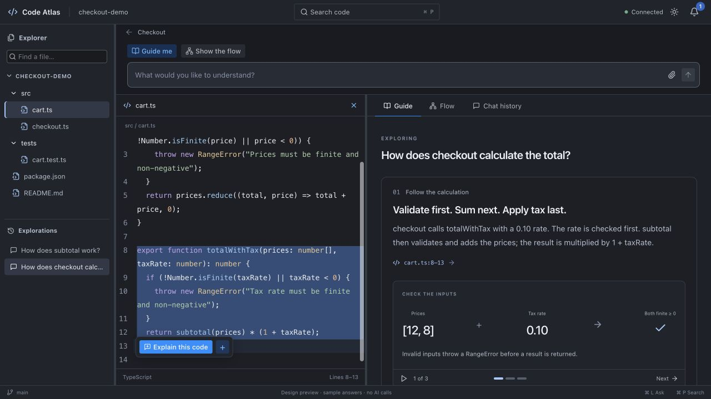

# Code Atlas

Code Atlas is an in-progress macOS app for understanding a repository from its captured source. Ask about the code, follow a visual Guide or Flow, and open cited lines beside the explanation. You choose when to move on or explore a detail.

**There is no signed, notarized installer or public app download yet.** To try the native app, run it from a source checkout using the [getting-started guide](docs/GETTING_STARTED.md). The local [browser design preview](#run-from-source) uses sample data; it does not read a repository, call an AI provider, or synthesize narration.

## What works in the current app

- Capture a local repository into a bounded, immutable snapshot and browse its captured files. The working copy is not edited.
- Ask from the workspace composer. Codex finds supporting code automatically after you grant permission for the selected snapshot. Validated sections appear in Guide as they are ready, with citations you can follow into the source.
- Read a Guide, inspect a Flow, or revisit Chat history within the same exploration. Citations open the captured source. Follow-up questions and **Explore further** keep their place in the exploration tree.
- Search captured paths, indexed symbols, and bounded captured text without sending a request for each keystroke. Local Git Changes provides a bounded, read-only history and comparison.
- Prepare Pocket voice once, then synthesize narration locally. Setup currently requires an Apple Silicon Mac, macOS 14 or later, internet access, and additional disk space. Human listening and clean-account release acceptance remain open.
- Standalone HTML guide export is planned for after 1.0. Saved explanations remain in the local app for the first release.

The first release is Codex-first. Direct API provider selection, PR explanations, and Claude or Antigravity account integrations are later work and are not qualified first-release routes; see [AI backend status](docs/AGENT_OPERATION_PARITY.md).

Code is the source of truth when repository documentation conflicts with implementation. Captures, search, supported languages, and large-repository explanations have limits; a citation identifies source but does not prove an explanation is correct. See the [release-readiness draft](docs/releases/0.1.0-draft.md) for known limitations and remaining gates.

## Workspace design preview



This image is from the browser design preview and uses a sample checkout repository. It illustrates the intended workspace; it is not a screenshot of the packaged Mac app or evidence that native visual acceptance has passed.

## Start here

- [Getting started](docs/GETTING_STARTED.md) — prerequisites, native first session, and current sharing and voice behavior.
- [Documentation map](docs/README.md) — user guides, implementation contracts, design references, and dated evidence.
- [Workspace contract](docs/design/WORKSPACE_EXPLORATION.md) — current interaction model and the illustrative preview.
- [Local data and permissions](docs/LOCAL_DATA.md) — captured data, app storage, exports, and removal.
- [Provider disclosures](docs/PROVIDER_DISCLOSURES.md) — what the first release sends to Codex and what stays local with Pocket voice.
- [Language capabilities](docs/LANGUAGE_CAPABILITIES.md) — implemented parsing and indexing limits by language.
- [Troubleshooting](docs/TROUBLESHOOTING.md) — recovery for repository, connection, chapter, and narration problems.
- [Offline export plan](docs/OFFLINE_EXPORT.md) — planned post-1.0 export contents and boundaries.
- [Security reporting](SECURITY.md) and [Support](SUPPORT.md) — current contact and response limits.
- [Contributing](CONTRIBUTING.md) — local development and change boundaries.

## Run from source

Prerequisites and native setup are in [Getting started](docs/GETTING_STARTED.md). Install dependencies with `npm ci`, then choose one mode:

```sh
npm run tauri dev
```

For the sample browser preview instead, use `npm run dev` and open `http://127.0.0.1:4173/workspace-preview.html`. Both commands use the same strict port and cannot run together. Stop the active server before switching modes; do not start another server on another port.

For contributor changes, `npm run check` runs the project quality checks, frontend tests and build, Rust tests, and Cargo check. `npm run bundle:macos` builds and verifies an **unsigned** `.app` and `.dmg`; it does not sign, notarize, or publish a release.

## Project status and trust

The app is under development. A synthetic Codex path and local Pocket narration have passed focused packaged checks, but the required Codex operations, real-repository explanation quality, Pocket speech quality, and signed release journey remain under qualification. Standalone offline export, direct API providers, PR explanations, and non-Codex agents are post-1.0. Do not interpret source code, synthetic checks, or a successful unsigned bundle as production or release acceptance.

Repository capture and saved explanations stay on this Mac unless you explicitly send reviewed context to a provider. Codex sharing permission is scoped to a captured snapshot and connected account. Local browsing and Pocket synthesis do not require a provider API key. See [Provider disclosures](docs/PROVIDER_DISCLOSURES.md) and [Local data](docs/LOCAL_DATA.md) before using private code.

The source authored for Code Atlas is licensed under [MIT](LICENSE). Third-party source, captured repositories, generated explanations, narration, and design assets may have separate rights. See [third-party notices](THIRD_PARTY_NOTICES.md) and [bundled license texts](THIRD_PARTY_LICENSE_TEXTS.txt).

The public [GitHub issue tracker](https://github.com/appunni-m/software-stories/issues) is not a confidential security channel. No monitored private security-reporting route or response-time guarantee is published; see [Security](SECURITY.md) and [Support](SUPPORT.md).
