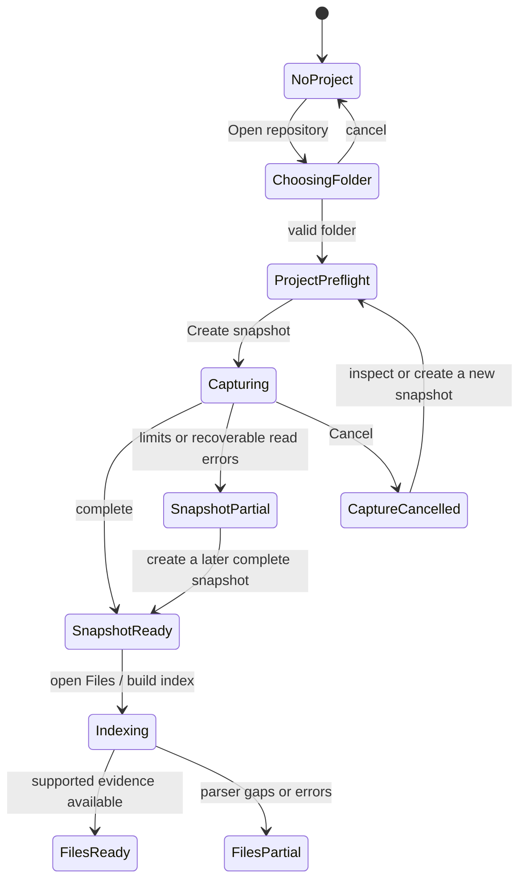

# Code Atlas — screen and interaction contract

> **Developer workspace migration — 16 October:** the [persistent code/chat/exploration workspace](design/WORKSPACE_EXPLORATION.md) is implemented in the production entry point. A left activity bar opens Explorer, Search, Changes and Explorations; pinned chat owns Guide / Flow / history at each level. Follow-ups stack and explicit branches attach to their originating answers. Native snapshot source, question-specific Codex generation, saved revisions, permission validation and local commit comparisons are wired. Packaged visual/accessibility and broader lifecycle qualification remain open in `na54` / `3rcd`; the separate preview uses sample data. Older navigation descriptions below are historical contracts superseded by this workspace.

The current navigation and conversation contract lives in [Workspace exploration](design/WORKSPACE_EXPLORATION.md). The sections below retain the earlier Guide / Files / Changes specification for its editor, player and review details; they do not define the current primary navigation. Detail is a shared code component available from Guide and Flow. Check the [design parity task](kata-tasks/43-design-implementation-parity.md), [technical plan](TECHNICAL_PLAN.md), and [Kata backlog](KATA_BACKLOG.md) for implementation and packaged-app status.

## Shared identity and navigation

Every workspace operates on one shared selection:

```text
project_id
snapshot_id
relative_path? / symbol_id?
chapter_id? / chapter_revision_id? / section_id?
anchor_id? / playback_position?
```

Optional fields are absent when they do not apply. Changing project or snapshot is explicit and visible in the global header. Navigation never changes the selected snapshot as a side effect of opening a file, chapter, or link.

When leaving a screen, save a local navigation-return entry with the origin screen, project/snapshot, selected file/symbol/section, tree or diagram viewport, source scroll/line, playback position, transcript position, and focused control. A Back action restores that entry. It does not create or select a newer source snapshot.

### Global controls

| Control | Activation | Result | Focus and side effects |
|---|---|---|---|
| Connection | Click backend/model/reasoning in the header | Open connection settings; reuse the saved choice for generation. Missing login opens setup when required. | Startup account restoration may contact Codex account services; source/metadata require their own reviewed request. |
| Appearance | Choose System, Light or Dark in header | Apply and remember the theme. | No repository or provider side effect. |
| Project picker | Click project name or `⌘O` | Show recent local projects and **Open repository**. Selecting a different project updates the shared project selection after confirmation when there is unsaved work. | Focus stays in picker until selection/cancel. No source bytes are read; selecting a project does not create a snapshot. |
| Open repository | Choose from picker or `⌘O` | Open the native macOS folder picker, then show the canonical selected folder, detected Git root, branch/HEAD when available, folder access, and **Create snapshot**. A nested folder resolves to its containing working copy. | Cancel returns to the previous screen with focus on the invoking control. Non-Git folders, missing folders, permission denial, missing Git, and metadata-storage failures have distinct recovery actions. No source bytes are read. |
| Recent project | Choose a row in the project picker | Recheck the saved path and Git metadata, then select the project for Explorer, Search, Changes, and its explorations. | Reopening never starts a snapshot. If the path moved or access changed, preserve the recent entry and offer **Choose a folder** or **Remove from Recents**. |
| Remove from Recents | Click the row's remove control | Remove that path from Code Atlas' local recent-project metadata. | Never delete or modify repository files. If it is the active project, the current session stays selected until the user switches projects or quits. |
| Snapshot picker | Click snapshot/revision label | List immutable snapshots with capture time, branch/HEAD, dirty-state summary, and partial/capture status. | Choosing one updates every view's shared snapshot. If a draft is open, ask Save draft / Discard draft / Cancel before switching. No new capture is made. |
| Create snapshot | Click from project preflight or snapshot list | Start a bounded local capture and show progress, phase, count, limits, and Cancel. | This is the only action that starts repository byte capture. It performs no network request and never writes into the selected repository. |
| Workspace activity bar | Click Explorer, Search, Changes, or Explorations | Switch activity while keeping the project, snapshot, pinned composer, and current exploration available. | Guide, Flow, and Chat history remain views within an exploration; switching views preserves that exploration's saved selection and reading state. |
| Guide coverage | Choose **File-by-file coverage** in Guide | Show every inventory path, its explanation state, and any skip/exclusion reason. | Returns to Guide with selection/focus restored. Does not call an AI API. |
| Chapter Studio entry | Choose a contextual **Review** or **Edit** action | Open the selected chapter revision/draft. | Opening a draft is local. Opening an accepted revision is read-only until the user chooses Edit. |
| Search and chat shortcuts | `⌘P` / `⌘K` opens repository search; `⌘⇧F` opens text search; `⌘L` focuses chat; `⌘1/2/3` selects Guide/Flow/Chat history | Search captured paths, indexed symbols, and source locally; typing a question also searches in parallel. A result opens captured code; **Explore with AI** sends only after the user chooses it. | Escape restores prior focus. Search and view shortcuts keep the current exploration and snapshot; they never silently dispatch a request or switch snapshots. |
| Back / Forward | `⌘[` / `⌘]` or toolbar buttons | Traverse the app's local navigation-return entries. | Back restores previous selection, scroll, focus, and playback context. It never reverses a source edit or accepted revision. |
| Help / About | App menu | Show product version, parser/provider metadata date, storage location help, keyboard shortcuts, and documentation links. | No provider request. |

`Escape` closes the topmost picker, menu, or non-sending dialog. If a provider request is in flight, use the explicit **Cancel request** control and confirm cancellation; Escape alone does not imply a network abort. `Space` toggles audio only when focus is in the Guide reader player and not in a text input. `⌘S` saves the current local draft in Chapter Studio. Enter activates the focused row/button; arrow keys move within a tree/list/menu. Focus is always visible.

## Startup and capture state machine



`SnapshotPartial` is not presented as a full repository capture. Guide and Files identify that snapshot as partial until the user captures again. Existing accepted chapters remain pinned to their original snapshot.

### Snapshot path inventory

The completed capture view includes one searchable inventory for the selected immutable snapshot. Its total is the union of captured files, recorded skipped/excluded paths, and traversed folders; rows are not deduplicated by filter or page. Directories are listed as containers and do not count as captured source files. The summary always distinguishes total inventory paths, captured files, captured source bytes, and skipped/excluded rows.

- Search matches the path and the stable reason/details for a row. Language, capture outcome, language-support tier, content kind, and config/test/generated/secret-like category filters combine with AND. Clear resets filters and returns to the first page; no filter changes snapshot contents or guide coverage.
- Each row identifies path, filesystem kind, inferred language, known size, capture disposition and reason, and a user-facing capability tier: **Partial structural**, **Text only**, or **Not analyzed**. That tier is separate from the selected snapshot's current local-index status. Binary and invalid-UTF-8 content are separate. The raw parser-readiness enum is an implementation detail, not a claim of complete language semantics or explanation quality. See the [language capability matrix](LANGUAGE_CAPABILITIES.md).
- Pages show both the visible range and the filtered/whole-inventory totals. Changing filters or page size returns to page one; an out-of-range page is clamped after the result set changes.
- **Open captured text** loads the path by project ID, snapshot ID, and relative path from the immutable snapshot blob store, then verifies its byte count and SHA-256 before display. A missing or corrupt blob produces an unavailable state; there is no working-tree fallback.
- Capture disposition is not a chapter state and does not select source for a future model request. Guide owns separate file-by-file chapter coverage, and Request Review owns explicit outbound file selection.

## Surface contracts

### App shell and project preflight

**Purpose:** make the local, no-AI path the first thing a developer can use.

**Primary selection:** current project; no snapshot until one is explicitly chosen or captured.

**Visible content:** project name and snapshot in the compact header; Explorer, Search, Changes, and Explorations activity bar; pinned chat; Guide, Flow, and Chat history views within the current exploration. Coverage and Chapter Studio are contextual actions.

**Controls and destinations:**

- **Open repository** → native folder picker → project preflight.
- **Create snapshot** → capture state machine above.
- **Explorer / Search / Changes / Explorations** → selected activity. If no snapshot exists, keep local project selection visible and offer the relevant Open/Create action.
- **Guide file-by-file coverage** without a snapshot → explain that a snapshot is required and route to preflight.
- **Remove from recents** → remove only Code Atlas project metadata after confirmation; never delete repository files or snapshots unless a separate destructive action names exactly what will be deleted.
- **Connections** → saved AI and voice providers and supported model choices. Opening connection settings does not send a request.

**States:** first launch/no projects; project selected/no snapshot; capture in progress; capture cancelled; partial capture; complete snapshot; no repository permission; project unavailable/moved; persistence error. Each state has a next action and preserves prior projects/snapshots.

**Focus:** first launch focuses Open repository. Picker cancel returns focus to its invoking control. Capture completion announces counts and focuses the snapshot summary, not an unrelated tab.

**Side effects:** project selection may read Git metadata needed for preflight. Only Create snapshot reads eligible source bytes. No screen entry checks a provider key or contacts an AI API.

### Files: repository tree and optional relationship map

**Purpose:** find a captured file, then optionally inspect parser-backed relationships.

**Primary selection:** folder, file, symbol, or relationship in the current snapshot.

**Layout:** searchable repository tree beside the selected file's source and explanation. The relationship canvas, filters, evidence details, and index status live under an explicit optional relationship view.

**Controls and destinations:**

- Typing in **Search** narrows paths/symbols in the current scope and updates the visible result count. A scope selector chooses repository, current folder, or indexed symbols. **Clear** removes only the text query.
- Clicking a folder selects it and filters canvas results to descendants. It does not open a chapter.
- Clicking a captured text file selects it in Explorer and opens its source beside the current Guide/Flow explanation. A symbol or relationship citation opens exact evidence in that source pane. No separate Code Lens destination is required.
- In the browser preview, source-open actions explain that local snapshots require the Mac app; they do not attempt a native snapshot read or imply that the file is missing.
- Clicking a relationship selects the edge and shows its type, confidence, and evidence. **Open evidence** navigates to the exact source range that proves the edge.
- Relationship-type filters use AND with the current path/language filters. Selected filters appear as removable chips; **Clear filters** removes all active filter chips but preserves the selected snapshot.
- Map **Fit**, **Zoom +**, **Zoom −**, and **Reset** affect only the viewport. Dragging empty canvas pans; selecting a node does not recenter the map unexpectedly.
- **Freshness status** opens the source-change report. It does not update or regenerate chapters.
- An unsupported relationship badge opens the parser status and reason; it is not a link to guessed callers.

**States:** no snapshot; indexing; indexed; partial index; empty repository; no search result; selected folder with no indexed descendants; selected unsupported file; scan/index error; stale accepted guide indicator. Tree and source browsing remain available when the optional graph has no supported nodes.

**Focus/return:** tree uses arrow navigation; Enter opens the selected file in the adjacent source/explanation area. Relationship canvas nodes are keyboard focusable with name/type/evidence summary. Returning from a citation restores the previous file or Guide reader section, tree query, optional map selection, zoom, and pan.

**Side effects:** searching/filtering/selecting/panning are local reads only. Files does not send source to an AI provider.

### Files: source, explanation, and evidence

**Purpose:** verify what a file explanation or relationship says against exact immutable source without leaving Files.

**Primary selection:** path, source range, and snapshot; optional related symbol.

**Layout:** file tree; read-only source with an optional highlighted anchor; the latest explanation accepted for this exact snapshot; clickable evidence; collapsed related-file details.

**Controls and destinations:**

- Clicking a citation selects its exact range in the source pane. The selected explanation shows path, snapshot, hash, line range, excerpt, and claim category.
- Browser Back returns to the prior file or Guide reader section, with its selection and focus restored. Moving between citations within one file does not create redundant history entries.
- Clicking a resolved caller/import/test opens that file and exact relationship anchor in Explorer while preserving the current exploration and stacking a return entry.
- Clicking **Copy path** copies only the repository-relative path. **Copy citation** copies path plus range and snapshot ID. Neither reads the live repository.
- A stale/missing citation has **View source change** when both snapshots are available, or **Return to chapter**. No “closest line” action is offered.

**States:** exact source available; unsupported highlighting/plain-text source; uncaptured path; binary/too large; invalid encoding; missing blob; range/hash mismatch; parser unavailable; relationship unresolved; permission revoked. Every unavailable state explains why and offers a valid return/refresh route.

**Focus/return:** source editor is read-only and keyboard navigable. Citation activation places focus on the source heading/range; Back returns focus to the initiating citation/hotspot. Source scrolling never changes the selected snapshot.

**Side effects:** opens captured local bytes only. No repository write, model request, or implicit recapture.

### Guide: file-by-file coverage

**Purpose:** answer “which files have an accepted explanation, and what remains?” through a contextual Guide coverage action.

**Primary selection:** one inventory path or an explicit user-created coverage group.

**Layout:** the current exploration's Guide view contains its answer cards. **File-by-file coverage** opens the full path table with status/reason, search, advanced filters, pagination, and chapter actions without introducing a new primary destination.

**Controls and destinations:**

- Clicking a path opens its source and file explanation in Files. **Read** opens an accepted chapter in the Guide reader; **Review** opens its revision in Chapter Studio.
- **Create chapter** opens a local empty draft for that one file; no request is sent.
- **Generate draft** builds a local manifest and opens Request Review. It does not send until the separate final confirmation there.
- **Exclude from guide** requires a reason and affects guide coverage only; it does not remove inventory/source data. **Restore coverage** removes that exclusion.
- **Create group** requires selecting members and entering a rationale. **Edit group** shows every member; **Remove group** returns each file to its own individual missing/draft/accepted state. Groups are never implicit.
- Search, status/language filters, page size, and sort order affect visible rows only. Counts always state whether they describe all paths or current results.
- There is no **Generate all** action in the initial release.

**States:** not indexed; inventory loading; all chapters missing; partial coverage; complete eligible coverage; partial snapshot; filtered no-results; unsupported/excluded paths; selected file with no chapter; selected group with missing members; stale chapters awaiting review; persistence error.

**Focus/return:** table uses row/column navigation and announces status. When returning from Files, the Guide reader, or Chapter Studio, restore the selected row, query, filters, page, and focus.

**Side effects:** all views and edits are local until the user completes Request Review confirmation. Excluding/restoring a path does not delete captured bytes.

### Chapter Studio

**Purpose:** make source-grounded drafts reviewable and editable before acceptance.

**Primary selection:** chapter revision and one section in the current snapshot.

**Layout:** chapter/file identity and revision status; section outline; editable prose and spoken text for a draft; claims/evidence panel; validation results; revision actions.

**Controls and destinations:**

- **Revision history** lists immutable chapter revisions with their revision number, lifecycle, creation date, source snapshot suffix, and parent revision. Selecting an entry displays that revision read-only. When an earlier revision exists, **Compare rN with rN** expands a field-by-field comparison with the immediately preceding revision number. It reports chapter title, source snapshot, status, parent, and section additions/removals/changes across order, title, explanation prose, spoken narration, claims, source references, dependencies, diagram inputs, and hotspots. Reader-facing text fields show before/after summaries; source-reference summaries show paths, ranges, abbreviated hashes, and excerpt length while hiding excerpt contents. Collections and typed visuals use bounded summaries. The comparison does not change either revision.
- **Restore rN as draft** is available for an earlier revision when the chapter has a current-snapshot revision. It copies the selected historical content into a new draft parented to that latest current revision; it never rewrites or reactivates the selected historical revision. If the source snapshot differs, citation anchors move only when the same stable symbol and exact excerpt are proven in the current snapshot. Unproven anchors remain on the draft, and the new draft is validated against the current snapshot. A draft with evidence issues stays unaccepted; Chapter Studio lists the precise validation issue and source location for repair. **Accept** remains disabled until validation passes.
- Selecting a section changes the editor/evidence panel only. Section reorder controls move the selected section in the draft and show its new order before save.
- **Edit accepted revision** creates a new draft based on it; original accepted content remains read-only.
- Editing prose changes draft text; editing spoken text changes only the speech input. Removing a claim removes that claim from the draft and marks validation dirty; source anchors cannot be changed by changing visible prose.
- Clicking an anchor opens Files at that range; Back restores section, editor scroll, and focus.
- On an older accepted revision, **Assess freshness** compares it with the selected snapshot without changing the revision. Each section reports Current, Safe to carry forward, Stale, or Needs review with evidence completeness and an explanation. Exact old/new source ranges open in Files at their respective snapshots; no line is guessed when mapping is ambiguous.
- **Validate** runs local schema/source/destination checks. **Accept** is disabled until validation passes. **Reject** asks for a reason and preserves the rejected payload in history.
- **Save draft** writes local content only. **Accept** creates an immutable accepted revision and routes to the Guide reader with this chapter selected. **Cancel** returns to origin without deleting a saved draft.

**States:** new blank draft; generated draft; unsaved edits; validation running; validation errors; valid draft; accepted read-only; rejected; stale against newer snapshot; freshness assessing; current; safe to carry forward; stale evidence; incomplete/unsupported evidence; storage error. A stale state identifies source and affected sections; it does not silently shift anchors. An incomplete index is shown as Needs review, not as proof that the source changed.

**Focus/return:** section outline and claims list are keyboard navigable. After validation, focus moves to the first error or success summary. After acceptance, focus moves to the selected chapter heading in the Guide reader.

**Side effects:** editing, validation, save, accept, and reject are local database operations. Only an explicitly chosen Generate action leaves this surface for Request Review.

### Guide reader: section-by-section Walkthrough

**Purpose:** help a developer learn a real file one small, inspectable section at a time.

**Primary selection:** accepted chapter, selected section, and optional playback position.

**Layout:** chapter/section rail; current section question/title; explanation; diagram; exact source excerpt; transcript/captions; transport controls.

**Diagram behavior:** only a validated visual version 2 is interactive. App-owned layout uses the saved direction; each node/edge label has visible source links to its own exact claim anchors. Edges name their destination node and keep their evidence links beside the edge. A missing, legacy, malformed, or unsupported diagram shows a short unavailable/legacy message while prose and evidence remain usable. Diagram values are text; no generated markup, script, CSS, or external URL is run.

**Controls and destinations:**

- Selecting a chapter opens its first section, or the last locally stored section when resuming that same chapter. It never auto-plays audio.
- Selecting an item in the section rail opens that section immediately and updates code/diagram/transcript to its accepted revision.
- **Previous** selects the preceding section; disabled on the first section. **Continue** selects the next section only after the reader clicks it; no timed auto-advance. On the last section the control becomes **Finish chapter**, which returns to the chapter list and remembers the last section.
- **Play/Pause**, **Replay section**, and the section timeline control narration. Playback completion does not advance the section. If there is no audio, controls are disabled with “Audio unavailable”; text remains usable.
- Clicking a diagram hotspot opens only its declared source, section, Files, or external destination. The focused hotspot action remains visibly highlighted when Back restores the origin section, playback time, and transcript position; audio resumes only if the user explicitly resumes it.
- Clicking a node or edge source link opens the exact cited range. Back returns focus to that specific visual evidence link, including when multiple visual items cite the same anchor.
- Clicking a code citation opens the exact range in Files. Back restores reader context.
- **Transcript** remains visible with audio off; if timestamps exist, selecting a timestamp seeks within the current section. The current chapter format stores one unsegmented `spokenText` string, so show section-wide source references separately and do not imply that they support a particular sentence. Each reference opens its exact anchor. Passage-level citations require transcript segments with explicit anchor relationships.

**States:** no accepted chapter; chapter with one section; selected section; first/middle/last section; audio generating/available/unavailable; stale chapter; missing diagram; source anchor unavailable; offline. Stale content is clearly labeled; the reader can still inspect the accepted revision's captured snapshot.

**Focus/return:** the focused section heading is announced after navigation. Space toggles play/pause only when focus is in player controls. Reduced-motion mode disables decorative transitions without changing section or hotspot behavior.

**Side effects:** viewing, section navigation, and playback are local. No chapter generation occurs from Continue or a hotspot.

### Request Review and provider consent

**Purpose:** let the user understand and approve one exact outbound request, not a broad repository upload.

**Primary selection:** request purpose, direct API provider, model ID, disclosure version, one captured target file, and zero to eleven supporting captured files. The target remains selected; supporting context can be filtered by path and selected from the same immutable snapshot.

**Review layout:** target and request purpose; provider, model ID, endpoint, disclosure date, and published pricing/free-tier notice; selectable eligible files; each selected file's complete captured UTF-8 contents, byte size, and hash; combined size/token estimate; exact system and user prompts and generation settings; request fingerprint; the selected provider's privacy notice and terms/pricing/region links; separate unchecked privacy, billing, and age/region/use acknowledgements.

**Controls and destinations:**

- **Choose source files** shows only captured regular text files with known or text content, each no larger than 250 KB, excluding paths marked secret-like. The target is required; up to eleven supporting files can be checked. The total selected source limit is 250 KB, and the encoded request limit is 512 KB. Binary, invalid-encoding, skipped, uncaptured, and secret-like files cannot be selected. Every selection change rebuilds the local request preview and clears all three acknowledgements.
- **Choose provider** and **Change model** select only explicit catalog entries and rebuild the review/fingerprint; neither silently substitutes a provider or model.
- **View provider terms/pricing** opens the selected provider's first-party page in the system browser; it sends no repository source.
- **Confirm privacy and data use**, **Confirm billing uncertainty**, and **Confirm age, region, and use** are separate, unchecked controls. They must all be checked with a current reviewed fingerprint before send.
- **Send this request** makes exactly one request matching the reviewed fingerprint to the selected Gemini, OpenAI, or Anthropic API. It is the only control on this surface that sends source context off the Mac. The result is shown as an unaccepted response preview and is not saved as a chapter.
- **Close** discards the temporary review and acknowledgement and sends nothing. During an active request use the explicit cancel control; it drops the local future, but the selected provider may already have received the request.
- Provider failure shows a sanitized named error. The consumed request is not retried; Code Atlas builds a fresh review and clears consent. The previous error remains visible while the new review is prepared.

**States:** no key; Keychain unavailable; snapshot file list loading; local manifest preview; stale/expired manifest; awaiting three acknowledgements; sending; unaccepted response preview; quota/billing/region/network/model error; malformed response. A request review and exact source exist only in Rust/WebView memory for up to fifteen minutes. Key setup and model metadata display are local and do not send prompt content; the key is stored in macOS Keychain.

**Focus/side effects:** opening settings reads provider disclosure metadata and Keychain status. In Request Review, loading the captured-file inventory reads local snapshot metadata only. Building a review reads selected immutable snapshot blobs but makes no network request. No request is sent by opening, filtering, changing context/model, scrolling, key setup, or reading disclosures. Consent is scoped to the exact fingerprint and disclosure version and one send. There is no retry, paid fallback, model discovery, or automatic model switching.

### Local Git comparison

**Purpose:** inspect a bounded difference between two locally available commits without changing the repository.

**Entry:** choose **Compare local revisions** from Project Tools. A selected local repository is required; an immutable snapshot is not. In the browser preview, the surface explains that local Git comparison is available only in the native Tauri Mac app.

**Controls and destinations:**

- Enter a local branch, tag, unambiguous short ref, or full commit ID for **Base revision** and **Head revision**. **Swap** exchanges the two values without running Git.
- **Compare revisions** invokes the bounded Rust command. It resolves both refs to immutable commit IDs and reads local objects. It does not fetch, checkout, update refs, write the index, or read repository files through the live working tree.
- Invalid, missing, ambiguous, and non-commit refs show a choose-again message identifying the side that needs correction. Comparison errors leave the entered pair available for retry.
- The result identifies the exact resolved commit pair and stable comparison ID. Changed files show change kind, classification, and whether bounded text hunks are available. Expand a file to inspect each diff excerpt with exact changed-line ranges and separate base/head paths, commit IDs, and blob IDs. When all available source blobs parse cleanly, parser-backed declaration names and full syntax ranges are shown only where the declaration overlaps changed lines.
- Limited results and skipped reasons remain visible. Binary, oversized, unsupported, and parser-uncertain files are not displayed as complete source text. A pair with no changes says so explicitly.
- Back/Forward restores the ref pair and expanded file selection. Editing either value hides the prior result until the new pair is compared.

**States:** no repository; desktop preview unavailable; refs incomplete; comparing; choose-again; ready with changes; ready with no changes; bounded/partial; comparison error. No provider request is made and no source is sent.

**Boundary:** comparing refs is a local evidence-browsing action and sends nothing. Declaration overlap is static syntax evidence, not inferred runtime impact. The separate PR Guide panel below may send only the user-selected diff after an exact request review and explicit consent. Neither workflow fetches a remote PR, comments, checks out refs, or writes Git state.

### PR Guide

**Purpose:** explain a selected local change set with claims that can be traced back to immutable base/head evidence.

**Entry:** after a complete ready comparison, use **Build a PR Guide**. The browser preview shows the interface but cannot run local Git, access macOS Keychain, or call a model API.

**Controls and destinations:**

- Select up to twelve changed text files. Binary, oversized, unsupported, incomplete, or skipped diffs cannot be sent. Changing the selection invalidates any existing request review and consent.
- **Review exact provider request** rebuilds the local comparison and lets the user select a provider and model. It shows the exact selected diff, prompt, generation settings/schema, endpoint, token estimate, pricing/data-use disclosure, and consent fingerprint. This makes no network request.
- The three privacy/data-use, billing, and age/region/use acknowledgements start unchecked. **Send reviewed request** is enabled only for the current fingerprint after all acknowledgements. The app sends one request to the explicitly selected Gemini, OpenAI, or Anthropic model; it does not retry through another model or provider.
- Each returned claim must contain an exact, unique diff-line citation with the correct base/head side and immutable commit/blob anchor. Static evidence does not prove runtime behavior. Inference claims require an explanation of their basis.
- **Review draft** opens the saved, unaccepted guide. Exclude claims individually, then **Accept selected claims** or reject the draft with a reason. A citation button expands and scrolls to its exact diff hunk. A decision appends a PR Guide revision to this comparison's local history; it does not modify repository chapters, working-tree files, or Git refs.

**States:** no eligible file selected; exact request review; awaiting fresh consent; sending; validated unaccepted draft; accepted/rejected history; changed refs or invalid evidence; provider, quota, network, cancellation, or malformed-response error. Failed requests do not alter accepted guide history.

**Boundary:** PR Guide revisions are stored separately from file-chapter revisions and Git history. A completed comparison identity is bound to immutable base/head commits. Changing either ref requires a new comparison; the old request fingerprint cannot be sent for it. Remote PR metadata, GitHub authentication, checkouts, comments, and Git writes are out of scope.

### Transient PR change explanation

**Purpose:** explain one selected diff hunk without creating a saved PR Guide revision.

**Entry:** after a comparison is ready, select a direct API provider and model in the PR Guide panel, then choose **Explain hunk N** beside an eligible text hunk. The browser preview cannot run local Git or call provider APIs; use the native Tauri Mac app.

**Controls and destinations:**

- Building the review is local. It revalidates the comparison and selected hunk, and displays only that hunk, the exact prompt and encoded body, provider/model and terms disclosures, cost estimate, and fingerprint.
- The three privacy/data-use, billing, and age/region/use acknowledgements start unchecked. **Send reviewed request** is enabled only for the current fingerprint after every acknowledgement. One request goes to the selected API; there is no provider or model fallback.
- Returned claims must pass local schema and exact, unique, side-aware base/head hunk citation checks. Results remain in the comparison panel only; they do not create PR Guide history or alter file chapters, Git refs, or the working tree.
- A citation focuses the corresponding hunk. **Close** returns to the comparison; changing the refs or hunk discards the old review. Cancellation and provider failures leave the local comparison usable.

**States:** provider/model missing; building local review; awaiting consent; sending; transient validated result; invalid/changed hunk; cancelled; provider, quota, network, or malformed-response error.

**Boundary:** only the selected hunk is sent after explicit review and consent. The provider may have received the request before cancellation. The result is not persisted as a PR Guide or chapter. No GitHub login, remote PR request, checkout, or Git write is performed.

## Cross-screen state and return table

| Origin | Action | Destination | State restored on Back |
|---|---|---|---|
| Explorer selected file/symbol | Open citation or relationship evidence | Same workspace at exact captured anchor | Prior file or Guide/Flow section; tree/map selection and focus. |
| Guide coverage file | Create chapter | Blank local draft | Selected row/status/filter/page; no request exists. |
| Compare local revisions | Expand changed file | Base/head diff evidence | Ref pair and expanded file selection. |
| Local Git comparison hunk | Explain hunk N | Transient PR change explanation | Close returns to the comparison and selected hunk; no guide history is created. |
| PR Guide claim | Open citation | Selected base/head diff hunk | Draft selections remain in memory; the exact hunk scrolls into view. |
| Guide coverage file | Generate draft | Request Review | Request cancel returns to selected row and chapter status. |
| Request Review | Send this request | Provider, then Chapter Studio draft | On success, draft is a new unaccepted revision; on failure, manifest can be reviewed again. |
| Chapter Studio draft | Open citation | Files at exact source evidence | Draft values, active section, editor scroll, focused claim. |
| Chapter Studio valid draft | Accept | Guide reader at first section | Guide coverage shows accepted revision; prior history remains. |
| Guide reader diagram/citation | Open target | Files or another Guide section | Chapter/revision/section, audio state/position, transcript scroll, hotspot/citation focus. |
| New snapshot | Assess freshness | Per-section status, evidence reasons, and exact old/new source ranges | Prior accepted guide, snapshot, and assets are unchanged. |
| Stale section | Carry forward | New local draft with old/new anchors | Old accepted section remains available. |
| Stale section | Regenerate | Request Review for one selected section | Cancel/reject keeps accepted revision; accept creates a new chapter manifest. |

## Product-level acceptance walkthrough

1. Launch with no project; verify no source/provider request and that Open repository is focused.
2. Choose a temporary repo, cancel once, then choose it again; verify no bytes are captured until Create snapshot.
3. Capture; inspect counts/reasons; use Explorer and Search, start a Guide question from the pinned composer, open Changes, then verify source/citation Back restores the current exploration, selection, and focus.
4. Open Guide's **File-by-file coverage** view and verify each inventory path has a visible status. Create one file draft; no network call occurs.
5. Generate that file; inspect exact request manifest; verify the send button is disabled until all three separate acknowledgements; Close; verify no request and origin state is restored.
6. Repeat with explicit consent in a mocked provider flow; land in Chapter Studio as an unaccepted draft; click a citation and return to the same section/editor position.
7. In Chapter Studio, select an earlier revision, compare it with its immediate predecessor, and restore it as a draft. Verify the accepted revisions remain unchanged, the restore is parented to the latest current revision, and an unmappable citation remains invalid with a precise repair issue; acceptance stays disabled until validation passes.
8. Accept valid content; in the Guide reader use Previous/Continue, select a section directly, click a hotspot into Files, return, and verify section/playback/transcript state.
9. Trigger permission, parser, network, quota, malformed response, stale anchor, and persistence failures; verify the recovery actions from the product blueprint.

This walkthrough defines the behavior M0 must implement. Later feature issues add their own domain-specific acceptance; they must preserve these shared transitions and side-effect boundaries.
