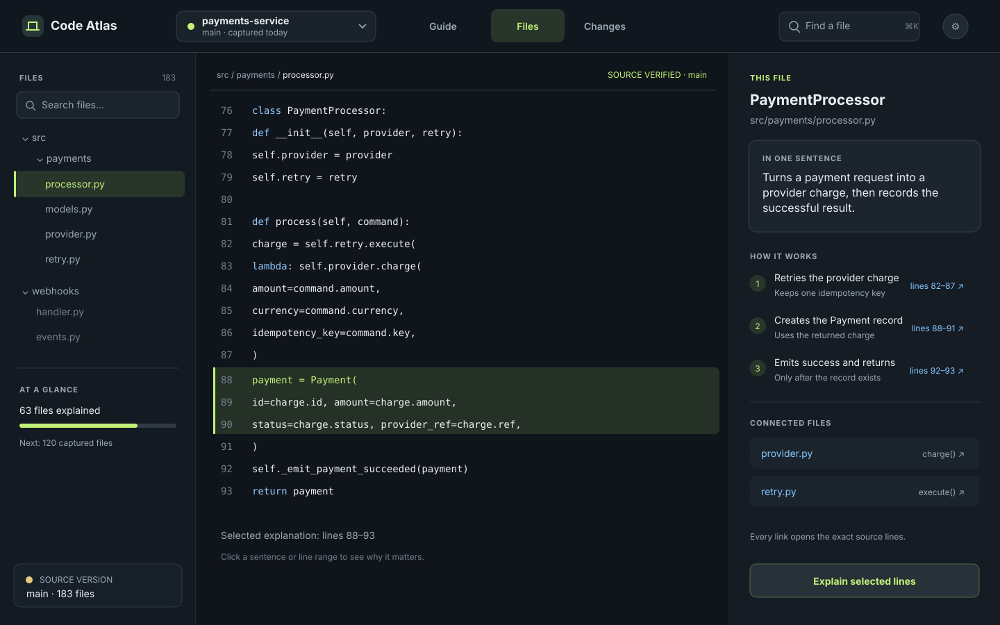
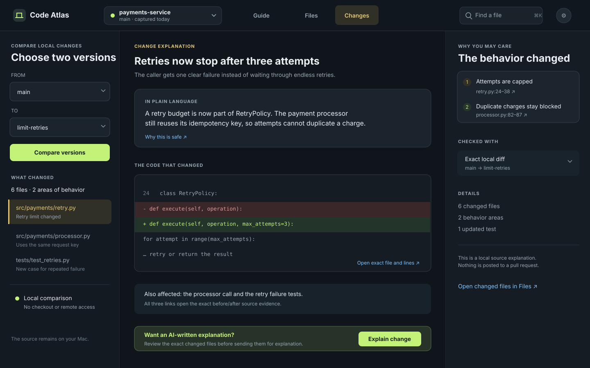

# Code Atlas — product blueprint

> **Developer workspace migration — 16 October:** the [persistent code/chat/exploration workspace](design/WORKSPACE_EXPLORATION.md) is implemented in the production entry point. A left activity bar opens Explorer, Search, Changes and Explorations; pinned chat owns Guide / Flow / history at each level. Follow-ups stack and explicit branches attach to their originating answers. Native snapshot source, question-specific Codex generation, saved revisions, permission validation and local commit comparisons are wired. Packaged design acceptance remains open in `13yp`; broader lifecycle work stays in its dedicated tasks. The separate preview uses sample data. Older navigation descriptions below are historical contracts superseded by this workspace.

> **Current 0.1 workflow — 9 November 2026:** Codex is the only first-release agent. Connect once and approve source sharing once for a captured snapshot. Submitting a question is the send action: Code Atlas discovers source automatically, checks the existing grant, validates the answer, then saves and shows it. There is no per-question file checklist, source-review dialog, or manual accept step. Formal accessibility audit matrices, a separate user-managed learning-plan/route builder, AI explanations for Git changes, exact five-slide look-ahead, and narration prewarming are not release gates. Normal keyboard use and readable themes remain baseline quality. The latest workspace contract below takes precedence over older direct-API, request-review, coverage-wizard, learning-plan, and manual-draft descriptions in this document.

**Status:** Product contract; implementation status is tracked separately  
**Plan date:** 13 October 2026  
**Product form:** Mac-first desktop app  
**Working name:** Code Atlas

This blueprint describes the intended experience, not the current release state. Source-backed implementation facts and unavailable integrations are summarized in the [README](../README.md), [technical plan](TECHNICAL_PLAN.md), and [AI backend capability matrix](research/ai-backend-capability-matrix.md). Every delivery gate below still needs its own acceptance evidence.

## Product promise

Open an unfamiliar local repository, ask what you want to understand, and follow a source-grounded answer into the files and functions that implement it. Browse or search any captured file at any time. Repository Guides explain useful behavior paths; individual files can be explained on demand. When code changes, update only the explanations and media that depend on it.

## Product concept

The current navigation authority is [Workspace exploration](design/WORKSPACE_EXPLORATION.md): a VS Code-style activity bar with Explorer, Search, Changes, and Explorations; pinned chat; and Guide, Flow, and Chat history views within each exploration. Opening code or a citation keeps the active exploration beside the captured source. The `workspace-*.jpg` images in that design document are illustrative preview screenshots, not the packaged app.

The older Guide / Files / Changes vector proposals are summarized in [PROPOSED_SIMPLIFICATION.md](design/PROPOSED_SIMPLIFICATION.md). They describe capabilities and behavior that remain relevant, but their top-level navigation has been superseded. The older `platform-overview.png`, `atlas-concept.png`, `code-lens-concept.png`, and `walkthrough-concept.png` depict an earlier information architecture and are historical references only.

The following capability descriptions use Guide, Files, and Changes as concepts, not as three primary destinations:

### Guide view — ask, follow the code, and choose when to continue

The current Guide follows the [conversational workspace design](design/WORKSPACE_EXPLORATION.md). The adjacent proposed Guide-home SVG below is an earlier dashboard proposal and is not the current screen.

- Put the pinned composer and two clear actions—**Guide me** and **Show the flow**—at the center of repository exploration.
- For a Guide, let AI find the relevant captured implementation in the background. Present one visual, source-backed section at a time with narration and explicit previous/next navigation.
- Keep detailed prose collapsed until the reader asks to inspect it. Citations open their exact captured lines beside the explanation.
- Let **Explore further** create a nested question from the current answer. Back and the exploration tree return to the exact parent context.
- Keep the file explorer available for direct source access. A selected file or code range can be attached to chat or explained at the current exploration level.
- Do not ask users to choose reference files for a repository-level explanation. Existing saved overview revisions may remain readable; new repository explanations use the Guide.

### Explorer and source — inspect one file beside its explanation

- Keep the repository tree, read-only source from the selected snapshot, and the selected file's accepted explanation visible in one destination.
- Clicking a citation opens its exact captured range in the source pane. Related files open there too, and Back returns to the originating guide section or file.
- The relationship map is an optional view inside Files. It is static parser evidence, never a complete runtime call graph.
- Keep unsupported, skipped, generated, and excluded paths visible with their reasons. Never silently substitute working-tree bytes for missing captured source.
- Editing and revision history remain contextual actions; the advanced relationship index and source hashes stay available without crowding the first view.

### Changes activity — compare local revisions

- Compare commits already present locally, show exact changed ranges, and explain behavior only from evidence on the correct base/head side.
- No fetch, checkout, remote request, or repository write occurs in the local comparison flow.
- A section-by-section Walkthrough is a deliberate reading flow within Guide, not a separate destination.

## Screen and state contract

The complete control-level destinations, keyboard/focus rules, side-effect boundaries, return-state contract, and acceptance walkthrough are specified in [Interaction contract](INTERACTION_CONTRACT.md). The summary below is the quick reference.

| Surface | State | What the user sees | Primary action and result |
|---|---|---|---|
| App shell | No project | Product promise, Open repository, recent projects if any; no AI prompt | Open launches the native folder picker. Cancel returns to this exact state. No scan or network call starts. |
| App shell | Project selected, no snapshot | Canonical repo path, branch/HEAD when available, capture limits, Create snapshot | Create snapshot begins a local, cancellable read. Changing project changes the shared project selection only after confirmation. |
| Capture | Scanning / cancelled / partial / complete | Progress, current phase, limits, cancel; final counts and per-path reasons | Cancel stops new reads. Partial capture is labeled and never presented as complete. A completed snapshot enables Explorer, Search, Changes, and AI-backed exploration when requested. |
| Guide | Empty / working outline / ready sections / partial result | Repository identity, useful Guide sections, visible gaps, exact source links | Ask about behavior; relevant code is selected automatically. Read each section as it is validated; no file-completion wizard is required. |
| Explorer | No file / source / explanation / unsupported / stale citation | Captured repository tree, selected snapshot source, optional explanation, exact citations | Select a file to read its source. Ask for an explanation when useful. Citation opens exact lines; missing or changed evidence names the reason with no live-source fallback. |
| Changes | No repository / refs incomplete / comparing / ready / bounded / invalid refs | Explicit local base/head refs, resolved commit IDs, classified paths, changed-line ranges, hunks, separate anchors | Compare existing local commits only; no fetch, checkout, remote request, or repository write. Uncertain and omitted evidence remains visible. |
| Search | Empty / matching captured code / no match | Local path, symbol and text results beside the composer | Open a result or choose Explore with AI. Search alone never sends a request. |
| Chapter edits | Current / stale / repair running / repaired / failed | Selected section, affected source change, and its revision history | Request repair for one selected section. The saved grant is checked in the background; a valid repair is saved automatically as a new immutable revision. |
| Guide player | Ready / playing / paused / audio unavailable | Large visual scene, collapsed narration text, source evidence, playback and section controls | Start audio when wanted; next/previous remain manual. Speech uses the local Pocket cache. A hotspot opens its exact captured source. |
| Connection | Not connected / connected / attention needed | One connection status in the header; supported model/reasoning settings on demand | Connect once. Grant snapshot sharing once per snapshot. Normal questions reuse both; setup appears again only when the account or scope needs action. |
| Local Git comparison | No repository / refs incomplete / comparing / ready / bounded / invalid refs | Explicit local base/head refs, resolved commit IDs, classified paths, exact changed-line ranges, bounded hunks, parser-backed declarations, separate base/head anchors | Compare existing local commits only; no fetch, checkout, remote request, or repository write. Uncertain and omitted evidence stays visible; syntax is not runtime impact. |
| PR Guide and AI hunk explanation | Deferred | Not part of the first release | Local commit history and diff browsing remain available in Changes. |

## Cross-screen transitions

| Start | User action | Destination | Return behavior |
|---|---|---|---|
| Current exploration | Open a captured file or source citation | Explorer opens the exact snapshot source beside the active Guide or Flow answer | Back restores the originating answer, source selection, and reading position. |
| Explorer | Open a source citation or related file | The same persistent workspace shows the exact snapshot and anchor | Back restores the prior file or Guide/Flow section and focus. |
| Chat composer | Submit a question | Local source discovery, connected Codex, native validation, and a saved answer card | Valid sections appear as ready; failure preserves earlier sections and gives one useful recovery action. |
| Explorer or selected code | Ask for an explanation | The exact captured selection is attached to the current question | The answer opens in the active Guide or Flow at the current exploration level. |
| Guide reader hotspot | Open code | Files at the hotspot's exact evidence | Return restores section ID, time, transcript position, and focused hotspot. |
| New source snapshot | Review changed evidence | Freshness list with source diff and affected sections/assets | User can inspect any source diff and leave without changing accepted guide history. |
| Local Git comparison | Inspect changed file or hunk | Read-only diff with exact changed lines | Stay in Changes; AI explanations of Git changes and PR Guides are deferred beyond 1.0. |
| Stale section | Request repair | Bounded source discovery under the saved snapshot grant | A valid repair is saved as a new immutable revision; prior history and unaffected sections remain available. |

No transition silently switches repository snapshots. A snapshot change is an explicit user action and is shown in the shared header and every activity/exploration view.

## Failure and recovery behavior

| Condition | User sees | Recovery |
|---|---|---|
| Folder access denied | Repo path and permission error; no capture progress | Choose another folder or grant macOS access, then retry explicitly. Existing project snapshots remain available. |
| Capture cancelled or bounded | Cancelled/partial label, captured/skipped counts, exact reasons | Resume only as a new capture, change the selected scope, or inspect captured files. Never treat partial as complete. |
| A source path is unavailable or a relationship cannot be established | A captured file stays openable; when a limitation affects the current action, show a short reason and a useful next step | Read and cite captured text where available. Keep parser and index diagnostics out of the reading workspace, and never invent relationships from missing structural evidence. |
| Codex disconnected or account unavailable | Clear connection status; local features remain active | Open Connections only when needed. Reuse the saved account after reconnection; no API-key setup is required. |
| Provider/quota/runtime error | Plain failure state; prior saved answers remain available | Stop or explicitly continue/retry. The existing snapshot grant is checked quietly; no new source-review dialog appears. |
| Invalid model response or citation | No invalid section is shown; a short actionable status appears | Keep earlier valid sections and allow a bounded repair or explicit retry. No manual answer-accept step. |
| TTS unavailable | Visual and transcript remain readable; audio status names the problem | Retry local Pocket setup or play cached speech when available. |
| Anchor changed or cannot remap | Stale reason and old/new source diff; no auto-open to nearby code | Carry forward only a unique exact match. Otherwise keep the prior revision, mark it stale, and offer a user-triggered repair; a valid repair saves as a new revision automatically. |
| Disk full or persistence failure | Save error; last durable revision remains selected | Free space and retry. Multi-record writes are atomic; no partial revision is exposed. |

## Non-negotiable product rules

1. **Source comes before story.** Code explanations cite captured source; a polished introduction cannot stand in for file-level understanding.
2. **Find relevant code automatically.** Every captured path remains browseable and searchable; the Guide explains relevant files on demand instead of asking the reader to plan source selection or finish a coverage checklist.
3. **Evidence is inspectable.** Every code-behavior claim resolves to the captured bytes and an exact path/range. Inferences are labeled as inferences.
4. **The reader controls time.** Sections are skimmable, pausable, replayable, and manually advanced.
5. **Edits are local and reversible.** Accepted guide revisions are immutable; selective edits create new revisions and preserve history.
6. **AI is optional.** Local repository browsing and previously accepted guides work without an account, API key, network, or model.
7. **No confidence theater.** Static relationships are not presented as runtime behavior; partial-structural and text-only capabilities, parse uncertainty, and incomplete evidence are named.

## First-use journey

1. **Open a repository.** The user chooses a local working copy. The app explains snapshot boundaries and does not scan source until the user starts a capture.
2. **Capture once.** The app shows progress and a final inventory for an immutable snapshot. It reports skipped paths and limits rather than hiding them.
3. **Ask from the workspace.** Connect Codex once. Grant source sharing once for the captured snapshot, then ask what you want to understand; no reference-file selection is needed.
4. **Follow the explanation.** Code Atlas finds relevant implementation in the background, validates each answer locally, and saves it automatically. Read the first visual section as soon as it is ready; start locally cached Pocket narration when useful.
5. **Explore at any depth.** Ask a follow-up in the current exploration, or choose **Explore further** on an answer to branch from it. Back and the exploration tree restore the parent reading context.
6. **Open code directly when useful.** Search or browse the file explorer, inspect the selected snapshot, and attach a file or selected range to the current question.
7. **Edit a section.** Request repair only for the selected stale section. The valid result is saved as a new immutable revision; unaffected sections and assets are reused.
8. **Understand changes.** Select a local commit comparison and inspect its captured diff and source links. AI explanations of PRs or hunks are deferred.
9. **Load new code.** Capture the latest repository snapshot. Code Atlas identifies affected explanations; repair the sections you need without rebuilding the guide.

## Repository inventory and file explanations

Explorer and Search expose the captured paths and explain why a path was skipped or could not be parsed. Every captured text file remains available to inspect or explain on demand. A repository Guide selects only the files needed to answer its behavior question; it does not require a chapter for every path, explicit groups, or a coverage-completion wizard. The UI must distinguish a file that has not been explained from one that is unsupported. Source omission from one answer never hides the path from local browsing.

## What each file chapter must explain

Depth follows the real file, not a template length. A chapter answers the applicable questions below with source-backed specifics:

- What does this exact file do in this repository, and what evidence supports that responsibility?
- What are the important functions, types, components, routes, or configuration blocks?
- What values enter and leave them? What state changes, side effects, and error paths are visible?
- How does execution move through the important code? Which callers, imports, dependents, and tests were statically resolved?
- What does a representative test demonstrate, and what does it not demonstrate?
- Which parts are direct code evidence, repository context, or inference?

Do not produce interchangeable summaries such as “this file handles logic.” Do not make business-flow or runtime claims based on a filename, folder name, or import alone. A simple file can have a concise chapter, but it still needs a specific explanation and exact evidence.

## Chapter and evidence contract

The generated artifact is structured data, not a video blob or a free-form script. A chapter contains a stable ID, target path, snapshot ID, chapter revision, ordered sections, claims, source anchors, optional typed visuals, user-visible hotspots, editable spoken text, and exact dependencies.

- A **claim** is `code_behavior`, `repository_context`, or `inference`.
- `code_behavior` requires one or more exact source anchors.
- An **anchor** stores repository-relative path, optional parser-stable symbol ID, inclusive line range, captured-source hash, and excerpt.
- An **inference** is labeled and states its basis; it cannot be rendered as observed runtime behavior.
- A **section** has a stable ID, reader-facing question/title, ordered claims, linked evidence, optional visual, spoken-text revision, and declared dependencies.
- A **hotspot** has a typed destination; arbitrary generated JavaScript and invisible click targets are forbidden.
- Local validation verifies schema, target snapshot, hashes, ranges, excerpts, and destinations before a section is saved and shown. Invalid output remains unpublished. Validation proves evidence identity, not that prose is true; quality review remains necessary.

## Editing like Git

The guide has its own immutable revision graph, separate from the repository's Git history. An accepted revision is never overwritten.

- Each chapter revision points to immutable section revisions. Editing one section creates a new section revision and a new chapter manifest that reuses unaffected section IDs/revisions.
- Source anchors and relationships are dependencies. A changed anchor marks only sections that depend on it stale; changed relationships can also stale explicitly linked dependent/test sections.
- Derived assets record fingerprints of their actual inputs. A prose edit invalidates that section's narration only if its spoken text changed. A diagram is reused if its nodes, edges, and anchors did not change.
- The user chooses one affected section to repair. The app checks its existing snapshot grant and exact evidence in the background. A valid repair is saved automatically as a new revision; existing revisions remain available in history.
- Restoring an earlier section is a deliberate edit that creates a new immutable revision. Full compare/restore tooling is deferred from 0.1.
- If safe identity-based remapping is possible, offer a carry-forward draft and show old/new source ranges. If evidence changed, do not silently attach the chapter to nearby code.

This model makes the editing unit a section with explicit evidence dependencies. A changed source reference may affect more than one section; those dependencies are shown before any regeneration.

## AI backend choices, cost, and privacy

Code Atlas 0.1 offers the user's connected Codex account for AI work. The user configures the connection, supported model/reasoning settings, and a revocable project/snapshot source grant once. Each submitted question is explicit send intent. The app finds the relevant captured code and revalidates account, snapshot and grant boundaries in the background; it does not expose per-request file selection, a request manifest, or a manual answer-acceptance gate. Locally validated sections are saved automatically. Provider failures preserve earlier answers and offer a clear next action. No API key or silent provider fallback is used.

The app sends only bounded captured source authorized by the saved grant. Revoking that grant prevents further source transmission. A different snapshot or account needs a new scope decision. Provider terms, quota limits and supported Codex runtime behavior must be explained during connection setup and when they materially change, not repeated for every question. Direct API catalogs, other agent backends, PR explanations and hunk-generation flows are deferred from 0.1; the local Changes view continues to show repository history and diffs.

## Narration and code pronunciation

The visual source and spoken script are separate fields. The TTS input is editable natural speech that explains what the code does; it does not blindly read identifiers, punctuation, source excerpts, or paths. For example, the code `retry.execute(() => provider.charge())` may be narrated as “The retry policy wraps the provider charge. If the provider reports a transient failure, the retry policy can try again.” The visible code remains clickable and exact.

Audio is optional and starts only when the user chooses Play. Pocket synthesizes locally, caches by script/runtime identity, and reuses the clip when inputs are unchanged. Do not block a Guide section on audio generation or prewarm every section in the background. The collapsed script remains available to read or edit, and the visual and navigation stay usable if TTS is unavailable.

## Scope

### First useful Mac release

- Local repository capture, complete path inventory, supported-language index, and Files source/evidence browsing with an optional relationship map.
- A substantive individual chapter for every eligible file, with visible disposition for every path.
- Codex account-backed generation, local validation, Chapter Studio editing, and explicit acceptance.
- Section-based interactive walkthrough with clickable diagrams, transcript, manual controls, and optional TTS.
- Git-like section/chapter history, stale evidence detection, and selective regeneration. Standalone offline guide export is post-1.0.
- Mac onboarding, recovery, repository safety, and signed/notarized packaging.

### Post-1.0 local change explanation milestone

- A local read-only comparison viewer for Git base/head refs, a reviewed PR Guide workflow from selected diff evidence, and a transient explanation flow for one selected hunk exist in source. PR Guides have their own claim review and immutable local history; single-hunk explanations are temporary and do not create guide history. Their Kata acceptance evidence remains open. No GitHub login or remote PR fetch is part of these workflows.

### Not in scope for first release

- A generated MP4 as the canonical guide, cinematic stock/video generation, or arbitrary generated animation code.
- Hosted accounts, cloud repository uploads, product telemetry, or mandatory local model downloads.
- Automatic file grouping, invisible exclusions, automatic bulk regeneration, or automatic chapter acceptance.
- Editing or committing files inside the selected repository.
- Claiming complete runtime behavior, full call graphs, or every language without validated parser evidence.
- Remote GitHub PR fetching, comments, collaboration, or repo write access.
- Standalone offline guide export, direct API provider selection, PR explanations, and non-Codex agent integrations are post-1.0 follow-ups.

## Recommended architecture

Use a macOS-first Tauri 2 app with a React/TypeScript interface and a Rust local core. Tauri officially supports maintained React project templates; the core owns filesystem and Git access, while the UI calls narrow, typed commands. This keeps local source handling and validation in a testable boundary while Explorer, Search, Changes, and Explorations share one workspace and project/snapshot identity. See [Tauri project creation](https://v2.tauri.app/start/create-project/).

The more detailed data and trust boundaries are in [Technical plan](TECHNICAL_PLAN.md).

## Delivery milestones and gates

| Milestone | Result | Gate |
|---|---|---|
| M0 — Product shell | Shared visual language and navigable Mac shell | Explorer, Search, Changes, and Explorations use the approved activity bar; the pinned composer and Guide/Flow/history views work without an AI request. |
| M1 — Repository truth | Immutable local snapshot, inventory, index, and Files source/explanation view | Offline browsing shows every path/reason and every source link opens the same captured snapshot. |
| M2 — On-demand file explanations and repository Guides | Source-grounded explanations when requested, plus a coherent Guide through relevant code | A useful Guide explains a supported behavior path without bulk-generating a chapter for every file; accepted claims cite captured source and unsupported claims cannot be accepted. |
| M3 — Interactive explainer | Manual section player, linked visuals, transcript, optional narration | The reader can pause at every section, inspect the cited source, return to the same state, and deliberately continue. |
| M4 — Git-like guide updates | Fine-grained staleness, section regeneration, history; standalone offline export is post-1.0 | Changing one file leaves unrelated sections and assets unchanged; regenerated content is a reviewed new revision. |
| M5 — Mac release | Onboarding, recovery, repository safety, packaging | A fresh user can open a repo offline, recover from failures, and use the signed app without a key. |
| M6 — PR Guide follow-up | Local diff explanation with a separate, reviewed guide history | Every claim cites the correct immutable base/head hunk; acceptance decisions do not change repository guide chapters or Git refs. |

The build order and independent issue scopes are tracked in Kata. PR Guide is deliberately not a dependency of the first useful release.

## Success measures

- From first launch, a user can open a repository and reach Guide or Files without an account, API key, or network request.
- Guide file-by-file coverage count equals inventory count; each eligible file is individually represented, and all other paths carry an explicit reason.
- Every accepted code-behavior claim resolves to the selected snapshot; no citation silently opens different bytes.
- In a representative repo study, a developer can find the entry point, explain one selected file, and reach its exact test/caller evidence faster than by unaided browsing.
- A reader can stop at any section, inspect code, return to the same section/time, and choose when to proceed.
- Editing one section changes only that section revision and assets whose recorded inputs changed.
- A denied request, quota error, or unavailable TTS voice never blocks local browsing, transcript reading, or previously accepted chapters.

## Principal risks and mitigations

| Risk | Product response |
|---|---|
| Model writes shallow, generic summaries | Generate one file at a time from real declarations/relations/tests; demand anchored claims; benchmark output depth and require human acceptance. |
| Static analysis is mistaken for runtime truth | Label relationship confidence and inference; never infer execution order from import edges alone. |
| User code is sent without understanding the exposure | Show exact context and unpaid-service terms before each request; no request until explicit consent; keep local mode useful. |
| A small source change causes a full rebuild | Stable section/claim/anchor IDs and explicit dependency fingerprints determine which sections and assets are affected. |
| TTS mangles code | Keep spoken prose separate from visible source; never synthesize raw source by default; preview and edit speech first. |
| Repository is too large or unusual | Bound reads and parser work, show every skip reason, preserve text browsing, and avoid claiming universal language support. |
