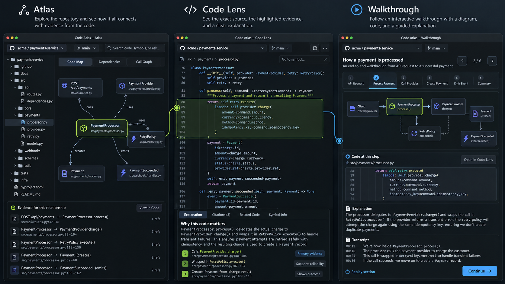
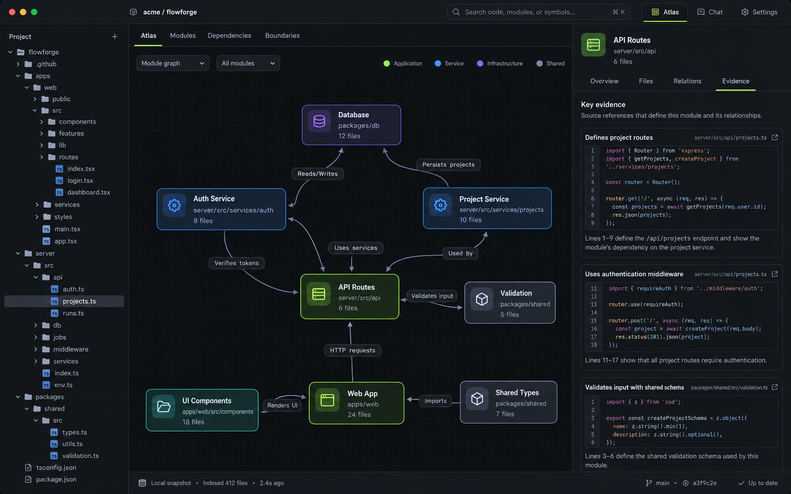
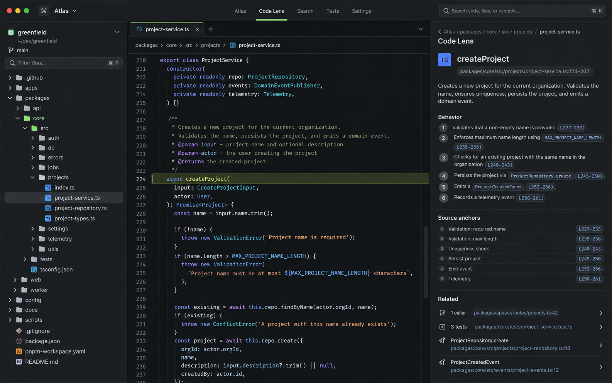
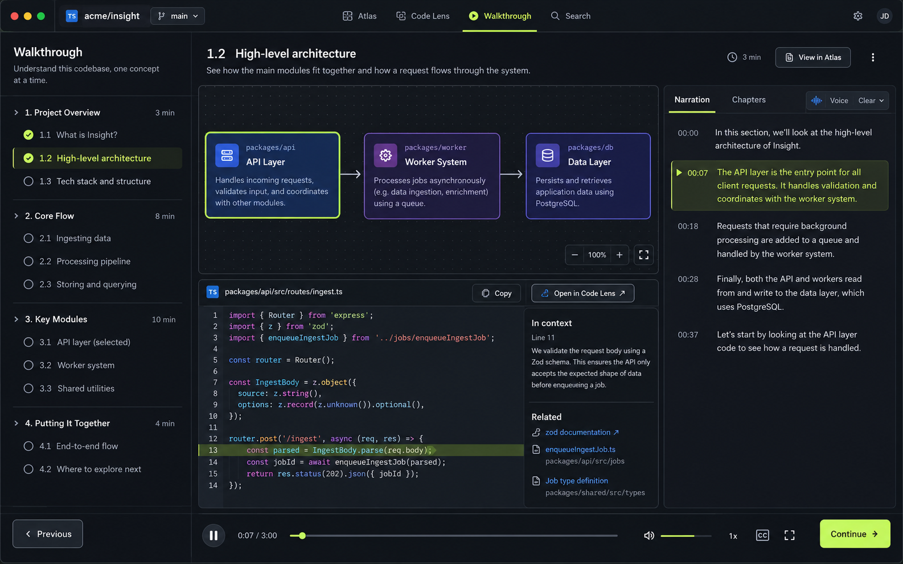

# Code Atlas — product blueprint

**Status:** Product contract; implementation status is tracked separately  
**Plan date:** 13 October 2026  
**Product form:** Mac-first desktop app  
**Working name:** Code Atlas

This blueprint describes the intended experience, not the current release state. Source-backed implementation facts and unavailable integrations are summarized in the [README](../README.md), [technical plan](TECHNICAL_PLAN.md), and [AI backend capability matrix](research/ai-backend-capability-matrix.md). Every delivery gate below still needs its own acceptance evidence.

## Product promise

Open an unfamiliar local repository and quickly see how it is organized, what each eligible file actually does, and where every explanation comes from. Move from a map to the exact captured source and into a short interactive walkthrough without losing your place. When code changes, update only the explanations and media that depend on it.

The guide is file-first. An overview can introduce the repository, but it never substitutes for the individual file explanations.

## Product concept

All four images in `docs/design/` are concept references for review; none depicts an implemented or running product screen.

The product has three equal, connected workspaces. Selecting a file or evidence item in one workspace resolves to the same immutable repository snapshot in the others.

### Atlas — orient in the real repository

- Show the repository tree and a relationship map derived from local parser evidence.
- Label every relationship type (such as imports, exports, statically resolved calls, or test reference) and show the source locations that support it.
- Clicking a folder filters the visible descendants; clicking a file or symbol opens its exact evidence in Code Lens.
- Keep unsupported, skipped, generated, and excluded paths visible with a reason. Show the captured revision and freshness state.
- Make search scope and filters explicit; never imply the graph is a complete runtime call graph.

### Code Lens — inspect the exact code

- Show read-only source from the selected snapshot, with line numbers and the cited range highlighted.
- Explain one claim at a time and expose its path, range, source hash, and excerpt.
- Let users follow resolved callers, imports, dependents, and tests. Label unresolved or inferred relationships.
- Opening a citation must never silently substitute current working-tree code for missing captured bytes.
- Back returns to the originating selection and restores its chapter section and playback position.

### Walkthrough — learn one section at a time

- Present accepted file chapters as short sections. Each section has a question, a specific explanation, code evidence, a visual when useful, and a transcript.
- Show Previous and Continue at section boundaries. Continue is always explicit; there is no automatic advance.
- Every hotspot has a declared destination: a source anchor, another guide section, an Atlas item, or a documented external reference.
- Let the reader select another section, pause or replay narration, inspect code, return to the same point, or leave.
- Motion is optional. No generated cinematic footage is required for the experience to work.

Guide Plan and Chapter Studio support creating and reviewing the guide. They are workflow surfaces for these three workspaces, not a fourth competing core mode.

## Screen and state contract

The complete control-level destinations, keyboard/focus rules, side-effect boundaries, return-state contract, and acceptance walkthrough are specified in [Interaction contract](INTERACTION_CONTRACT.md). The summary below is the quick reference.

| Surface | State | What the user sees | Primary action and result |
|---|---|---|---|
| App shell | No project | Product promise, Open repository, recent projects if any; no AI prompt | Open launches the native folder picker. Cancel returns to this exact state. No scan or network call starts. |
| App shell | Project selected, no snapshot | Canonical repo path, branch/HEAD when available, capture limits, Create snapshot | Create snapshot begins a local, cancellable read. Changing project changes the shared project selection only after confirmation. |
| Capture | Scanning / cancelled / partial / complete | Progress, current phase, limits, cancel; final counts and per-path reasons | Cancel stops new reads. A partial capture is labeled partial and cannot masquerade as a complete snapshot. Complete enables Atlas and Code Lens. |
| Atlas | Indexing / ready / partial / empty result / error | File tree, supported relationship map, selected snapshot, parser/capture state | Select folder filters descendants; select file/symbol opens Code Lens at exact snapshot evidence. Search with no results offers clear/reset. |
| Code Lens | Source / unsupported / unavailable / stale anchor | Snapshot source or a named reason, path, hash, line range, related evidence | Citation click highlights exact range. Missing or changed evidence shows stale/unavailable; no live-source fallback. Back restores caller state. |
| Guide Plan | Missing / draft / accepted / grouped / excluded / unsupported | One row per inventory path, total counts, current snapshot, status and reason | Select a file to create/review its chapter. Group requires explicit membership and rationale. Exclusion requires a reason and can be reversed. |
| Chapter Studio | Draft / validation errors / valid / accepted / rejected / stale | Section editor, claims, source citations, spoken text, validation findings, revision status | Edit and validate locally. Accept only a valid draft. Reject preserves payload/history. Accepted content is read-only; Edit creates a new draft. |
| Walkthrough | No accepted chapter / selected chapter / selected section / audio unavailable | Chapter rail, section question, explanation, linked visual, source evidence, transcript, playback state | Previous/Continue or direct section selection changes section deliberately. Hotspot opens exact target. Audio failure leaves transcript and navigation active. |
| Request Review | No key / manifest preview / awaiting consent / sending / success / cancelled / provider error | Purpose, target, exact paths/excerpts or narration text, current model/disclosure, size estimate, fingerprint, privacy/cost notice | Review itself is local and sends nothing. Only the explicit final confirmation sends the reviewed fingerprint. Any changed input returns to a new manifest review. |
| Local Git comparison | No repository / refs incomplete / comparing / ready / bounded / invalid refs | Explicit local base/head refs, resolved commit IDs, classified paths, exact changed-line ranges, bounded hunks, parser-backed declarations, separate base/head anchors | Compare existing local commits only; no fetch, checkout, remote request, or repository write. Uncertain and omitted evidence stays visible; syntax is not runtime impact. |
| PR Guide | No eligible change / request review / draft / accepted or rejected / invalid evidence | Selected local base/head IDs, changed files, exact diff evidence, claim citations, separate PR Guide history | Select a subset of files, review exact provider context, then include/exclude claims and accept/reject separately from repository chapters. |
| PR change explanation | Hunk selected / local review / awaiting consent / sending / transient result / invalid evidence | One selected local hunk, exact base/head context, provider/model disclosure, bounded claims and side-aware citations | Explain one eligible text hunk after review and consent. Results are temporary; closing returns to the comparison without writing PR Guide history or Git state. |

## Cross-screen transitions

| Start | User action | Destination | Return behavior |
|---|---|---|---|
| Atlas file/symbol | Open source/evidence | Code Lens at the same snapshot and anchor | Restore tree selection, map viewport, and filter. |
| Guide Plan file row | Create chapter | Local chapter target preview, then Request Review if the user chooses Generate | Cancel returns to the same row and status; no request was sent. |
| Request Review | Confirm exact request | Selected Gemini, OpenAI, or Anthropic API request, then unaccepted Chapter Studio draft | User sees the draft and validation result; errors return to a retryable review state. |
| Chapter Studio | Accept valid draft | Accepted chapter in Walkthrough | Chapter remains visible in Guide Plan; prior revisions remain accessible. |
| Walkthrough hotspot | Open code | Code Lens at the hotspot's exact evidence | Return restores section ID, time, transcript position, and focused hotspot. |
| New source snapshot | Review changed evidence | Freshness list with source diff and affected sections/assets | User can inspect any source diff and leave without changing accepted guide history. |
| Local Git comparison hunk | Explain hunk N | Transient PR change explanation review/result | Close returns to the same comparison and hunk; no PR Guide history or Git state changes. |
| Stale section | Carry forward or regenerate one section | New section draft; regeneration first opens Request Review | Accept creates a new chapter manifest; cancel/reject keeps prior accepted content. |

No transition silently switches repository snapshots. A snapshot change is an explicit user action and is shown in all three workspaces.

## Failure and recovery behavior

| Condition | User sees | Recovery |
|---|---|---|
| Folder access denied | Repo path and permission error; no capture progress | Choose another folder or grant macOS access, then retry explicitly. Existing project snapshots remain available. |
| Capture cancelled or bounded | Cancelled/partial label, captured/skipped counts, exact reasons | Resume only as a new capture, change the selected scope, or inspect captured files. Never treat partial as complete. |
| Parser unsupported or fails | File stays in inventory; parser state and reason are shown | Read captured text when possible. No relationship edges or chapter facts are fabricated from parse failure. |
| No selected API key or Keychain unavailable | Provider setup state; local features remain active | Choose a provider, add/remove its key, or grant Keychain access. No request is sent during setup. |
| Network, quota, billing, region, or model error | Named provider error; saved content remains available | A retry requires a fresh exact manifest and consent; otherwise continue using local content. No paid fallback. |
| Invalid model response or citation | Validation issues next to the draft; Accept disabled | Edit/remove unsupported claim, request a repaired draft after new review, or reject it. Existing accepted revision is unchanged. |
| TTS unavailable | Transcript stays visible; audio status names failure | Read, replay locally cached speech if available, or retry TTS under a new request review. |
| Anchor changed or cannot remap | Stale reason and old/new source diff; no auto-open to nearby code | Carry forward only a unique exact match or regenerate selected affected section after review. |
| Disk full or persistence failure | Save/export error; last durable revision remains selected | Free space and retry. Multi-record writes are atomic; no half-accepted chapter is exposed. |

## Non-negotiable product rules

1. **Source comes before story.** Code explanations cite captured source; a polished introduction cannot stand in for file-level understanding.
2. **Every path is accounted for.** A path is individually explained, explicitly grouped only by user choice, or visibly marked unsupported/excluded with a reason.
3. **Evidence is inspectable.** Every code-behavior claim resolves to the captured bytes and an exact path/range. Inferences are labeled as inferences.
4. **The reader controls time.** Sections are skimmable, pausable, replayable, and manually advanced.
5. **Edits are local and reversible.** Accepted guide revisions are immutable; selective edits create new revisions and preserve history.
6. **AI is optional.** Local repository browsing and previously accepted guides work without an account, API key, network, or model.
7. **No confidence theater.** Static relationships are not presented as runtime behavior; unsupported parsers and incomplete evidence are named.

## First-use journey

1. **Open a repository.** The user chooses a local working copy. The app explains snapshot boundaries and does not scan source until the user starts a capture.
2. **Capture once.** The app shows progress and a final inventory for an immutable snapshot. It reports skipped paths and limits rather than hiding them.
3. **Explore locally.** Atlas and Code Lens work without setup or network access. A user can inspect source before configuring AI.
4. **Review coverage.** Guide Plan lists every inventory path, its chapter state, and any skip/exclusion reason. Eligible text/source files default to one independent chapter each. The initial release has no automatic file grouping or bulk generation.
5. **Request one chapter.** The user selects a file, reviews the exact context and current provider disclosures, and separately confirms sending that request. No request is sent by opening settings or the review screen.
6. **Review the draft.** Chapter Studio shows claims beside their cited source. The user edits, validates, rejects, or accepts; generation never auto-accepts.
7. **Learn.** The user opens an accepted chapter, chooses a section, clicks a diagram hotspot to inspect code, returns to the same point, and chooses when to continue.
8. **Update after code changes.** A new snapshot identifies affected sections and dependent assets. The user compares the source change, carries forward a safe anchor or regenerates one selected section, then reviews a new draft.

## File coverage contract

Guide Plan is the canonical completion view. For a snapshot containing `N` inventory paths, the view shows `N` rows or explicitly paginated rows with stable counts and searchable paths. No path disappears because a parser, size limit, encoding, binary check, or exclusion rule rejected it.

Each path has exactly one visible disposition:

- **Chapter required:** readable source, code, configuration, or documentation with a substantive individual file chapter. This is the default for eligible files.
- **User-approved group:** an explicit user-created group with a name, rationale, and complete path membership. Every member remains individually listed and linked, and the chapter must explain each member. No implicit grouping counts as coverage.
- **Unsupported:** readable or otherwise present, but the product cannot safely or reliably explain it; show the reason and keep local navigation available where possible.
- **Excluded:** omitted from a particular AI request or guide by a visible rule or user action. The path remains in the inventory and can be reconsidered when eligible.
- **Non-text/unavailable:** binary, unreadable, oversized, or outside the capture limits; show the exact reason and do not pretend it was analyzed.

The inventory and guide status are distinct. Excluding a file from a provider request does not erase it from the repository map or mark its explanation complete.

## What each file chapter must explain

Depth follows the real file, not a template length. A chapter answers the applicable questions below with source-backed specifics:

- What does this exact file do in this repository, and what evidence supports that responsibility?
- What are the important functions, types, components, routes, or configuration blocks?
- What values enter and leave them? What state changes, side effects, and error paths are visible?
- How does execution move through the important code? Which callers, imports, dependents, and tests were statically resolved?
- What does a representative test demonstrate, and what does it not demonstrate?
- Which parts are direct code evidence, repository context, or inference?

Do not produce interchangeable summaries such as “this file handles logic.” Do not make business-flow or runtime claims based on a filename, folder name, or import alone. A simple file can have a concise chapter, but it still needs a specific explanation and exact evidence.

## Chapter and evidence contract

The generated artifact is structured data, not a video blob or a free-form script. A chapter contains a stable ID, target path, snapshot ID, chapter revision, ordered sections, claims, source anchors, optional typed visuals, user-visible hotspots, editable spoken text, and exact dependencies.

- A **claim** is `code_behavior`, `repository_context`, or `inference`.
- `code_behavior` requires one or more exact source anchors.
- An **anchor** stores repository-relative path, optional parser-stable symbol ID, inclusive line range, captured-source hash, and excerpt.
- An **inference** is labeled and states its basis; it cannot be rendered as observed runtime behavior.
- A **section** has a stable ID, reader-facing question/title, ordered claims, linked evidence, optional visual, spoken-text revision, and declared dependencies.
- A **hotspot** has a typed destination; arbitrary generated JavaScript and invisible click targets are forbidden.
- Local validation verifies schema, target snapshot, hashes, ranges, excerpts, and destinations before a draft can be accepted. Validation proves identity, not that prose is true; quality review remains necessary.

## Editing like Git

The guide has its own immutable revision graph, separate from the repository's Git history. An accepted revision is never overwritten.

- Each chapter revision points to immutable section revisions. Editing one section creates a new section revision and a new chapter manifest that reuses unaffected section IDs/revisions.
- Source anchors and relationships are dependencies. A changed anchor marks only sections that depend on it stale; changed relationships can also stale explicitly linked dependent/test sections.
- Derived assets record fingerprints of their actual inputs. A prose edit invalidates that section's narration only if its spoken text changed. A diagram is reused if its nodes, edges, and anchors did not change.
- The review screen previews affected sections and assets before generation. The user chooses one section or chapter. No silent batch regeneration or automatic acceptance occurs.
- A restored older section becomes a new draft revision. Existing accepted versions and assets remain available for compare and restore.
- If safe identity-based remapping is possible, offer a carry-forward draft and show old/new source ranges. If evidence changed, do not silently attach the chapter to nearby code.

This model makes the editing unit a section with explicit evidence dependencies. A changed source reference may affect more than one section; those dependencies are shown before any regeneration.

## AI backend choices, cost, and privacy

Gemini, OpenAI, and Anthropic direct API routes are implemented for file chapters, optional orientation, selective section updates, PR Guides, transient single-hunk PR change explanations, and transient Code Lens explanations grounded in a verified source range. The PR change flow sends one reviewed hunk and returns temporary side-aware citations without creating PR Guide history. The operation-by-provider fixture and acceptance gate remains open. Optional Gemini TTS is a separate speech path. Coding-agent runtimes such as OpenAI Codex, Claude Agent (powered by Claude Code), Gemini CLI, and Google Antigravity remain separate planned integrations. Antigravity's SDK, ACP binary, and headless CLI are separate surfaces to evaluate, not one interchangeable integration. The app must not automate interactive terminal UIs or reuse a consumer Antigravity login.

Each candidate remains unavailable until its exact version, authentication and terms, capability limits, request scope, cancellation behavior, and read-only boundary pass the relevant acceptance gate. Prefer an existing vendor-supported SDK/app-server or a protocol adapter where it fits; do not build a new agent loop or infer equivalent permissions across runtimes. The user chooses an API provider or an agent runtime for each supported operation. These execution modes have different capabilities, authentication, and usage behavior. The product does not host a model gateway or switch provider silently. See the [M7 capability matrix](research/ai-backend-capability-matrix.md) for dated candidate research and status.

For every direct model request, the app must:

- show the purpose, current model ID, current published free/paid terms, the exact selected paths and excerpts, byte/token estimate where available, and a fingerprint;
- disclose the selected provider's data use, retention, human-review, location, pricing, quota, and region terms;
- show what the app can and cannot verify about account billing and usage; never promise a $0 bill from a free-tier label alone;
- require a separate explicit confirmation for that exact request after review; changing the target, model, disclosure version, or context invalidates consent;
- stop on quota, billing, region, model, network, or provider errors. Never switch to a paid model silently; local features remain usable;
- keep the API key in macOS Keychain and never put it in logs, issue bodies, analytics, or generated assets;
- send only context the user selected and reviewed. TTS sends the approved spoken script, not raw source code by default.

Provider availability, pricing, quotas, billing rules, terms, and supported regions change. Verify each provider's disclosures against its first-party pages at release. For Gemini specifically, as checked on 13 October 2026, Google's docs say unpaid-tier submitted content may be used to improve products and may be human-reviewed, free-tier availability varies by model, and access through a billing-enabled Cloud project can be paid. See [Gemini API pricing](https://ai.google.dev/gemini-api/docs/pricing), [billing](https://ai.google.dev/gemini-api/docs/billing), [model catalogue](https://ai.google.dev/gemini-api/docs/models), [TTS guide](https://ai.google.dev/gemini-api/docs/speech-generation), and [API terms](https://ai.google.dev/gemini-api/terms).

Coding-agent integrations use their own documented sign-in and execution surfaces. Before launch, the app must show the selected agent and version, the exact immutable files exposed to the run, whether one run can make multiple model requests, the agent's usage/billing model and terms, and the supported permission boundary. An agent is unavailable for repository explanation if the app cannot keep it from modifying the real checkout or accessing unapproved repository content. Agent output remains untrusted until local evidence validation and human acceptance.

## Narration and code pronunciation

The visual source and spoken script are separate fields. The TTS input is editable natural speech that explains what the code does; it does not blindly read identifiers, punctuation, source excerpts, or paths. For example, the code `retry.execute(() => provider.charge())` may be narrated as “The retry policy wraps the provider charge. If the provider reports a transient failure, the retry policy can try again.” The visible code remains clickable and exact.

Users can preview or edit the narration before speech generation. Audio is optional, cached by script hash plus voice/model settings, and regenerated only when one of those inputs changes. Transcript, captions, and manual playback remain usable if TTS is unavailable.

## Scope

### First useful Mac release

- Local repository capture, complete path inventory, supported-language index, Atlas, and Code Lens.
- A substantive individual chapter for every eligible file, with visible disposition for every path.
- Exact per-request direct API review, local validation, Chapter Studio editing, and explicit acceptance.
- Section-based interactive walkthrough with clickable diagrams, transcript, manual controls, and optional TTS.
- Git-like section/chapter history, stale evidence detection, selective regeneration, and offline guide export.
- Mac onboarding, recovery, accessibility, and signed/notarized packaging.

### Local change explanation milestone

- A local read-only comparison viewer for Git base/head refs, a reviewed PR Guide workflow from selected diff evidence, and a transient explanation flow for one selected hunk exist in source. PR Guides have their own claim review and immutable local history; single-hunk explanations are temporary and do not create guide history. Their Kata acceptance evidence remains open. No GitHub login or remote PR fetch is part of these workflows.

### Not in scope for first release

- A generated MP4 as the canonical guide, cinematic stock/video generation, or arbitrary generated animation code.
- Hosted accounts, cloud repository uploads, product telemetry, or mandatory local model downloads.
- Automatic file grouping, invisible exclusions, automatic bulk regeneration, or automatic chapter acceptance.
- Editing or committing files inside the selected repository.
- Claiming complete runtime behavior, full call graphs, or every language without validated parser evidence.
- Remote GitHub PR fetching, comments, collaboration, or repo write access.

## Recommended architecture

Use a macOS-first Tauri 2 app with a React/TypeScript interface and a Rust local core. Tauri officially supports maintained React project templates; the core owns filesystem and Git access, while the UI calls narrow, typed commands. This keeps local source handling and validation in a testable boundary while allowing the three workspaces to share one navigation model. See [Tauri project creation](https://v2.tauri.app/start/create-project/).

The more detailed data and trust boundaries are in [Technical plan](TECHNICAL_PLAN.md).

## Delivery milestones and gates

| Milestone | Result | Gate |
|---|---|---|
| M0 — Product shell | Shared visual language and navigable Mac shell | Atlas, Code Lens, Walkthrough, Guide Plan, and empty/error states are mapped to the concept board and work without repository or provider access. |
| M1 — Repository truth | Immutable local snapshot, inventory, index, Atlas, and Code Lens | Offline browsing shows every path/reason and every link opens the same captured source. |
| M2 — File-by-file guide | Full coverage accounting, reviewed generation, validation, editing, quality review | Every eligible file can have its own substantive chapter; invalid or uncited claims cannot be accepted; no hidden omission. |
| M3 — Interactive explainer | Manual section player, linked visuals, transcript, optional narration | The reader can pause at every section, inspect the cited source, return to the same state, and deliberately continue. |
| M4 — Git-like guide updates | Fine-grained staleness, section regeneration, history, offline export | Changing one file leaves unrelated sections and assets unchanged; regenerated content is a reviewed new revision. |
| M5 — Mac release | Onboarding, recovery, accessibility, packaging | A fresh user can open a repo offline, recover from failures, and use the signed app without a key. |
| M6 — PR Guide follow-up | Local diff explanation with a separate, reviewed guide history | Every claim cites the correct immutable base/head hunk; acceptance decisions do not change repository guide chapters or Git refs. |

The build order and independent issue scopes are tracked in Kata. PR Guide is deliberately not a dependency of the first useful release.

## Success measures

- From first launch, a user can open a repository and reach Atlas without an account, API key, or network request.
- Guide Plan count equals inventory count; each eligible file is individually represented, and all other paths carry an explicit reason.
- Every accepted code-behavior claim resolves to the selected snapshot; no citation silently opens different bytes.
- In a representative repo study, a developer can find the entry point, explain one selected file, and reach its exact test/caller evidence faster than by unaided browsing.
- A reader can stop at any section, inspect code, return to the same section/time, and choose when to proceed.
- Editing one section changes only that section revision and assets whose recorded inputs changed.
- A denied request, quota error, or unavailable TTS voice never blocks local browsing, transcript reading, or previously accepted chapters.

## Principal risks and mitigations

| Risk | Product response |
|---|---|
| Model writes shallow, generic summaries | Generate one file at a time from real declarations/relations/tests; demand anchored claims; benchmark output depth and require human acceptance. |
| Static analysis is mistaken for runtime truth | Label relationship confidence and inference; never infer execution order from import edges alone. |
| User code is sent without understanding the exposure | Show exact context and unpaid-service terms before each request; no request until explicit consent; keep local mode useful. |
| A small source change causes a full rebuild | Stable section/claim/anchor IDs and explicit dependency fingerprints determine which sections and assets are affected. |
| TTS mangles code | Keep spoken prose separate from visible source; never synthesize raw source by default; preview and edit speech first. |
| Repository is too large or unusual | Bound reads and parser work, show every skip reason, preserve text browsing, and avoid claiming universal language support. |
