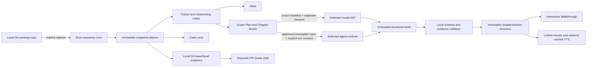

# Code Atlas — technical plan

This document records source-backed implementation facts alongside the planned architecture. The [Product blueprint](PRODUCT_BLUEPRINT.md) defines intended product behavior; neither document proves every acceptance or release gate has passed. The current repository source is the authority for what is implemented. Planned boundaries and remaining work are called out below.

## Implementation status in this checkout

- The app has a React/TypeScript WebView and a Rust/Tauri command layer. Local repository selection, bounded snapshot capture, content-addressed source storage, static indexing, chapter generation/review commands, chapter revision files, and freshness/remapping code are present in source.
- Walkthrough builds a single self-contained HTML file from selected accepted chapter revisions. It embeds written sections, navigation, supported typed visuals, an integrity manifest for included excerpts, visual data, and optional locally cached narration audio. Live Atlas/Code Lens destinations remain unavailable offline, and the full offline acceptance workflow remains open.
- A TypeScript helper can summarize chapter revision changes, but there is no user-facing revision comparison or restore workflow. A bounded local Git base/head comparison command is present in the Rust backend; it does not yet attach parser-resolved symbols/relationships or feed a PR Guide UI.
- Snapshot catalogs and manifests are JSON under Tauri app data. Captured source bytes are stored by SHA-256 under `objects/sha256/`. Indexes, chapter revisions, and pending generated previews are also local files. **There is no SQLite dependency or database in the current implementation.**
- Chapter generation currently calls Google's Gemini API directly. It supports a file chapter and a repository-overview purpose. Requests require exact-context review and explicit consent; responses are canonicalized and locally validated. A valid response is stored as a recoverable, unaccepted preview. Saving creates a local draft; acceptance or rejection is a separate Chapter Studio revision.
- Optional speech generation calls Google's Gemini API separately with a reviewed section transcript and speech settings. It has its own disclosure, consent check, and local WAV cache; it does not send the source excerpt by default.
- OpenAI and Anthropic direct API adapters, Codex/Claude Agent/Google Antigravity agent runtimes, and PR Guide workflows are planned. Their task contracts do not mean those backends are selectable or supported today. See [M7](kata-tasks/phase-7.md) and the [capability matrix](research/ai-backend-capability-matrix.md).

Source presence is not release evidence: the exact native app acceptance, quality review, supported macOS range, signing/notarization, and distribution gates remain separate.

## System shape

The diagram is the target boundary. The Gemini path, local chapter flow, initial static offline export, and bounded local base/head comparison command exist in current source. The normalized multi-provider/agent layer and PR Guide remain planned.

All local browsing, accepted guide reading, chapter editing, source navigation, and existing audio work without a provider connection.

### Planned AI backend boundary

The current generation path is Gemini-specific. The [M7 AI-backend tasks](kata-tasks/phase-7.md) extend it with two distinct integration types: direct model APIs and coding-agent runtimes. The API path starts with Gemini, OpenAI, and Anthropic, using an existing Rust multi-provider client where it preserves the consent, exact-context, and validation rules. The agent path uses Agent Client Protocol (ACP) when a runtime supports it, otherwise that product's documented SDK, app-server, or headless CLI. It does not recreate an agent loop or pretend these modes have identical permissions, costs, credentials, or capabilities.

## Runtime boundary

### React/TypeScript UI

- Owns visible layout, selection, navigation history, keyboard controls, playback time, and user-facing loading/error/empty states.
- Calls typed Tauri commands for repository, snapshot, source, indexing, persistence, validation, and provider operations.
- Does not get general filesystem, shell, Git, keychain, or network access.
- Uses one shared selection identity: `(project_id, snapshot_id, path, symbol_id?, section_id?)`.

### Rust core

- Owns folder selection validation, Git queries, bounded file reads, content hashes, local parser runs, source anchors, filesystem persistence under app data, request manifest construction, chapter validation, and TTS cache.
- Does not execute repository scripts or build tools during scan.
- Exposes narrow typed commands; validates every repository-relative path and snapshot ID before access.
- Owns the current Gemini clients and exact request assembly so API keys remain outside the WebView. M7 proposes a capability-aware direct API layer and a separate agent-runtime bridge; each must preserve local consent and validation boundaries.

### Persistence

- Before capture, Rust owns the native folder picker and returns only a canonical selected path plus Git root/branch/HEAD metadata. The WebView can request the picker but cannot submit an arbitrary filesystem path. A recent project's stable ID is its canonical Git root path; recent paths are stored atomically under Tauri's app-data directory, and removing one edits only that metadata.
- Snapshot catalogs and manifests are JSON records under the Tauri app-data directory; source blobs are content-addressed by SHA-256. Index data is stored as versioned JSON.
- Chapter revisions are immutable JSON files under per-project/per-target app-data directories. A save stages and publishes a complete new record; prior revisions are not overwritten.
- Generated but unsaved chapter previews have a separate bounded JSON recovery store. They can be reviewed after restart and are revalidated against their pinned snapshot before saving.
- macOS Keychain stores the Gemini API key. It is not copied into local chapter/snapshot files, logs, exports, or application-authored diagnostics.
- There is no SQLite transaction layer in the current source. Future persistence changes must describe the migration and recovery semantics explicitly rather than relying on the earlier proposed database design.

## Planned data identities and revision graph

The intended editing unit is an independently versioned section. The current `chapter_store` appends complete chapter-revision JSON files; it does not yet persist a deduplicated section-revision graph or demonstrate that an edit reuses unaffected sections and assets. The TypeScript revision summary helper compares stable fields, but it does not provide a user-facing compare or restore flow. The design below is the target for the Git-like editing milestone, not a claim about current persistence.

Use stable IDs for a chapter target, section, claim, anchor, hotspot, and asset. A symbol ID is based on parser module/path and qualified declaration identity, not current line number. Line numbers are presentation/remapping data.

Each immutable snapshot records the repository root identity, full Git HEAD object ID when available, index/worktree state, capture timestamp, inventory, content hashes, and capture-limit outcomes. Snapshot ancestry connects local source captures but never mutates the source repository.

Each accepted chapter revision is a manifest over immutable section revisions. A section revision stores:

- ordered structured claims and exact source anchors;
- explanation prose and independently editable speech text;
- optional typed visual specification and hotspot destinations;
- source and relationship dependency IDs/fingerprints;
- derived asset fingerprints and local references;
- validation result and snapshot ID.

A chapter edit creates a new manifest that can point to unchanged prior section revisions. A changed section creates a new section revision. Accepted rows and their asset hashes are immutable.

The current version 3 chapter payload, legacy readers, inclusive anchor coordinates, exact validation rules, typed hotspot destinations, visual safety boundary, and line-shift remapping contract are specified in [Chapter schema](CHAPTER_SCHEMA.md).

## Local repository capture

The scanner is read-only. Limits are named and user-visible, versioned, and covered by fixtures. A starting safety profile is:

- do not enter `.git` internals, symlink targets, nested repositories, ignored contents, or vendored/generated directories by default;
- cap file size, total captured bytes, path count, and per-directory entries; show each skipped path and its reason;
- classify binary, oversized, invalid UTF-8, secret-like, and parser-unsupported inputs before they can become model context;
- never run code from the selected repository;
- persist exact captured bytes before source views or citations are offered.

The initial limits are constants of the product specification and must be validated against sample repositories before release; users see them in the capture summary and can inspect skipped content locally.

## Index and relationship semantics

The current Rust manifest pins Tree-sitter 0.27.1 with the Rust 0.24.2, TypeScript/TSX 0.23.2, and JavaScript 0.25.0 grammars. The indexer records runtime and grammar versions/ABIs in each snapshot index. The Rust fixtures cover representative declarations, imports, calls, test files, line movement, dynamic dispatch, recovered syntax errors, and unsupported files; this is a supported subset, not a claim of complete language semantics or a released support promise.

An index is derived only from captured snapshot blobs after their SHA-256 and UTF-8 checks. It never reads the live worktree or executes repository code. Output rows and edges sort by stable keys. Symbol identity hashes language, path, qualified declaration name, kind, and a declaration signature that excludes the body and line number; source anchors retain the exact captured source hash, half-open byte range, one-based line, and one-based UTF-8 byte column. A moved unchanged declaration therefore keeps its ID while its source anchor changes.

The initial index recognizes Rust `.rs`, TypeScript `.ts`/`.mts`/`.cts`, TSX `.tsx`, and JavaScript `.js`/`.jsx`/`.mjs`/`.cjs`. Per-file results distinguish indexed, partial parse, parse error, unsupported language, binary, invalid encoding, missing or hash-invalid source, oversized input, global index limits, parser unavailability, analysis limit, and cancellation. Snapshot index status is complete only when every captured file is indexed; any omission or parse gap yields partial. Unsupported files remain in the captured inventory and source browser.

Every edge has a type, confidence, stable ID, and exact evidence anchor. M0 records definitions and explicit exports, import statements, direct identifier calls with one same-file target, and direct calls through a unique named ESM import to one explicit exported callable in a fully parsed captured module. Test-path calls are labelled test references. Relative ESM module resolution is accepted only when the captured candidate path is unique. Rust `use` paths, default and namespace import targets, re-exports, CommonJS/dynamic imports, external packages, ambiguous module/symbol matches, member dispatch, reflection, and dynamic callees remain unresolved with a reason. Partial parse files do not prove exported targets unique. No complete call-graph claim is made.

Index work caps input at 5,000 files, 512 KiB per file, 50 MiB total source, 250,000 syntax nodes per file, 50,000 symbols, 100,000 candidate/retained relationships, 50,000 total named-import bindings (10,000 per file), 128 nesting levels, 1.5 seconds per parse, and 32 MiB serialized output. Work runs off the UI thread, coalesces progress events, accepts cancellation during parsing and AST traversal, and does not save cancelled output. Saved indexes are versioned JSON keyed by project and snapshot. These limits bound work while leaving every captured path browsable.

## Gemini request boundary

The implemented Gemini request boundary is a one-shot reviewed text request:

1. Rust accepts a target file and up to eleven supporting files from one selected immutable snapshot. It reads the captured blobs by project/snapshot/path, verifies their hashes, rejects secret-like, binary, invalid-encoding, missing, and over-limit context, and never falls back to the worktree. Total selected source is capped at 250 KB; the encoded request is capped at 512 KB.
2. The WebView loads only the snapshot's file metadata for the context picker. It can select captured text/unknown-text files up to 250 KB each; target is locked in the selection. Rust builds the prompt/body locally and exposes the exact chosen file contents, byte counts, hashes, system/user prompt, generation settings, estimated tokens, and fingerprint for review. This step makes no network request.
3. Request reviews are ephemeral in-memory Rust state, capped at eight and expiring after fifteen minutes. Consent requires three explicit acknowledgements: Google unpaid-service data use and possible human review, billing uncertainty, and Google's age/region/professional-use requirements.
4. The fingerprint covers request/prompt schema and versions, purpose, project/snapshot/target, model, disclosure version, prompt text, selected paths and source hashes/sizes, and generation settings. Before sending, Rust checks the exact fingerprint, active project session, current disclosure/version and snapshot bytes. A changed input requires a new preview and new consent.
5. A confirmed review is consumed before the single HTTPS call. Rust puts the user key only in the sensitive `x-goog-api-key` header, never the JSON body. The client uses a fixed Google API root, HTTPS-only, a 90-second timeout, bounded response bytes, no retry, no tools/grounding, and no paid fallback or model autodiscovery. During the request, **Cancel request** requires an explicit confirmation and drops the local HTTP future when possible. Google may already have received the request; any eventual response is discarded. A failure or cancellation consumes that review; retry requires a fresh preview and consent.
6. Successful text is canonicalized into an unaccepted chapter preview and checked against the pinned snapshot and saved index before it is shown. The recovery copy is persisted separately so it can be reviewed after restart. Saving the preview revalidates evidence and appends a local JSON draft revision; it does not accept the chapter. A user accepts or rejects the saved draft in Chapter Studio as a separate revision.

The model allowlist and disclosure are static versioned release metadata. The UI links to Google's current primary sources and displays the last checked date; it cannot verify live price/terms changes or the user's Cloud-project billing state. The checked claims and URLs are recorded in [Provider disclosures](PROVIDER_DISCLOSURES.md).

The current provider flow supports a file chapter and a repository overview. The response is parsed, canonicalized, and checked against the pinned source and index before a durable pending preview is created. Saving that preview revalidates it and appends an unaccepted chapter revision; explicit review actions create later edit, accept, or reject revisions. A pending preview is limited to 2 MiB each, 16 records, and 16 MiB total. Loading a recovered preview revalidates evidence and restores only an in-memory review handle; it does not restore consent or a provider request.

Selective section regeneration, end-to-end file coverage, and PR diffs remain governed by their domain tasks. They must reuse the same exact-context boundary rather than bypass it.

## Interactive visuals and audio

Visuals are versioned data structures (for example typed nodes, edges, labels, and anchor destinations), rendered by product code. Their hotspot IDs and destinations are validated locally. The model cannot emit executable scripts, raw HTML, or arbitrary CSS.

Speech is a separate optional Gemini TTS path. Each section has editable `spokenText` separate from code, path labels, and display text. The request review includes the exact section script after enabled pronunciation substitutions, voice, style, and WAV format; it excludes source excerpts by default. A confirmed request can be cancelled locally, though Google may already have received it. Cached audio is keyed by script hash, model, voice, style, and format; matching audio can be loaded locally. The date-stamped usage and billing notice is documented in [Provider disclosures](PROVIDER_DISCLOSURES.md#optional-section-narration).

## Offline export

The current Walkthrough can build one static, self-contained HTML file from selected accepted chapter revisions. The preview lists paths and cited excerpts and permits excerpts to be omitted. The exporter excludes non-accepted revisions, omits hidden or secret-like paths, redacts recognized credential patterns and local absolute paths, and records chapter revision/snapshot identities plus SHA-256 hashes for included excerpts and typed visual data.

The package supports written sections, manual section navigation, typed visuals that the current renderer recognizes, and optional cached narration WAV tracks selected in the export preview. Export only reads matching local cache entries; it never generates speech. The manifest records hashes and identities for included assets. Live Atlas/Code Lens navigation is not available offline; unsupported legacy or malformed visuals produce an explanatory message. Full offline acceptance—including opening and navigating an exported package while disconnected and verifying its manifest and privacy behavior—remains a release task.

## Source change propagation

The current source contains an explicit local, read-only freshness assessment and anchor-remapping path for comparing an older accepted chapter with a newer snapshot. Freshness is computed per section from captured source and per-file index evidence:

- **Current:** all source and relationship dependencies match.
- **Safe to carry forward:** stable symbol identity and one exact excerpt match allow an unambiguous range remap.
- **Stale:** cited bytes, symbol identity, relationship dependency, or destination are proven to have changed or disappeared.
- **Needs review:** captured source or relevant index evidence is missing, partial, unsupported, or ambiguous, so change cannot be confirmed.

Changed whole-file hashes trigger comparison but do not stale every section in that file. Relationship identity is compared semantically because serialized relationship IDs include byte positions. A relationship is carried only when its exact evidence span maps uniquely in verified captured bytes; this also handles file-level imports with no enclosing symbol. Source anchors require stable symbol identity and an exact, unique excerpt match; no nearest-line guess is offered. The report retains old/new line ranges and reasons. Assessment never writes the accepted revision or snapshot. Carry-forward, section-selective regeneration, and asset invalidation are separate planned work; a freshness result alone does not create a new draft or alter accepted content.

## Local Git comparison and PR Guide extension

The Rust backend currently exposes a bounded local base/head comparison command. It resolves local refs and returns deterministic changed-file classifications, diff hunks, and separate base/head line anchors. It does not yet attach parser-resolved symbols or relationships, and the UI does not yet expose a complete comparison workflow.

The planned PR Guide builds on that evidence to produce a separate, reviewed draft. It does not fetch a GitHub PR, push, comment, check out refs, or rewrite the repository guide. Each change claim must cite a diff hunk or a snapshot-pinned source anchor.

## Nonfunctional requirements

- Local-only browsing succeeds with networking disabled.
- A cancellation or provider failure cannot leave a half-accepted chapter or corrupt prior revisions.
- Large repository scans yield progress and cancellation; a measured 2,000-file fixture is recorded in [Performance validation](PERFORMANCE_VALIDATION.md). It measures backend phases, not rendered UI responsiveness.
- Keyboard focus, VoiceOver names/announcements, text zoom, reduced motion, and high-contrast legibility are part of each feature's acceptance.
- Logs contain operation IDs and error categories, not API keys, raw prompt context, or source excerpts.
- Release checks verify signed/notarized macOS artifacts and document supported macOS versions and storage locations.

Current accessibility source evidence and unverified native checks are listed in [Accessibility validation](ACCESSIBILITY_VALIDATION.md). Repository and provider input boundaries are indexed in [Security validation](SECURITY_VALIDATION.md).
