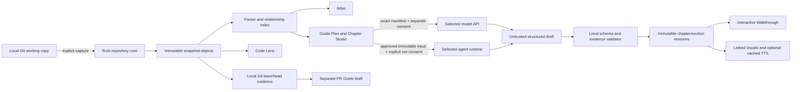

# Code Atlas — technical plan

This document records source-backed implementation facts alongside the planned architecture. The [Product blueprint](PRODUCT_BLUEPRINT.md) defines intended product behavior; neither document proves every acceptance or release gate has passed. The current repository source is the authority for what is implemented. Planned boundaries and remaining work are called out below.

## Implementation status in this checkout

- The app has a React/TypeScript WebView and a Rust/Tauri command layer. Local repository selection, bounded snapshot capture, content-addressed source storage, static indexing, chapter generation/review commands, chapter revision files, and freshness/remapping code are present in source.
- Walkthrough builds a single self-contained HTML file from selected accepted chapter revisions. It embeds written sections, navigation, supported typed visuals, and optional locally cached narration audio. When audio is included, its exact reviewed speech script is sanitized and bundled as the matching transcript; schema 3 records SHA-256 hashes and byte lengths for that transcript and the WAV alongside included excerpts and visual data. Internal section/evidence links stay inside the file; Atlas/Code Lens destinations are labeled unavailable offline. The full offline acceptance workflow remains open.
- Chapter Studio lists immutable guide revisions, compares a selected revision with its immediate predecessor, and restores an earlier revision as a new draft parented to the latest current revision. Citation anchors move to a newer snapshot only when the same stable symbol and exact excerpt are proven; the new draft is validated before it can be accepted. Selective updates can prepare one stale section at a time; multiple stale sections are not combined into one request. A bounded local Git base/head comparison is exposed from Project Tools. It resolves local refs to immutable IDs and renders classified files, exact changed-line ranges, bounded hunks, and separate base/head line, commit, and blob identities. When both blobs parse without errors, it attaches declaration names whose syntax spans overlap changed lines. A separate PR Guide panel can send a selected subset of exact diff hunks through an explicitly selected Gemini, OpenAI, or Anthropic API after request review and consent; returned claims are checked against the correct base/head hunk and saved in a separate immutable per-comparison history. Each eligible hunk also has a transient, reviewed single-hunk explanation route that returns locally validated side-aware claims without writing PR Guide history. These flows do not fetch, check out, or write Git state. They do not yet attach cross-file relationship impact.
- Snapshot catalogs and manifests are JSON under Tauri app data. Captured source bytes are stored by SHA-256 under `objects/sha256/`. Indexes, chapter revisions, and pending generated previews are also local files. **There is no SQLite dependency or database in the current implementation.**
- Direct text API selection currently routes Gemini, OpenAI Responses, and Anthropic Messages for file chapters, optional repository orientation, selective section updates, PR Guide drafts, transient PR change explanations, and transient Code Lens range explanations. The pinned `rig-core` provider wires encode and decode unary requests/responses; a narrow Reqwest transport wrapper enforces the reviewed endpoint and body, replaces the credential placeholder with the selected provider's sensitive auth header, and bounds network time and response size. The request fingerprint includes provider, model, endpoint, body hash, and disclosure version. Requests require exact-context review and explicit consent; responses are locally validated. Chapter results are unaccepted previews with Chapter Studio decisions. PR Guide results have separate immutable per-comparison revisions and their own claim-by-claim accept/reject review; they never modify chapter history or Git refs. PR change and Code Lens explanations cite only their reviewed hunk/range and are not persisted as chapters. Streaming is disabled in this transport. Offline fixtures cover reviewed provider/model/body dispatch, complete-consent gating, invalidated-review rejection, and single-call synthetic quota failures across every currently wired operation/provider pair; a separate classifier fixture checks vendor-specific status categories using constructed Rig error responses. Localhost-only HTTP integration fixtures now verify all three auth headers, the exact reviewed body, and cancellation closing the pending socket; a plain-HTTP test confirms the production client refuses the request before opening a socket. Live vendor endpoint behavior, eligibility, and production TLS/proxy behavior remain unverified.
- Optional speech now defaults new section preferences to Pocket TTS. The source contains explicit managed setup/repair/status and a finite local worker per reviewed segment, plus a runtime-aware WAV cache. Apple Silicon macOS and an existing `uv` installation are required; it is not a self-contained runtime bundle. Previous Google preferences/cache and explicitly selected Gemini speech remain available. Setup, offline synthesis, listening and packaged acceptance have not been executed for this implementation.
- The Codex source route uses `codex_agent.rs`, `codex_commands.rs`, shared evidence validation, `CodexChapterDialog` and the backend chooser. It covers file chapters, selected-source overviews, section repair, exact source ranges, bounded repository plans, planned chapters, PR Guides and hunks. Codex is the immediate delivery target; the user deferred Claude to later work. October 16 builds/tests and a separate desktop-Codex GPT-6 Luna/max synthetic account request passed, but native Code Atlas Connect fails its restricted-read protocol check. Do not label these routes accepted support. See [the executed evidence](acceptance/2026-10-16-codex-validation.md), [operation matrix](AGENT_OPERATION_PARITY.md) and [M7](kata-tasks/phase-7.md).

Source presence is not release evidence: the exact native app acceptance, quality review, supported macOS range, signing/notarization, and distribution gates remain separate. No tests, builds, app launches or runtime probes were performed for the October 15 index-v2, Codex and Pocket changes; historical fixtures do not qualify these changes.

## System shape

The diagram is the target boundary. Local chapters, static offline export, bounded local base/head comparison and PR Guide exist in source. The direct API layer routes three providers; the initial Codex path covers file/selected-file-overview chapters and one-section stale repairs. Broader agent integration and direct API/PR Guide acceptance remain open.

All local browsing, accepted guide reading, chapter editing, source navigation, and existing audio work without a provider connection.

### AI backend boundary and remaining expansion

The direct API path routes Gemini, OpenAI, and Anthropic for file chapters, optional orientation, selective section updates, PR Guides, transient single-hunk PR change explanations, and transient range-level Code Lens explanations. Historical offline routing fixtures cover these pairs; the full capability and acceptance matrix remains open. The [M7 AI-backend tasks](kata-tasks/phase-7.md) treat coding agents as a separate integration type. Codex uses its official app-server; remaining adapters should prefer each vendor's maintained programmatic surface, evaluating ACP where it fits the required lifecycle and boundary. These modes have separate permissions, credentials, usage and capability contracts.

### Initial Codex chapter route

The Rust manager starts one configured Codex executable as an app-server child over stdio and uses app-owned configuration/storage. A finite schema-inspection command checks required protocol fields before a turn. Native `account/login/start` uses the runtime's managed ChatGPT login and requests keyring credential storage; Code Atlas opens the returned allowlisted sign-in URL in the system browser. This is a local-app implementation, not direct Sign in with ChatGPT client registration/token sharing. No packaged executable/version or distribution/authentication eligibility has been qualified.

Explicit model discovery calls app-server `model/list` and exposes its reasoning values. That response is runtime capability metadata, not proof of account entitlement or remaining quota. The initial approval policy is fixed to `never`; arbitrary permission choices are not offered. Non-secret model/effort preferences are saved locally. A review binds the selected immutable files, prompt/schema, model, effort, executable path and effective controls; sending requires separate explicit consent. File/overview output enters the existing local chapter/evidence validator and unaccepted-draft save/review flow.

For each run the adapter stages only selected captured files and requests an ephemeral thread, restricted read roots, no tool network access, and explicit shell/web/plugin-related configuration overrides. Unexpected tool/permission events are rejected. Read-only mode alone is not a universal `tools: none` guarantee; the real pinned runtime and macOS boundary still require adversarial acceptance, including platform-default readable paths and provider-control versus tool egress. Progress, interrupt, deadlines and child cleanup are implemented in source. Threads are not persisted or resumed after restart. Runtime/account identity invalidation, crash/expiry recovery, quota behavior, native credential handling and packaging remain acceptance work.

## Runtime boundary

### React/TypeScript UI

- Owns visible layout, selection, navigation history, keyboard controls, playback time, and user-facing loading/error/empty states.
- Calls typed Tauri commands for repository, snapshot, source, indexing, persistence, validation, and provider operations.
- Does not get general filesystem, shell, Git, keychain, or network access.
- Uses one shared selection identity: `(project_id, snapshot_id, path, symbol_id?, section_id?)`.

### Rust core

- Owns folder selection validation, Git queries, bounded file reads, content hashes, local parser runs, source anchors, filesystem persistence under app data, request manifest construction, chapter validation, and TTS cache.
- Does not execute repository scripts or build tools during scan.
- Exposes narrow typed commands; validates every repository-relative path and snapshot ID before access.
- Owns direct API request assembly, reviewed transport, response parsing, Pocket runtime lifecycle, and the separate Gemini TTS path. Provider-specific keys use macOS Keychain; Gemini narration has a separate Gemini key. The Rig/Reqwest adapter accepts only explicit Gemini, OpenAI, or Anthropic routes and unary JSON requests. The initial Codex bridge separately manages account login, stdio protocol, staging and chapter validation; its new runtime behavior remains unverified.

### Persistence

- Before capture, Rust owns the native folder picker and returns only a canonical selected path plus Git root/branch/HEAD metadata. The WebView can request the picker but cannot submit an arbitrary filesystem path. A recent project's stable ID is its canonical Git root path; recent paths are stored atomically under Tauri's app-data directory, and removing one edits only that metadata.
- Snapshot catalogs and manifests are JSON records under the Tauri app-data directory; source blobs are content-addressed by SHA-256. Index data is stored as versioned JSON.
- Chapter revisions are immutable JSON files under per-project/per-target app-data directories. A save stages and publishes a complete new record; prior revisions are not overwritten.
- Generated but unsaved chapter previews have a separate bounded JSON recovery store. They can be reviewed after restart and are revalidated against their pinned snapshot before saving.
- macOS Keychain stores one item per direct API provider, plus a separate Gemini narration key. Keys are not copied into local chapter/snapshot files, logs, exports, or application-authored diagnostics.
- Pocket's managed interpreter, virtual environment, caches, fixed model assets and readiness manifest live under app data in `pocket-tts/runtime-3.3.0-v1`. Codex has an isolated app-owned configuration home and staging area; its runtime is configured to store login credentials in the native keyring and to keep agent threads ephemeral. Neither new runtime's packaged storage/cleanup behavior has been accepted.
- There is no SQLite transaction layer in the current source. Future persistence changes must describe the migration and recovery semantics explicitly rather than relying on the earlier proposed database design.

## Planned data identities and revision graph

The intended editing unit is an independently versioned section. The current `chapter_store` appends complete chapter-revision JSON files; it does not persist a deduplicated section-revision graph. Chapter Studio has a user-facing field-summary comparison and restores an older revision as a new, revalidated draft. Selective generation can update one chosen section while retaining unrelated section and asset identities, but the containing chapter revision is still stored as a complete record.

Use stable IDs for a chapter target, section, claim, anchor, hotspot, and asset. A symbol ID is based on parser module/path and qualified declaration identity, not current line number. Line numbers are presentation/remapping data.

Each immutable snapshot records the repository root identity, full Git HEAD object ID when available, index/worktree state, capture timestamp, inventory, content hashes, and capture-limit outcomes. Snapshot ancestry connects local source captures but never mutates the source repository.

Each accepted chapter revision is a manifest over immutable section revisions. A section revision stores:

- ordered structured claims and exact source anchors;
- explanation prose and independently editable speech text;
- optional typed visual specification and hotspot destinations;
- source and relationship dependency IDs/fingerprints;
- derived asset fingerprints and local references;
- validation result and snapshot ID.

A chapter edit creates a new manifest that can point to unchanged prior section revisions. A changed section creates a new section revision. Accepted rows and their asset hashes are immutable.

The current version 3 chapter payload, legacy readers, inclusive anchor coordinates, exact validation rules, typed hotspot destinations, visual safety boundary, and line-shift remapping contract are specified in [Chapter schema](CHAPTER_SCHEMA.md).

## Local repository capture

The scanner is read-only. Limits are named and user-visible, versioned, and covered by fixtures. A starting safety profile is:

- do not enter `.git` internals, symlink targets, nested repositories, ignored contents, or vendored/generated directories by default;
- cap file size, total captured bytes, path count, and per-directory entries; show each skipped path and its reason;
- classify binary, oversized, invalid UTF-8, secret-like, and parser-unsupported inputs before they can become model context;
- never run code from the selected repository;
- persist exact captured bytes before source views or citations are offered.

The initial limits are constants of the product specification and must be validated against sample repositories before release; users see them in the capture summary and can inspect skipped content locally.

## Index and relationship semantics

The current Rust manifest pins Tree-sitter 0.27.1 with the Rust 0.24.2, TypeScript/TSX 0.23.2, and JavaScript 0.25.0 grammars. The indexer records runtime and grammar versions/ABIs in each snapshot index. The Rust fixtures cover representative declarations, imports, calls, test files, line movement, dynamic dispatch, recovered syntax errors, and unsupported files; this is a supported subset, not a claim of complete language semantics or a released support promise. The user-facing capability tiers and operation limits are recorded in the [language capability matrix](LANGUAGE_CAPABILITIES.md).

An index is derived only from captured snapshot blobs after their SHA-256 and UTF-8 checks. It never reads the live worktree or executes repository code. Output rows and edges sort by stable keys. Symbol identity hashes language, path, qualified declaration name, kind, and a declaration signature that excludes the body and line number; source anchors retain the exact captured source hash, half-open byte range, one-based line, and one-based UTF-8 byte column. A moved unchanged declaration therefore keeps its ID while its source anchor changes.

The initial index recognizes Rust `.rs`, TypeScript `.ts`/`.mts`/`.cts`, TSX `.tsx`, and JavaScript `.js`/`.jsx`/`.mjs`/`.cjs`. Per-file results distinguish indexed, partial parse, parse error, unsupported language, binary, invalid encoding, missing or hash-invalid source, oversized input, global index limits, parser unavailability, analysis limit, and cancellation. Snapshot index status is complete only when every captured file is indexed; any omission or parse gap yields partial. Unsupported files remain in the captured inventory and source browser.

Every edge has a type, confidence, stable ID, and exact evidence anchor. M0 records definitions and explicit exports, import statements, direct identifier calls with one same-file target, and direct calls through a unique named ESM import to one explicit exported callable in a fully parsed captured module. Test-path calls are labelled test references. Relative ESM module resolution is accepted only when the captured candidate path is unique. Rust `use` paths, default and namespace import targets, re-exports, CommonJS/dynamic imports, external packages, ambiguous module/symbol matches, member dispatch, reflection, and dynamic callees remain unresolved with a reason. Partial parse files do not prove exported targets unique. No complete call-graph claim is made.

The October 15 source changes use semantics/cache identity `atlas-symbol-index-v2`. They collect lexical bindings and retain parameter/local/pattern shadowing, reassignment, unsupported scopes and duplicate bindings as uncertainty; exports are checked at the module boundary instead of inherited by nested declarations. Repeated declaration occurrences retain distinct IDs rather than collapsing into one target. Existing snapshot and Git comparison index paths share this implementation. No regression run or broadened language qualification accompanies this source-only change; [binding resolution](kata-tasks/31-parser-binding-resolution.md) and [language capability tiers](kata-tasks/39-language-capability-tiers.md) remain open.

Index work caps input at 5,000 files, 512 KiB per file, 50 MiB total source, 250,000 syntax nodes per file, 50,000 symbols, 100,000 candidate/retained relationships, 50,000 total named-import bindings (10,000 per file), 128 nesting levels, 1.5 seconds per parse, and 32 MiB serialized output. Work runs off the UI thread, coalesces progress events, accepts cancellation during parsing and AST traversal, and does not save cancelled output. Saved indexes are versioned JSON keyed by project and snapshot. These limits bound work while leaving every captured path browsable.

## Direct API request boundary

The current shared text-generation route uses explicit provider/model selection behind one reviewed request boundary:

1. For file chapters and one-section updates, Rust loads the target plus selected supporting files from one immutable snapshot, verifies stored hashes, rejects secret-like, binary, invalid-encoding, missing, and over-limit context, and never falls back to the working tree. A file request is capped at 250 KB of selected source and 512 KB of encoded request body. Optional orientation uses its selected snapshot context. PR Guide requests use their separate bounded base/head diff evidence.
2. The WebView loads local snapshot metadata for the context picker. The user chooses a provider and model explicitly. Rust builds the prompt and provider JSON locally and presents the selected context, prompt, settings, endpoint, body digest, terms, and cost uncertainty. Building or rebuilding the preview makes no network request.
3. Pending reviews are ephemeral in-memory Rust state, capped at eight and expiring after fifteen minutes. Three independent consent acknowledgements cover the selected provider's data-use/privacy notice, billing uncertainty, and age/region/use requirements.
4. The fingerprint binds purpose and versions, project/snapshot/target, selected provider and model, endpoint, disclosure version, prompt/schema/settings, selected paths and source hashes/sizes, and encoded body hash. Before send, Rust revalidates the review against the active session and current snapshot/disclosure. A changed input requires a new preview and consent.
5. After consent and revalidation, Rust loads the provider-specific key from macOS Keychain and makes one HTTPS POST through the Rig provider wire and guarded Reqwest transport. The transport verifies method, endpoint, content type, and body against the reviewed request, then replaces the Rig placeholder with the selected provider's sensitive auth header. It uses a 90-second timeout and bounded response bytes; streaming and multipart are disabled. There is no provider/model fallback, retry, tool/grounding access, or model autodiscovery. Cancel drops the local request future; the provider may already have received or started the request.
6. Successful responses become locally validated, unaccepted previews. Chapter previews are recoverable after restart; saving creates an unaccepted chapter revision, and the user accepts or rejects it later in Chapter Studio. PR Guide results have separate per-comparison history and claim review.

The app routes Gemini, OpenAI Responses, and Anthropic Messages for file chapters, optional repository orientation, selective section updates, PR Guides, a transient single-hunk PR change explanation, and a distinct transient Code Lens range explanation. These operations share provider selection, exact request review, and consent-gated Rig dispatch. Mocked dispatch, consent, invalidation, and quota-failure fixtures cover each wired operation/provider pair; they also verify byte-for-byte unchanged accepted chapter history after failed saved-operation requests and unchanged Git refs, Git index, and PR Guide history after failed PR change explanations. Classifier fixtures check documented status categories from constructed Rig error responses. Loopback Reqwest/Rig tests verify actual local request encoding and credential placement for all three providers and that cancelling a pending call closes its local socket. Live endpoint behavior and eligibility, production TLS/proxy behavior, response parsing, and whether a provider accepted a request before cancellation remain open for t28. The full operation-to-capability matrix is recorded in [the provider matrix](research/ai-backend-capability-matrix.md).

Provider model IDs, prices, and terms are static versioned release metadata. The app links to each provider's first-party sources and displays its disclosure date; it cannot verify live price/terms changes or the account, region, billing, quota, or eligibility attached to a key. See [Provider disclosures](PROVIDER_DISCLOSURES.md).

A pending generated preview is limited to 2 MiB each, 16 records, and 16 MiB total. Loading a recovered preview revalidates evidence and restores only an in-memory review handle; it does not restore consent or a provider request.

## Interactive visuals and audio

Visuals are versioned data structures (for example typed nodes, edges, labels, and anchor destinations), rendered by product code. Their hotspot IDs and destinations are validated locally. The model cannot emit executable scripts, raw HTML, or arbitrary CSS.

Speech is optional and separate from chapter generation. New section preferences use Pocket TTS; legacy Google preferences retain their cloud identity, and switching engines preserves their delivery settings. Each section has editable `spokenText` separate from code, path labels and display text. The review shows pronunciation-expanded text and deterministic segments of at most 4,000 UTF-8 bytes, up to 16,000 bytes per section. Pocket fixes the Alba voice and does not accept delivery-style prompts. Its local path has no API-key lookup or Google-consent requirement; Gemini requires explicit engine selection and its own request/terms consent.

Pocket setup installs pinned Python/core packages and immutable model/voice assets inside app data. Generation starts a finite offline worker for each segment, with bounded PCM16 mono 24 kHz WAV output and no listener; it reloads the model each time. The section is joined with 200 ms pauses and cached only after every segment succeeds. Local cache/review identity includes backend, runtime fingerprint, model/voice, final speech text, segmentation/joining policy and PCM format. Legacy Google keys remain unchanged. Status polling, cancellation on navigation, stale-result guards and repair setup are implemented. Runtime exclusivity is currently per segment; another window can interrupt section progress by taking the runtime between segments, resulting in failure without partial audio acceptance. Whole-section scheduling and packaged lifecycle/listening evidence remain open. See [Pocket runtime](research/pocket-tts-runtime.md) and [Provider disclosures](PROVIDER_DISCLOSURES.md#optional-section-narration).

## Offline export

The current Walkthrough can build one static, self-contained HTML file from selected accepted chapter revisions. The preview lists paths and cited excerpts and permits excerpts to be omitted. The exporter excludes non-accepted revisions, omits hidden or secret-like paths, redacts recognized credential patterns and local absolute paths, and records chapter revision/snapshot identities plus SHA-256 hashes for included excerpts and typed visual data.

The package supports written sections, manual section navigation, typed visuals that the current renderer recognizes, and optional cached narration WAV tracks selected in the export preview. Export only reads matching local cache entries; it never generates speech. The manifest records hashes and identities for included assets. Live Atlas/Code Lens navigation is not available offline; unsupported legacy or malformed visuals produce an explanatory message. Full offline acceptance—including opening and navigating an exported package while disconnected and verifying its manifest and privacy behavior—remains a release task.

## Source change propagation

The current source contains an explicit local, read-only freshness assessment and anchor-remapping path for comparing an older accepted chapter with a newer snapshot. Freshness is computed per section from captured source and per-file index evidence:

- **Current:** all source and relationship dependencies match.
- **Safe to carry forward:** stable symbol identity and one exact excerpt match allow an unambiguous range remap.
- **Stale:** cited bytes, symbol identity, relationship dependency, or destination are proven to have changed or disappeared.
- **Needs review:** captured source or relevant index evidence is missing, partial, unsupported, or ambiguous, so change cannot be confirmed.

Changed whole-file hashes trigger comparison but do not stale every section in that file. Relationship identity is compared semantically because serialized relationship IDs include byte positions. A relationship is carried only when its exact evidence span maps uniquely in verified captured bytes; this also handles file-level imports with no enclosing symbol. Source anchors require stable symbol identity and an exact, unique excerpt match; no nearest-line guess is offered. The report retains old/new line ranges and reasons. Assessment never writes the accepted revision or snapshot. A user can separately request one selected stale section to be regenerated; a freshness result alone does not create a draft or alter accepted content.

## Local Git comparison and PR Guide extension

The Rust backend exposes a bounded local base/head comparison command, and **Compare local revisions** in Project Tools provides its evidence-browsing UI. It resolves local refs to immutable commit IDs and returns deterministic changed-file classifications, exact changed-line ranges, bounded diff hunks, and separate base/head line anchors with commit and blob identity. For cleanly parsed Rust, TypeScript, TSX, JavaScript, and JSX blobs, each hunk also includes declaration names whose source spans overlap changed lines. A declaration anchor retains its revision, path, blob, and full syntax range. Parser errors, unsupported extensions, binary data, and bounded-parse failures do not receive declaration evidence. Each revision is separately indexed for high-confidence resolved imports to changed files and calls/test references to exact changed declarations; source and target anchors retain the corresponding commit, blob, path, and line range. Relationship analysis is capped at 10,000 regular tree entries plus changed paths, 5,000 indexed files and 50 MiB of source per revision, 512 KiB per file, eight seconds across both revisions, and 16 relationships per changed file and revision. Partial or unavailable status explains when limits or parser uncertainty may hide more relationships; dynamic and unresolved edges are omitted, and no runtime impact is inferred. Fixture tests cover ref errors, exact base/head relationship anchors, deterministic caps, partial status, unchanged refs/worktree/index, and supported file classifications.

The PR Guide builds on a ready comparison. The user selects up to twelve eligible text-diff files, chooses Gemini, OpenAI, or Anthropic, reviews the exact prompt, request settings, selected diff evidence, endpoint, and provider disclosure, then explicitly consents before the selected provider receives it. Each generated claim must cite a unique exact diff line from the correct base or head side and carries an immutable commit/blob/source anchor. The review UI can expand and scroll to the cited hunk, exclude individual claims, and append an accepted or rejected PR Guide revision to local per-project/per-comparison JSON history. This history is independent of repository chapters and Git refs. The workflow does not fetch a GitHub PR, push, comment, check out refs, or modify the checkout. Its Kata acceptance evidence remains open.

## Nonfunctional requirements

- Local-only browsing succeeds with networking disabled.
- A cancellation or provider failure cannot leave a half-accepted chapter or corrupt prior revisions.
- Large repository scans yield progress and cancellation; a measured 2,000-file fixture is recorded in [Performance validation](PERFORMANCE_VALIDATION.md). It measures backend phases, not rendered UI responsiveness.
- Keyboard focus, VoiceOver names/announcements, text zoom, reduced motion, and high-contrast legibility are part of each feature's acceptance.
- Logs contain operation IDs and error categories, not API keys, raw prompt context, or source excerpts.
- Release checks verify signed/notarized macOS artifacts and document supported macOS versions and storage locations.

Current accessibility source evidence and unverified native checks are listed in [Accessibility validation](ACCESSIBILITY_VALIDATION.md). Repository and provider input boundaries are indexed in [Security validation](SECURITY_VALIDATION.md).
