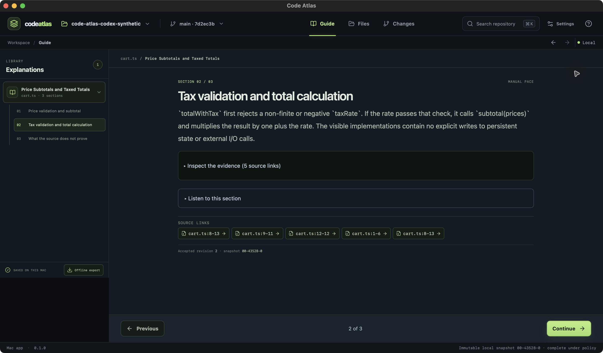

# Code workspace refinement — 16 October 2026

## Purpose and scope

The user asked for code understanding with VS Code-style navigation, fewer competing panels, an understandable graph, a section player, and no repeated backend setup. This iteration refines the working app around that request. It does not certify full design parity or production readiness.

## Implementation

- One full-height file explorer, source editor, and explanation tool pane. Repository/version selection stays in the top bar; the redundant project sidebar and Files hero are removed from a populated workspace.
- A single Explain action beside the selected file. Normal source browsing no longer displays a warning-like “No citation anchor” card or repeated source-storage footnotes. Actual invalid/stale anchor failures remain visible.
- Explanation has numbered behavior sections and clickable exact-line links. Flow shows verified static calls/imports/test references for the current file. Player opens the accepted section reader in one action. Unsupported or absent evidence is not drawn as a proven execution path.
- Captured files are shown by default. Skipped/excluded paths stay available through an explicit explorer control; folder labels no longer claim their contents were excluded merely because folders have no file bytes.
- Codex is the default. Backend preferences persist across file, planning and PR entry points, with existing model/reasoning preferences retained. Ordinary one-file generation prepares its source review locally; sending still requires consent. Recovery keeps its original backend and acknowledgement gates.
- The player has a separately pinned Previous/Continue row. Generic help cards and empty visual slots no longer compete with the section. Audio and detailed evidence remain available through relevant disclosures.
- Opening a repository restores its saved source version and last file when available, otherwise selects the newest saved snapshot. It never creates a capture or sends source automatically. Unsent planning question/source selections are retained locally per repository and snapshot.

## Native observations

The installed Code Atlas 0.1.0 bundle was inspected through native computer use at a 1440 × 844 window capture (2880 × 1688 pixels at 2×). The app is unsigned; bundle/DMG verification is a local build check, not release signing acceptance.

| Check | Observation |
| --- | --- |
| File workspace | On fontdone snapshot `snap-1792140879637485000-11155-0`, opened `examples/render_mask.rs` and `examples/load_glyph.rs`. Source, explorer and a single explanation action were visible together; no duplicate outer project panel or normal no-anchor warning. |
| Repeated backend selection | Opened Explain for both real files. Both went directly to Codex, loaded `gpt-6-luna` / `max`, and prepared an exact local review. Consent remained unchecked; no generation was sent during this review. |
| Saved explanation | Existing synthetic accepted `cart.ts` revision 2 displayed three numbered sections and clickable line links. Player opened directly from the tool pane. |
| Manual player | Section 2 of 3 had visible Previous/Continue. After expanding five source links and scrolling the long evidence, both controls remained visible. No automatic advancement. |
| Source return | Opened `cart.ts:8–13` from the player, saw the exact selected snapshot/range, then used Back and returned to section 2 of 3. |
| Guide | Learning-plan management, static reading order and file coverage were collapsed; the tour/file actions remained visible. |

## Final installed bundle

Native executable SHA-256: `14b71dacb6bef60cc1eae8d526f500893e8cfd1c77eec38643bf4094308fa043` (arm64, Code Atlas 0.1.0). App/DMG build and verification completed successfully.

- Reopened fontdone and the synthetic project from Recents. Both selected an existing saved snapshot automatically, without creating a new capture.
- Opened Flow on fontdone. It built a local partial index over the 2,768 captured files. The small `render_mask.rs` example had no verified call/import/test links and displayed an honest empty state. `src/render.rs` showed 130 verified connections; selecting `split_sdf_cubic_axis` opened exactly lines 2477–2498 in the captured source.
- Restored the user’s unsent font-rendering question in the local planning form, navigated to Files and back, and confirmed the question remained. Nothing was sent.
- Saved final-bundle synthetic Files and Player screenshots below. Reopened fontdone after switching to the synthetic project: the saved snapshot and `src/render.rs` were restored automatically. Last-file persistence also has a unit test.

## Evidence handling

Native screenshots of fontdone are retained locally in `/private/tmp/code-atlas-design-evidence/`; they are not published with this repository. The before/after captures use the same window size but different selected files, so they establish layout changes rather than a pixel comparison of identical content. Synthetic screenshots may be published because they contain only the small validation fixture.

Local captures: `files-before.jpg`, `first-run-after.jpg`, `files-after.jpg`, `guide-after.jpg`, `synthetic-explanation-after.jpg`, `player-after.jpg`, and `player-expanded-evidence-after.jpg`.

## Remaining design gaps

| Area | Concrete remaining work | Tracking |
| --- | --- | --- |
| First run | Replace the remaining Files-oriented introductory heading with the dedicated welcome composition. | `13yp`, `x21h` |
| Relevant source | Guide currently ranks pending files by existing inventory order and can suggest configuration before code entry points. Propose relevant files from a question without manual context hunting, while preserving review boundaries. | `xvjk` |
| Graph and video quality | This flow view is an interactive static source map. Generated diagram quality, animation/story pacing and full repository narrative quality still need real-project qualification. | `j53m`, chapter-quality work |
| Changes | The comparison work area still uses stacked change/PR-guide controls; the approved persistent diff/explanation composition remains open. | `13yp`, `x21h` |
| Familiar editor behavior | Full editor-tab history, richer graph layout and resizable panes are not implemented by this iteration. | `13yp` |
| Accessibility | This native inspection establishes the observed default-window interactions only. VoiceOver, contrast, reduced motion and 200% reflow still require the dedicated acceptance work. | `bcn2` |

## Automated and packaging evidence

- Frontend: **104 tests passed**, including backend persistence, local-review consent separation, and per-project file location storage.
- TypeScript and Vite build passed. Native app/DMG bundle verification passed during the workspace iteration; the final bundle identity is recorded below.
- Existing nonfatal warnings: eight Rust dead-code warnings and the frontend chunk-size warning. Rust implementation was not changed by this iteration.
- Logs: `/private/tmp/code-atlas-design-tests.log`, `/private/tmp/code-atlas-design-build.log`, `/private/tmp/code-atlas-design-bundle-final.log`.

