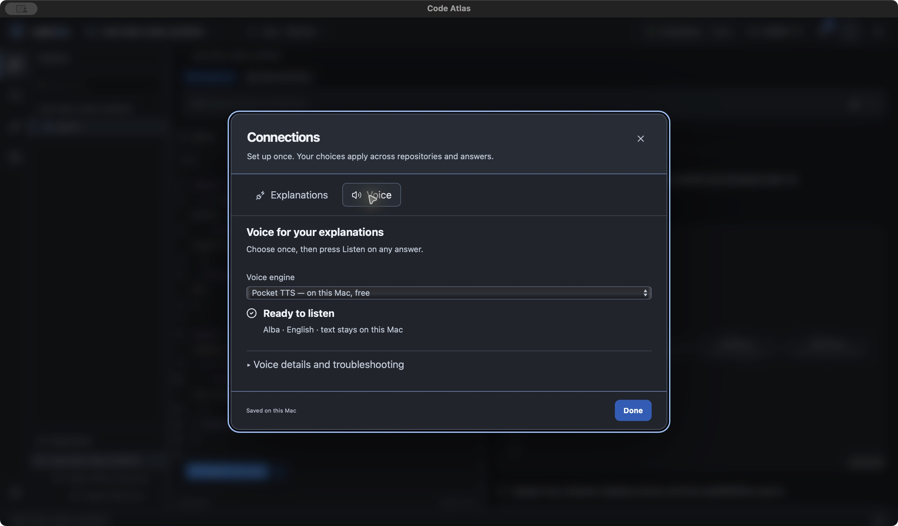
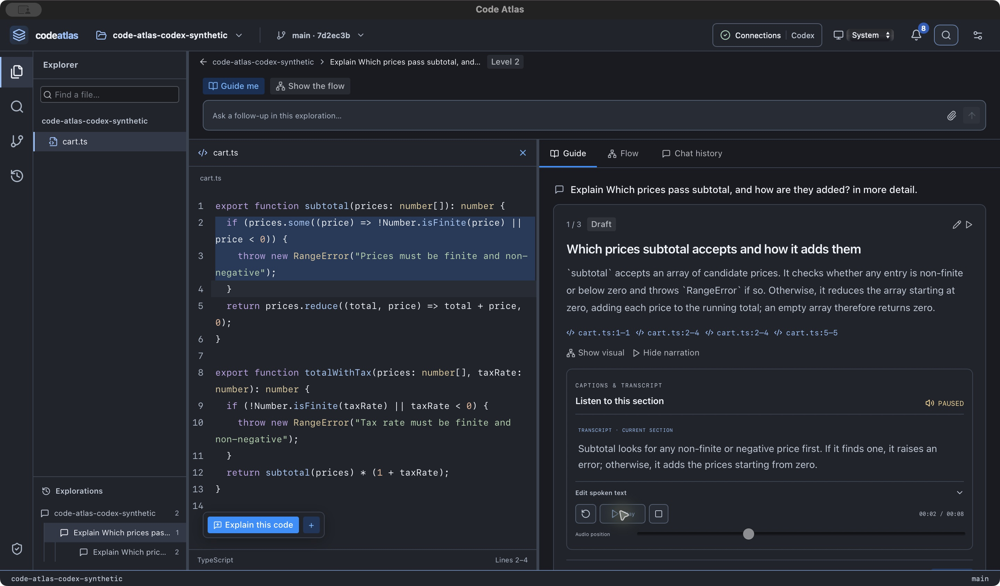
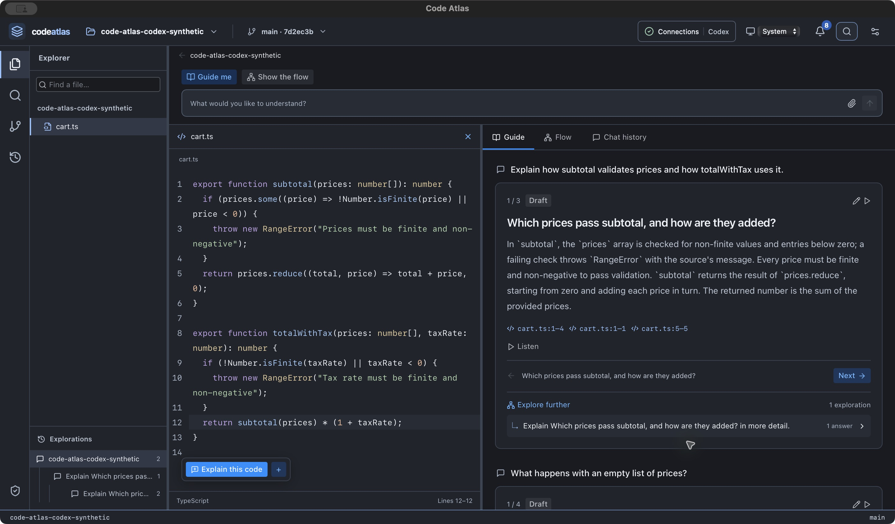

# Connections and answer playback — October 16, 2026

## User contract
Configure AI and voice once in the header's Connections window. Answers show the explanation, source, visuals and ordinary playback. Engine, model, voice, delivery style, runtime downloads/repair and credential management belong in Connections. Transcript/pronunciation edits belong to their section. Local Listen reviews exact speech inputs internally, checks the native cache, then generates and plays only when needed. Google remains explicit and requires exact-text consent before transmission; choosing it in Connections is not consent to send.

## Implementation
- One Connections window with Explanations and Voice, shared modal focus handling and existing Codex account controls.
- Pocket/Alba defaults to local speech. Setup and attribution/troubleshooting are in Voice. Optional Google Keychain key, voice and style are in the same window.
- Versioned global delivery preferences persist across answers/repositories/restarts and are observed by open players and offline cache scans. Existing section script/pronunciation edits survive; legacy cloud section preferences cannot silently select cloud speech. Existing saved audio is not rewritten.
- Changed settings invalidate review/cache matching, pause playback and cancel/discard obsolete synthesis. Returning from Connections refreshes runtime/key status; a Listen waiting for setup can resume after local setup.
- Local playback has no engine selector, runtime card, voice/style form, request fingerprint or extra Generate step. The displayed transcript reflects pronunciation expansion. Optional text/pronunciation edits remain available.

## Checks
- Frontend: 133 tests passed, zero failed. Four new regressions cover safe global defaults, preservation of legacy script/lexicon edits, engine round trips/cache identity and bounded malformed values.
- TypeScript and production frontend build passed; existing large-chunk warning remains.
- Native suite for unchanged native source: 203 passed, zero failed, three ignored live checks (saved-answer migration included).
- Open Source documentation audit: zero errors; four existing review notes remain.
- Unsigned app and DMG built successfully; bundle metadata and DMG checksum verified.

## Installed native observations
Final source `35aa23f` was installed at `/Users/lazytrot/Applications/Code Atlas.app`, preserving the previous bundle. Executable SHA256: `c52933183ce2472c0af8dbf3aa4b4d6fab45443f1281bf2093e90038d105b0e8`.

- The initial Connections package reopened the synthetic project at its saved level-2 Flow view. Existing five saved explanations loaded; the previous origin-v1 metadata error is gone. The real generated four-node diagram rendered, and clicking Validation opened captured cart.ts lines 2–4.
- Header opened Connections with the existing GPT-6 Luna/max Codex account. Voice showed Pocket/Alba ready; engine and setup details were absent from the answer. Troubleshooting remained collapsed.
- Changed the global engine to Google and back to Pocket in Connections. Google voice/style/key controls appeared only there; no key was entered and no Google inference/synthesis request was made.
- A single Listen on the child answer generated and played an approximately eight-second local recording; pause worked at 5.45 seconds. Next selected the second section without auto-playing. Listen then generated/played approximately ten seconds without any backend/voice selection.
- A different root answer reused its existing approximately three-second audio directly from Listen. Stop reset its position to zero. The selected explanation did not auto-advance.
- The earlier empty-list follow-up was retried explicitly and saved a four-section file chapter using GPT-6 Luna/max and the existing snapshot permission, with no manual attachment/backend selection. Its new origin is schema 2. A new generated flow rendered; clicking subtotal(prices) opened cart.ts line 12. This qualifies the single-file routing and new visual wire format for this synthetic case, not multi-file/language quality.
- Light appearance was visually inspected and System restored. Full accessibility acceptance remains open.

Final restart qualification: the `35aa23f` package restored the root Flow view and captured line 12, including the newly saved schema-2 answer and diagram. Header Connections reused Codex GPT-6 Luna/max without sign-in; Voice retained Pocket and showed Ready to listen. All six saved explanations loaded. Root and child Listen immediately reused cached audio; the child recording paused at 2.7 seconds. The final app was left open/raised on that child Guide with audio paused. No new AI or Google request was made during restart qualification. The header visibly names Connections; its value shows Codex. Playback resets when delivery changes, and Stop is disabled during preparation while Cancel audio remains available.

## Boundaries
This change does not qualify speech quality, full VoiceOver/zoom/motion accessibility, all cancellation races, offline export audio or the broader narrative/language/release gates. Kata `dbmd` and `na54` retain explicit acceptance work. No private repository source or Google request is needed for this validation.

The Voice and playback images above show the final installed package; the native flow/light observations in the companion migration record were captured during the preceding package with the same generation/schema implementation.
