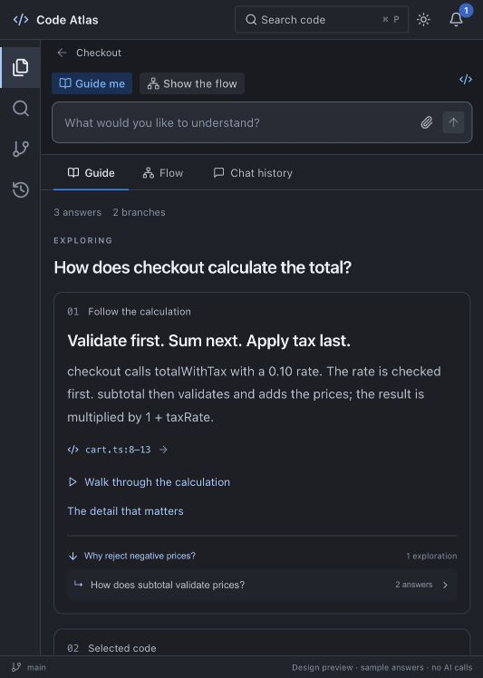
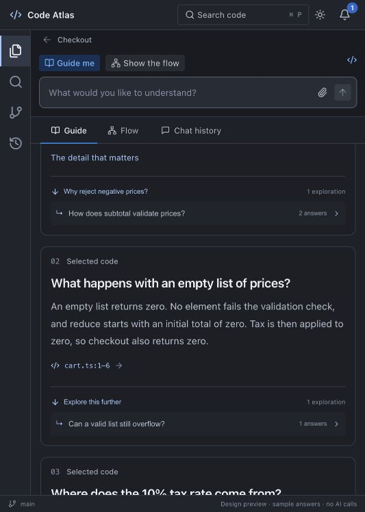

# Developer workspace migration — October 16, 2026

## Scope
This record covers the production conversational workspace migration, not a production release. The earlier installed Guide / Files / Changes app and its screenshots predate this migration. The browser `workspace-preview.html` remains an illustrative design, never a source of production answers.

## Implemented source surfaces
- Production `WorkspaceFrame` / `DeveloperWorkspace`: left Explorer, Search, Changes and Explorations; one pinned composer; real immutable source and Guide / Flow / history. Shared Radix controls, CodeMirror and resizable panels; narrow windows switch readable panes.
- Flat exploration records: follow-ups stack at the active level; explicit child links/counts attach to their originating turn; parent/root navigation and per-exploration last view. Versioned WebView metadata references native revisions.
- Module-owned question operation: automatic local indexing shared with reading, automatic source discovery, exact-question generation, unaccepted native draft save, notification action and explicit stop. Branch topic and recent same-level questions inform follow-ups. Navigation does not own or cancel the operation. Restart interrupts without an automatic resend.
- Native revocable permission binds project/snapshot manifest/account/runtime; actual source-discovery and chapter dispatch recheck it. A changed question/focus changes the generation fingerprint. Advanced PR/editor flows retain explicit scoped reviews.
- Captured-source search uses local bounded reads (24 MB, two seconds, 80 matches); typing never calls AI. Git history reads at most 80 local commits with bounded subprocesses and opens a first-parent comparison. It is a commit list, not a complete DAG; initial commits are labelled and disabled because parent comparison is unavailable.
- Contextual revision editor, interactive player, typed evidence-linked visuals, exact citations and optional Pocket narration reuse existing native stores and validators. No sample checkout data enters production source.

## Checks executed

| Check | Result |
| --- | --- |
| `npm test` | 127 passed, zero failed |
| `RUSTC_WRAPPER= CARGO_BUILD_JOBS=4 CARGO_INCREMENTAL=0 cargo test --release --manifest-path src-tauri/Cargo.toml --lib` | 198 passed, zero failed, three ignored live checks |
| `npm run build` | Passed; large frontend chunk warning remains |
| `git diff --check` | Passed before source commit |
| Open Source documentation inventory | No broken-local-link findings; root license and three broad-claim review notes remain |

Focused tests cover native permission scope/revocation and dispatch fingerprinting, captured-text search, stacked turns, explicit nesting, last view, interrupted reload, corrupted graph/state fallback, implementation entry ranking and bounded follow-up intent. They do not establish visual/narrative quality.

## Browser observations
In the separate design preview, navigated root → child → grandchild. Back restored the parent's Guide view and reopening the grandchild restored Flow. Follow-up cards and originating-turn child counts are visible. A narrow browser panel initially squeezed code and explanation together; fixed responsive panel visibility and verified readable explanation/source switching. These observations do not qualify native generation or the packaged app.

## Native installation / qualification
The Mac was unlocked and the unsigned replacement built from `eba0589` was installed at `/Users/lazytrot/Applications/Code Atlas.app`, preserving the previous bundle and application data. Native binary SHA256: `a858d7f9e57be912afd737c8ef0775a645ee4d0ad1dc4dc6f54059891bb6745b`. The new app opened the synthetic repository and restored the existing Codex connection. One scoped permission allowed a question about subtotal validation and taxed totals; a three-section native draft with exact source citations saved successfully. Its draft player opened and a citation returned to captured lines 1–4. No private project source was sent for these checks.

The first native follow-up exposed a newline in contextual questions, rejected by native discovery. The native screenshot also exposed a Radix root-theme minimum height clipping the bottom of the workspace. These were fixed, with a focused control-character regression; requalification of the final package is recorded below. The first generated answer had no diagram: Flow now falls back to verified static links, and the question prompt requests a compact evidenced diagram for a supported multi-step path. This is not evidence that all generated visuals meet the quality gate.

## Work still open
Kata `na54`, `3rcd`, `13yp`, `x21h` and the seven workspace tasks remain open. Required remaining evidence: final-package contextual follow-up; nested live answers and restoration; Search/Changes/editor/player; keyboard/drag and packaged accessibility across themes/window sizes. Durable native job scheduling, complete section/playback/graph viewport persistence, root-commit diff and quality/language/release gates remain open. No production-readiness claim is made.

## Illustrative browser proof
These are the separate design preview at the browser panel's current narrow width, not native screenshots.

## Integration fixes before final packaging
An explicit saved draft can now open the interactive player with a Draft preview badge. Rejected/unknown exact revisions cannot silently select a different accepted answer, and offline export still receives only accepted revisions. A focused reader-selection regression covers draft, accepted, missing and rejected cases. File, symbol and relationship visual destinations now resolve through captured source/index evidence in the shared workspace, including returns from the player. The Mac was unlocked after the initial packaging checks; final replacement walkthrough is in progress.

## Final native refinements
The `f5010f7` package's full-height workspace is visually confirmed: explorer branches, source footer and app footer are visible. Reopening the synthetic repository restored its questions and Flow tab without reconnecting or repeating the sharing grant. Changes displayed two real local commits and a one-click five-line added-file diff while the follow-up ran. The follow-up reached Codex but returned an unsupported item and was rejected. The adapter now supplies explanation-only base instructions supported by the installed schema, with narrow event-type diagnostics and unchanged permission/tool rejection. Questions queue for the single runtime. PR generation in the embedded workspace reuses the header connection and preselects bounded changed text files. These changes are pending final-package qualification below.

Protocol references checked: [official App Server documentation](https://learn.chatgpt.com/docs/app-server) and the JSON schema generated by the existing installed vendor Codex executable. The published schema includes `baseInstructions` and `developerInstructions`; no private APIs, replacement executable or API key was introduced.
