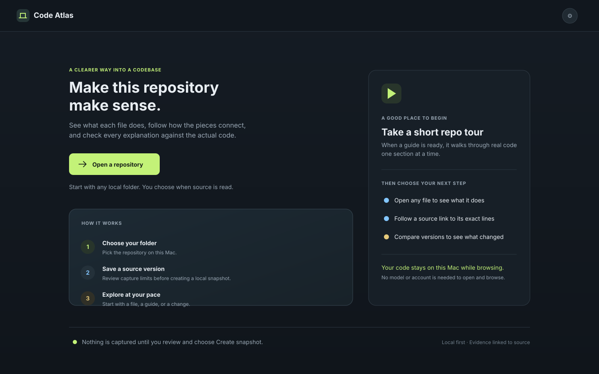
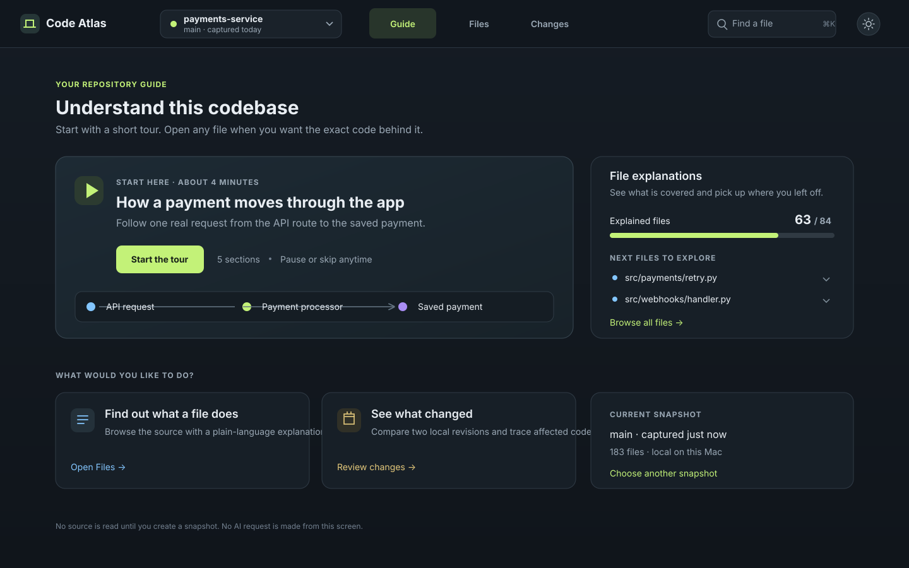
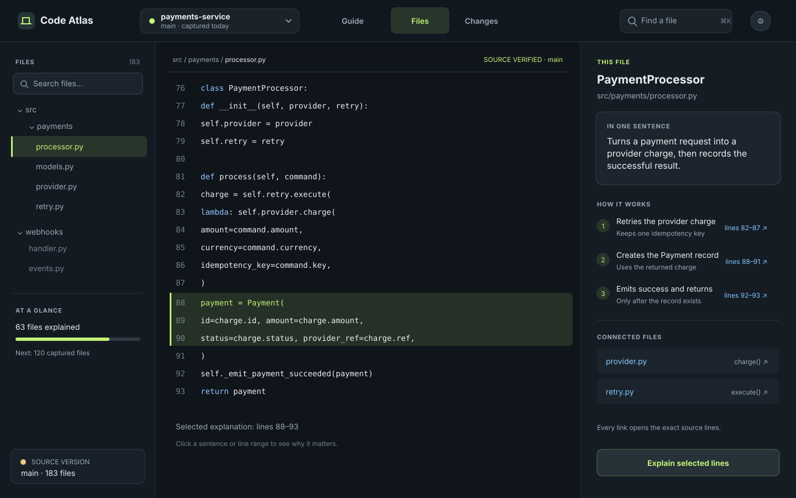
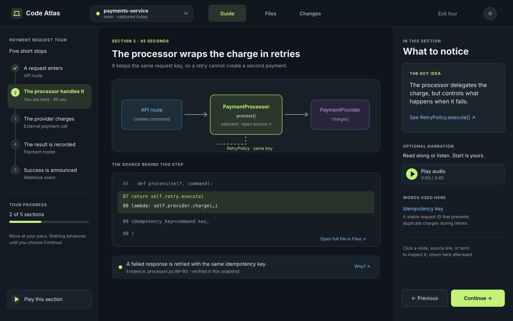
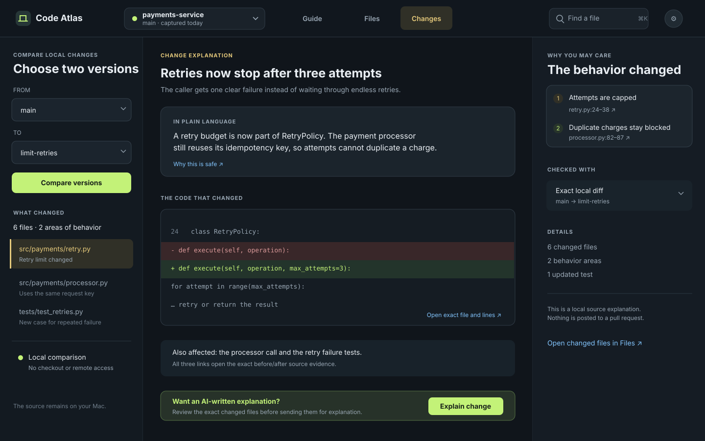

# Code Atlas simplification

These five SVGs are the approved design references for the Code Atlas information architecture. They are proposals, not packaged-app screenshots. On 16 October the user refined the direction to a VS Code-style workspace: explorer, real code, explanation, focused flow, and a deliberate section player. The native implementation and remaining gaps are recorded in [the workspace review](../acceptance/2026-10-16-code-workspace.md). Kata `13yp` remains open for full design acceptance.

## The proposed shape

Keep three destinations in the main bar:

1. **Guide** — understand the repository, continue a short tour, and see which
   files still need explanations.
2. **Files** — browse the real source and read its explanation in the same
   place. The relationship map becomes an optional view here; Code Lens becomes
   the selected-file/source detail rather than a separate destination.
3. **Changes** — compare two local revisions, inspect exact before/after source,
   and understand which behavior changed. Pull request sharing stays a later,
   explicit extension of this local workflow.

`Guide Plan` and `Chapter Studio` should no longer appear as separate project
workspaces. File coverage belongs on Guide and editing/review belongs beside the
selected file explanation. An optional overview remains visibly separate from
the individual file explanations. The existing guide must keep its promise to
explain every eligible file; a repo tour introduces the system and helps a
reader choose what to inspect next.

Model, voice, exact request review, advanced index filters, snapshot hashes,
unresolved relationships, and recovery tools remain available behind the
relevant action or Settings. This changes when details appear, not whether
source evidence, request consent, safe capture, or revision history exist.

## Main images

### First run

### Guide home

### Files and explanation

### Section-by-section walkthrough

### Change explanation

## Historical installed-app observation — before 16 October

In the inspected installed Mac app (version 0.1.0), the primary tabs were Atlas,
Code Lens, and Walkthrough; Guide Plan, Chapter Studio, and revision comparison
were separate or hidden workflows. Atlas presented an inventory tree, a
relationship canvas, filters, unresolved-edge counts, and evidence details at
once. In the inspected fontdone snapshot, Code Lens showed hundreds of
unresolved relationship rows below the source. Guide Plan put per-path statuses,
filters, grouping, pagination, and chapter actions together. That made a new
reader learn internal product concepts before answering “what does this file do?”

The observations above describe that installed build. A source-only iteration
started moving Guide and Files toward the approved hierarchy on 15 October
2026. The packaged app has not been rebuilt or inspected for that iteration, so
it is not yet evidence of design parity.

The redesign focuses each screen on one question:

| Screen | First question answered | Main action |
| --- | --- | --- |
| Guide | Where should I start? | Start or continue a short tour |
| Files | What does this file do? | Open exact evidence or explain selected lines |
| Changes | What is different between these versions? | Compare, inspect, then explain the change |

## Interaction rules for the implementation

- Keep one project and one immutable source version visible across all three
  screens. Put full hashes, capture counts, and policy details on demand.
- Explain one idea at a time. Every explanation links to exact captured lines;
  unresolved relationships stay collapsed and are never presented as facts.
- Every tour section has **Previous** and **Continue**. Audio is optional,
  never starts automatically, and never advances the reader on its own.
- Clicking a diagram node, source range, or related-file link opens the exact
  local evidence. Returning restores the selected section and its scroll/audio
  position.
- Show partial-capture gaps as a plain warning with one next action, such as
  **Review skipped files**. Do not bury the warning among metadata.
- Keep advanced setup, provider/model choice, filters, and troubleshooting out
  of the first-use path. Explain the current action before asking for exact
  source-sharing consent.
- Offer one-file explanation as the default. Multi-file overviews and grouping
  require an explicit selection and show what the selection means.
- Put recovery, stale citations, and failed generation next to the item they
  affect, with a clear retry, inspect, or return action.

## Image and implementation notes

The images are exact-label SVG screen proposals, drawn directly as vectors to
honor the standing instruction to use only GPT-6 Luna Max and not call another
model. They use the existing dark graphite, warm-neutral, blue, and restrained
lime design language. The SVGs remain design references; they are not screenshots
of the current build.

## Historical source iteration — 15 October, before the native workspace rebuild

- Guide now has a repository home that reads a current accepted overview when
  one exists, otherwise points to a real captured file. The optional overview
  remains separate from file-by-file coverage, which is behind an explicit
  disclosure.
- Files now routes source links to the selected snapshot in the Files view.
  The intended composition keeps the tree, read-only source, exact citation,
  and saved explanation together. Relationship exploration remains optional.
- The file explanation panel is scoped to the selected file and snapshot. It
  shows the latest accepted revision, draft/rejected state, or a clear
  explanation action. Source links remain tied to their recorded path, range,
  hash, and snapshot.
- The walkthrough still uses explicit Previous and Continue controls, and
  source navigation retains its return route.

For that 15 October iteration, these were source edits only. No test, build, native app launch, screenshot, or
accessibility acceptance was performed then. The 16 October native workspace review supersedes this source-only status. Kata task `13yp`
remains open for source review, packaged-app interaction checks, screenshots,
and confirmation that the built app presents these screens as designed.
