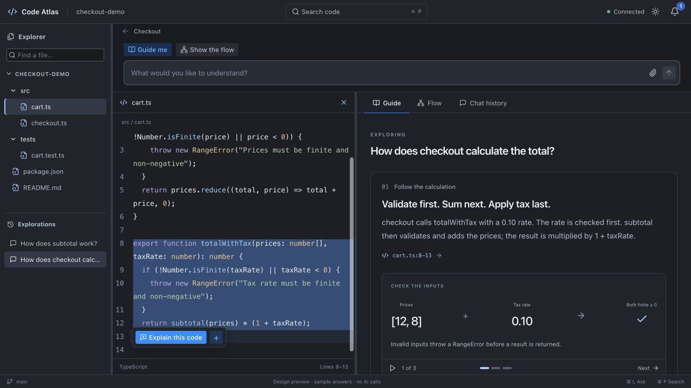
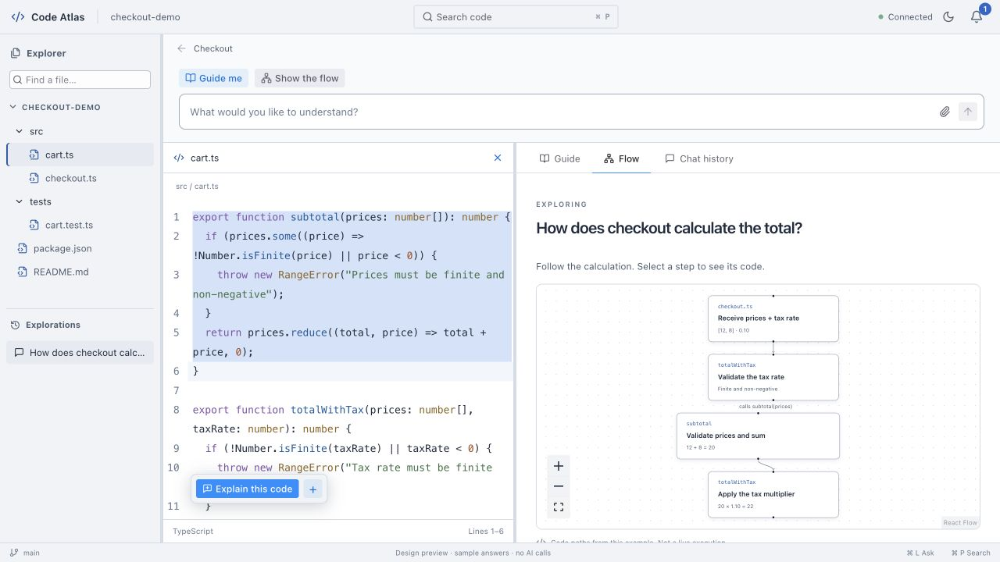
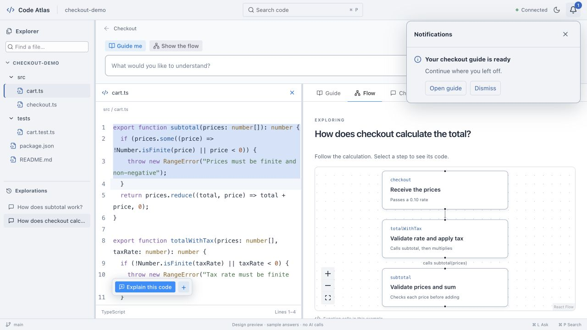
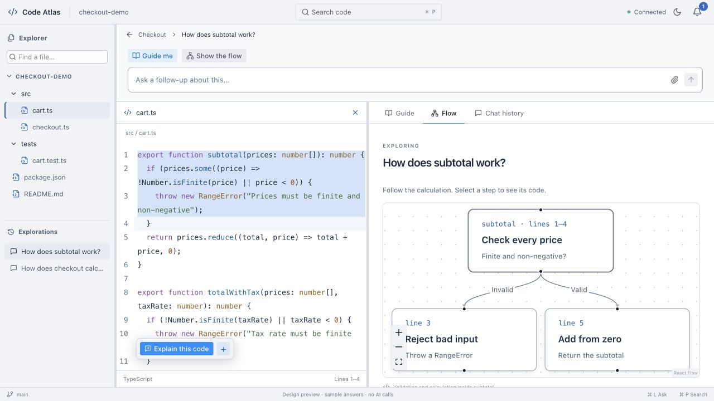
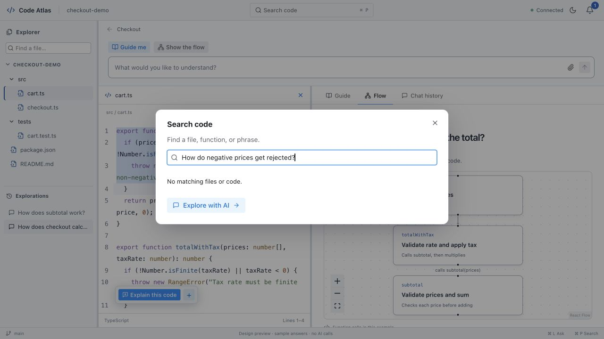

# Code, questions, and explanations in one workspace

**Design contract: 16 October 2026, latest user direction.** This supersedes the old Guide / Files / Changes header navigation. The production migration uses a VS Code style activity bar for Explorer, Search, Changes and exploration history. Guide / Flow / Chat history are views of the same exploration. The browser preview remains an illustrative checkout sample; it is not the repository-backed app. See the acceptance record for exactly which packaged flows have been observed.

Open the [interactive preview](http://127.0.0.1:4173/workspace-preview.html) while `npm run dev` is running on the existing port 4173. It uses a small illustrative checkout repository, local sample responses, and separate preview preferences. It reads no repository, invokes no AI, and does not synthesize audio. Its player demonstrates visual steps only.

## Preview images

These are screenshots of the interactive sample design, not the packaged app.

## What the reader sees

- **Left edge:** a compact activity bar for Explorer, Search, Changes and Explorations. Changes includes a bounded read-only commit list with real parent relationships and one-click comparison.
- **Sidebar:** a persistent, searchable file explorer. Opening a file shows actual code beside the explanation; closing code gives the explanation more space. The explorer remains available in every view.
- **Top:** one chat bar, with **Guide me** and **Show the flow** above it. This stays visible while content scrolls. A small project header contains search, connection status, appearance, and a notification bell. Settings do not occupy a workspace pane.
- **Main area:** resizable code and explanation panes. The current exploration has **Guide**, **Flow**, and **Chat history** views. Implementation detail is an inline code component in Guide or Flow, never a third explanation mode or a detached destination.
- **Guide:** the answer unfolds in readable, headed cards. A card can contain text, an interactive visual, source links, and an optional narrated sequence. The reader controls when to continue. Every follow-up has a visible question heading and its own answer card at the current level. Branch links and real counts appear on the answer they came from. The hierarchical exploration list shows deeper levels before navigation; breadcrumbs alone do not establish visible nesting.
- **Flow:** an understandable graph, initially at the current question's level. Select a node to inspect its implementation; explicitly explore it to descend. The graph can move from repository structure to modules and functions, only as supported by evidence.
- **Navigation:** a breadcrumb and Back return one level; the first breadcrumb returns to the root. Each exploration reopens its last view, code selection, scroll position, graph viewport and player position. Deeper exploration creates a branch, not an ever-growing stack of nested modal components.

Typing a question starts local code search in parallel. Results appear without requiring a separate search process. Opening a result reveals code; **Explore with AI** answers the question. No results is a normal state and still offers the AI action. AI is never dispatched on every keystroke.

## Exact actions

| Action | Result |
| --- | --- |
| Ask / Enter | Add a user message and an answer card to the **current exploration**. Keep its parent and active workspace. |
| Guide me / Show the flow with text | Send the same current-level intent and show the chosen view. No extra reference or backend picker. |
| Guide me / Show the flow without text | Show that view of the current exploration. Never send an empty AI request. |
| Drag file into chat | Attach an explicit file chip. It supplements AI-discovered supporting code. Do not send until Ask. |
| Select lines or function → Explain this code | Send the question plus that exact source context to chat **at this level**. Show the answer inline in the active Guide or Flow view. No separate dialog or second Send. |
| Add selection to chat | Attach exact selected lines for a custom question. |
| Click citation or graph node | Reveal the correct captured file/range in the code pane. Keep the current question, view, graph and player position. |
| Explore further on an answer | Create/open a child exploration. The parent card shows its real child count and links; counts are never invented. |
| Back / root breadcrumb | Restore the selected ancestor's saved view and state. No regeneration. |
| Notification bell | Open background outcomes, interrupted work and actionable failures. Notifications never open themselves or take focus. |

Shortcuts: `⌘P` quick code search, `⌘⇧F` repository text search, `⌘L` focus chat, `⌘I` explain selected code, `⌘1/2/3` Guide/Flow/history, `⌥←` parent. Provide discoverable equivalents on Windows/Linux if supported. Use editor-native Find inside code. IME composition must not accidentally submit.

## What stays in the background

Indexing, file selection, scope construction, route planning, evidence checks, chapter generation and asset reuse are orchestration. The reader sees a quiet working state and then useful content. Do not expose request fingerprints, source budgets, schema identifiers, backend selection steps, raw validation failures or recovery journals in the normal reading view. A failure offers a plain next action in its answer and the notification center; exact diagnostic data belongs in optional support details.

Connect once. The header shows a compact connection state; model, reasoning and approval preferences are in connection settings. An account or permission problem opens relevant setup only when it prevents the requested action. Source authorization must remain meaningful: implement a revocable project/snapshot-scoped sharing grant and validate every request against it natively before replacing the current per-request source reviews. Existing reviewed fingerprints are not blanket permission. A question outside the authorized scope needs one specific scope decision; routine already-authorized requests should run without staged dialogs.

Code is the source of truth. Documentation can suggest places to look. Do not announce every internal stage or burden the reader with documents unless a documented claim contradicts code relevant to their question. Static relationships must not be presented as a recorded runtime trace. Unknowns must be stated in the answer.

## Standard components and spacing

The preview uses [Radix Themes](https://www.radix-ui.com/themes/docs/overview/getting-started) for buttons, tabs, inputs, badges, tooltips and dialogs; [Radix Popover](https://www.radix-ui.com/primitives/docs/components/popover) for the notification center; [CodeMirror](https://codemirror.net/examples/) for selectable highlighted code; [React Flow](https://reactflow.dev/learn) for graph interactions; and [react-resizable-panels](https://github.com/bvaughn/react-resizable-panels) for keyboard-accessible splitters. These are real reusable components, not raster pictures of controls. The persistent explorer/editor composition follows the [VS Code workspace guidance](https://code.visualstudio.com/api/ux-guidelines/overview).

Use one token scale (4, 8, 12, 16, 24, 32), compact 40–44px workspace bars, readable 14px explanation text and 13px source. Keep neutral light/dark surfaces with restrained blue actions. Avoid repetitive card-inside-card chrome, full-page heroes and permanent settings columns. Pane layouts must reflow at 200% zoom; hide/collapse code deliberately rather than forcing two unreadable columns. A code selection is a temporary context affordance, not a new workspace.

## Storage and generation contract

Persist a flat exploration graph with stable IDs: project, source snapshot, parent exploration, originating card/turn, title, messages, answer references and last-view state. Store generated content as independent revisioned artifacts, not duplicated HTML blobs per tab. Guide and Flow derive from the same source-backed answer. Keep presentation preferences separate from immutable chapter/source revisions. Branch navigation never triggers generation.

Code attachments carry project, snapshot, path, content hash, exact byte/line range and optional indexed symbol identity. Dragging a file or selecting a function must not silently convert a captured citation into live filesystem context. Any stale/out-of-scope attachment is resolved before dispatch, with a clear user action only if necessary.

Job ownership must outlive an open view. Removing the generation dialogs without moving their cancellation/unmount ownership would silently stop work. Use durable native job IDs and a workspace job store, idempotent saves, explicit Stop, no hidden inference retries, and recovery after restart. Preserve independently saved chapters when a later chapter fails. Project switching and opening notifications must not cancel a job.

Reuse existing validated claim anchors, diagram specifications, Pocket TTS caches, revision history and section dependency tracking. Rich guide layouts use safe local templates/typed visuals; model output must not gain arbitrary HTML/JavaScript execution or filesystem access. Section edits regenerate only affected content and dependent assets.

## Delivery and evidence

1. Record this contract and show the preview before replacing native navigation.
2. Build the shared workspace shell and real source/explorer adapter.
3. Add versioned explorations, current-level chat, search and exact context actions.
4. Keep question generation outside view lifetimes and implement native snapshot/account/runtime scoped authorization. The initial migration uses a module-owned job with native interruption journals; it does not silently resume inference after an app restart.
5. Compose Guide, Flow, inline details and optional narration from the same revisioned artifacts.
6. Qualify the packaged app against these same screens and keyboard/accessibility/large-repository journeys. A design preview does not pass native acceptance.

The detailed tasks are in `57`–`62` under [Kata definitions](../kata-tasks/). Existing Codex, narrative, visual, accessibility and release gates remain open. Claude remains deferred. The preview adds no model invocation and preserves the standing GPT-6 Luna/max preference.

## Implementation scope

The production workspace consumes native immutable snapshot inventory/source, native validated chapter revisions and the existing Codex account connection. New questions preserve the question and exact range in the native fingerprinted request, discover supporting implementation files, generate and save a separate draft, then render that revision as Guide/Flow content. Draft is not automatic acceptance. Existing revision review, editing, interactive visual rendering and Pocket narration remain contextual tools. Nothing in production imports sample repository contents.

The one-time sharing decision is distinct from account connection: it names this snapshot, destination OpenAI through Codex, indexed metadata/documentation hints, automatically selected code, the 12-file/250-KB bounds and account quota. The native permission binds the manifest digest, account identity and executable hash. The new workspace investigation checks its versioned grant before every owned tool response and final validation. Old grants require one explicit policy renewal; legacy reviewed dialogs keep their own preparation/revalidation checks. New snapshots/accounts/runtimes need a new decision. **Repository sharing** opens the revocation control; **Revoke permission and stop questions** revokes the grant and requests cancellation of current workspace questions. Legacy reviewed requests keep their existing per-request rules.

Conversation UI state is versioned flat data in WebView local storage with native revision IDs; generated prose/assets remain native records. An interrupted question never restarts automatically. Native previews/recovery notices remain available when a save cannot be confirmed. This is not yet a native persisted job scheduler: a restart can require explicit recovery, and large-repository/VoiceOver qualification remains separate. Search covers captured paths, indexed symbol names and immutable captured text. A native local scan is bounded to 24 MB, two seconds and 80 matches; a partial search is labeled and never presented as exhaustive.

### Follow-up context
Workspace discovery and generation include the active branch topic and up to two preceding user questions at that level, bounded to the native operation's question limit. The current question remains last. This preserves recent intent; it is not an unbounded transcript or a guarantee of semantic answer quality. Source is independently selected from the snapshot and revalidated before transmission.

## Evidence and presentation contract
Workspace questions use one owned Codex investigation, with optional attachments as starting points. The agent searches and reads captured ranges; it does not first select whole files in a separate model call. The current response uses the overview `anchored-claims-v1` presentation recipe even when the question focuses on one file. Legacy file dialogs retain their file chapter contract. Native code validates claim quotes, identifiers, relationships and visuals, then builds display/narration from complete anchored claim sentences. Separate generated overview prose/narration is discarded. Inference labels remain visible, storage independently checks exact-copy support, and API/legacy overview requests keep their strict original contract. Unsupported source evidence still fails without silently retrying.

The native chapter wire contract uses camelCase for enum fields as well as variant names. Legacy snake_case hotspot, inference-label and dependency records remain readable; rendering a chapter does not rewrite its saved bytes.
