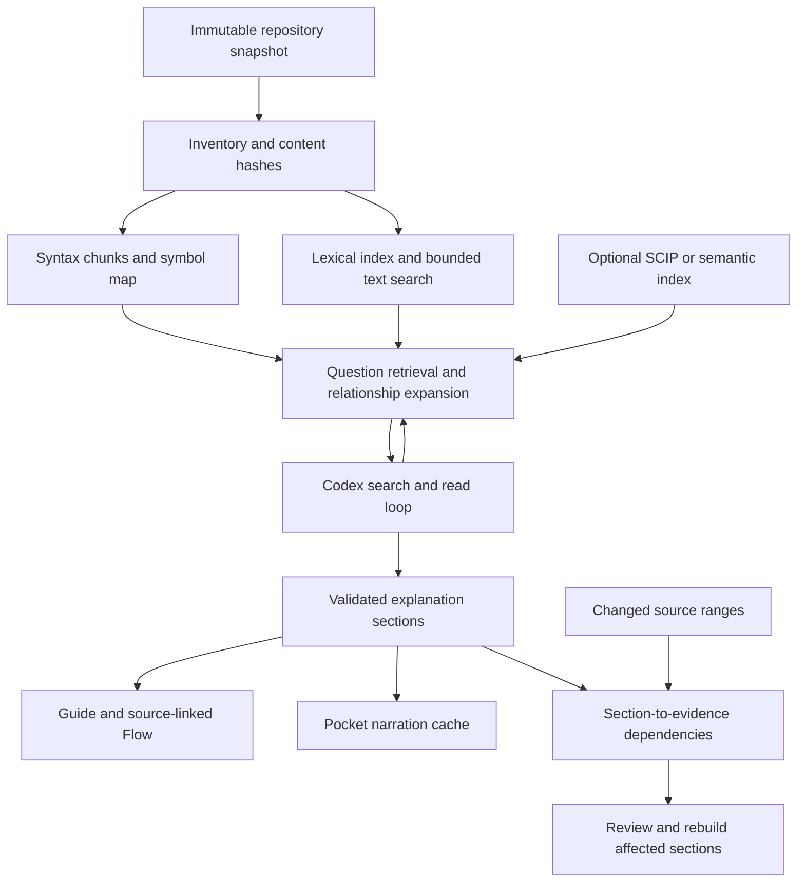

# How code tools understand entire repositories

Research date: 17 October 2026. App inspected at `be49e35`, following the [Fontdone acceptance run](../acceptance/2026-10-17-fontdone.md).

## Recommendation

Build a shared, local repository context service: an immutable inventory, syntax-aware source ranges, lexical search, and confidence-labelled relationships. Let the existing Codex app-server search and read those ranges through narrowly scoped tools. Generate independently saved explanation sections from the retrieved evidence, then attach visuals and Pocket narration.

The first implementation should use our existing Tree-sitter parsers, **Tantivy** for ranked text search, and the ripgrep project's Rust search libraries for bounded fallback searches. Keep semantic embeddings and compiler indexes as optional improvements evaluated against retrieval failures. The architecture below is a recommendation. A subsequent [local retrieval implementation checkpoint](../acceptance/2026-10-17-range-retrieval.md) has native measurements; the Codex retrieval loop and broad repository explanation remain unimplemented/unqualified.

The studied systems offer repository-wide retrieval or exploration; their documentation does not establish exhaustive understanding of every file or execution path. Exclusions, language coverage, stale indexes and generated summaries still require explicit treatment.

## What established products actually do

These are vendor-documented mechanisms, not an independent product benchmark. Internal algorithms that the vendor does not publish remain unknown. Windsurf documentation currently redirects to Devin Desktop documentation; the names below preserve that relationship.

| System | Published approach | Lesson for Code Atlas |
| --- | --- | --- |
| **Cursor** | Detects changed files with Merkle trees, splits changed files into syntactic chunks, embeds them asynchronously and caches embeddings by chunk content. It can reuse a related team index while filtering results against the user's content proofs. [Engineering article](https://cursor.com/blog/secure-codebase-indexing). | Incremental indexing and chunk identities reduce repeated work. A large file should contribute searchable pieces. |
| **GitHub Copilot** | Automatically builds a repository semantic search index. Its cloud agent can use semantic search when exact names are unknown. Index creation and updates run in the background. [Repository indexing](https://docs.github.com/en/copilot/concepts/context/repository-indexing). | Natural-language discovery needs more than filename matching. Background preparation can serve several questions. |
| **Claude Code** | Uses an iterative context-gathering loop with file reads, pattern/regex search and optional definition/reference tools through code intelligence plugins. [How it works](https://code.claude.com/docs/en/how-claude-code-works). | An agent can progressively inspect code; a vector index is not a prerequisite for this workflow. The cited page does not establish the absence of all internal indexing. |
| **Codex** | The official OpenAI documentation describes app-server as an agent harness supporting conversation state, tools, streamed events and application-owned MCP services. [Platform architecture](https://developers.openai.com/blog/codex-as-a-platform). | Keep the existing account-backed integration and give it useful repository tools. Reuse its agent loop. |
| **Sourcegraph** | Cody combines keyword search, Sourcegraph Search and code relationships. Its Enterprise FAQ explicitly says Sourcegraph Search replaced embeddings. Precise navigation uses SCIP with search-based fallback. [Context](https://sourcegraph.com/docs/cody/core-concepts/context), [FAQ](https://sourcegraph.com/docs/cody/faq), [SCIP navigation](https://sourcegraph.com/docs/code-navigation/precise-code-navigation). | Exact search and semantic relationships can be effective without mandatory embeddings. Precise links and heuristic links need different confidence labels. |
| **Windsurf / Devin Desktop** | Documents indexed RAG context. Fast Context uses a specialized retrieval agent and parallel searches to return relevant code sections. [Context engine](https://docs.devin.ai/desktop/context-awareness/overview), [Fast Context](https://docs.devin.ai/desktop/context-awareness/fast-context). | Separate retrieval from answer construction. The advertised speedups are vendor claims and are not transferable to our app or model. |
| **Augment** | Publishes a personal, changing-code-aware index and embedding retrieval. Its scale article describes quantized candidate search followed by full-vector scoring, with handling for recent changes. [Personal index](https://www.augmentcode.com/blog/a-real-time-index-for-your-codebase-secure-personal-scalable), [Retrieval architecture](https://www.augmentcode.com/blog/repo-scale-100M-line-codebase-quantized-vector-search). | Retrieval must match the actual branch and source version. Enterprise-scale ANN machinery is not a necessary first step for a desktop app. |
| **Aider** | Sends a compact repository map of declarations and signatures. A dependency graph ranking algorithm selects relevant map portions within a token budget. [Repository map](https://aider.chat/docs/repomap.html). | A small, question-relevant structural map helps orientation without copying every implementation into the prompt. |
| **Continue** | Current documentation deprecates its old `@Codebase` provider and recommends file/search tools, rules and MCP. Custom RAG remains an advanced option for large internal codebases. [Current awareness guide](https://docs.continue.dev/guides/codebase-documentation-awareness). | Older articles describing its embedding pipeline are not the current recommended integration. Expose context through reusable tools. |
| **DeepWiki** | Generates repository summaries, architecture diagrams and source-linked pages. Its docs describe default cluster-based planning, hierarchical page configuration and known missing-component limits. [Repository wikis](https://docs.devin.ai/work-with-devin/deepwiki). | This is the closest product reference for a repository explainer. Combine a persistent overview with deeper exploration; do not infer its private indexing algorithm from the wiki output. |

### The common pattern

Across these different implementations, repository context is assembled for the current task. An index locates candidates, tools inspect actual code, and the answer uses a bounded evidence set. Semantic similarity locates candidates; it does not establish control flow or prove an explanation.

For Code Atlas, repository-wide availability, question retrieval coverage and completed explanation coverage should be measured separately. The reader should be able to ask about any captured code without selecting references manually. That does not require pre-generating a video for every file.

## Why our Fontdone workflow failed

The following are confirmed source observations, not explanations of unmeasured model latency:

| Current implementation | Consequence |
| --- | --- |
| [Discovery eligibility](../../src-tauri/src/source_discovery.rs) rejects files above 250,000 bytes. | Fontdone's captured, indexed 375,700-byte `src/font.rs` cannot even be proposed. |
| Discovery ranks question words against paths and advertises only the first 18 symbols and ten high-confidence links per file, inside a 96,000-byte record budget. | A relevant function late in a large file can be absent from the model's choices. There is no content search in this selector. |
| [Workspace jobs](../../src/workspace/store.ts) run a discovery inference, then send whole selected files to a separate chapter inference. | Every question pays for two serial model operations. Attaching a line range adds focus metadata but does not reduce the whole-file source bytes. |
| [Codex adapter](../../src-tauri/src/codex_agent.rs) disables shell and inherited MCP tools and rejects tool execution events. | We are using the account-backed Codex harness as a bounded structured-output generator. It cannot investigate missing implementation through tools. |
| The chapter is admitted only after complete structured output and native validation. | The reader waits for the whole answer artifact. Streaming arbitrary unvalidated text would bypass the current evidence contract. |
| No persistent per-stage timing trace is available. | We cannot attribute the ten-minute observation to search, reasoning, output generation or validation. A vector database would not by itself diagnose this. |
| [Answer UI](../../src/workspace/Workspace.tsx) stores its section index in component-local state. | Back, view changes and restart can lose the selected section. This is independent of indexing. |

The broad Fontdone run selected nine files and 247,956 source bytes, omitted `src/font.rs` and `src/api.rs`, and was manually stopped at 606 seconds. `src/api.rs` was eligible; its omission is a selection/budget outcome, not the per-file exclusion. This was a failed usability run, not a completed latency benchmark or a native timeout.

## Indexing options and the decision

| Layer / existing solution | What it gives us | Tradeoff / decision |
| --- | --- | --- |
| **Content search using ripgrep libraries** | Exact identifiers, error messages and regex matches; parser-independent fallback. [grep-searcher](https://docs.rs/grep-searcher/latest/grep_searcher/). | Repeated broad scans cost work. Search immutable captured text with byte, match and time budgets; preserve existing exclusions. Use now. |
| **Tantivy** | Embedded Rust full-text engine with BM25 ranking and incremental indexing. [Project documentation](https://docs.rs/crate/tantivy/latest). | Requires a code-aware tokenization policy and explicit commit/reload lifecycle. Recommended first persistent lexical engine for this Rust app. |
| **SQLite FTS5** | Embedded full-text search, BM25 and optional trigram tokenization. [Official reference](https://www.sqlite.org/fts5.html). | Strong alternative if we adopt SQLite for durable jobs/content too. External-content indexes require explicit consistency maintenance. Do not ship two lexical engines initially. |
| **Tree-sitter** | Incremental syntax trees and language-specific declaration boundaries. [Introduction](https://tree-sitter.github.io/tree-sitter/). | Already used here for Rust and JS/TS. Syntax does not resolve dynamic dispatch or prove execution. Use for chunks; keep text fallback for unsupported/oversized inputs. |
| **SCIP / language servers** | Compiler-backed definitions, references and type-aware navigation where supported. [SCIP indexers](https://sourcegraph.com/docs/code-navigation/precise-code-navigation). | Requires language/toolchain setup and can depend on build configuration. Import compatible indexes later; keep revision identity and distinguish unresolved relationships. |
| **Embeddings + LanceDB** | Optional semantic candidate retrieval; LanceDB also supports combining vector and full-text results. [Hybrid search](https://docs.lancedb.com/search/hybrid-search). | Requires an embedding model and an update pipeline. A vector store does not create embeddings itself. Evaluate later against questions that lexical/graph retrieval misses. No local model is required by the proposed baseline. |
| **Zoekt** | Existing trigram code-search engine for larger search deployments. [Project](https://github.com/sourcegraph/zoekt). | Useful reference for future shared multi-repo search; separate service/toolchain complexity is unnecessary for the current single-user app. |
| **Repomix** | Packages repository content for AI use. [Guide](https://repomix.com/guide/). | Useful for controlled exports and investigations. Packaging alone does not provide incremental question-specific retrieval or resolve context limits. |

**Selected baseline:** existing snapshot store + existing Tree-sitter + Tantivy + bounded fallback search + Codex app-server. Preserve Pocket for local narration. Search/index work has no per-query model charge; Codex generation still consumes the connected account's quota. Hosted embeddings, additional agent providers and a hosted search service are optional future decisions.

## Proposed architecture

### 1. Make every captured implementation range discoverable

Keep per-file inventory independent of parser and model request limits. Represent each chunk with snapshot ID, original path, full-file hash, absolute byte and line range, chunk hash, symbol/parent identity when known, and parser version. Split oversized functions into bounded pieces retaining enclosing signature/context. Use bounded line windows when parsing is unavailable. Report unavailable text; never call it understood.

Index identifiers in both their original spelling and searchable components. Preserve exact-match preference for `Font::memory_face`, snake_case, camelCase and paths. Search code contents as well as symbol names. Rank caller/callee and import neighbours with explicit confidence. Deduplicate overlapping windows before spending the request budget. A compact module map helps broad questions reach the correct subsystem.

### 2. Let Codex retrieve evidence progressively

Expose app-owned tools such as `search_code`, `read_source_range`, `find_definition`, `find_references` and `repo_map`. Each result carries immutable coordinates and coverage/truncation information. The native service enforces snapshot/account grant, exclusions, aggregate byte budget, result limits, cancellation and deadlines on **every call**. It cannot read arbitrary live files, execute repository code or widen its own permission.

Prefer a private local MCP integration because the same retrieval contract can later serve Claude or other qualified agents. Keep inherited unrelated MCP servers disabled. Only permit the owned tool/event surface. App-server dynamic tools are an alternative, but the official docs currently mark that interface experimental; validate against the installed runtime before selecting it. [Protocol documentation](https://learn.chatgpt.com/docs/app-server).

Use the existing Codex installation and account, GPT-6 Luna with max reasoning. The recommendation changes context access, not the user's selected model. Persist the retrieved evidence ledger in Code Atlas rather than relying on a hidden model transcript. Multi-call retrieval must remain bounded and stops when evidence is sufficient or the budget is exhausted.

### 3. Generate a complete repo guide in independently usable parts

For a broad tour, derive a package/module map and entry points, identify behaviour journeys, then build a hierarchical outline. Each section declares its learning question, prerequisites, exact evidence and unresolved boundaries. Generate a short direct answer first; expand detail sections when requested or through the explicit whole-guide job. This is automatic planning, not a manual file picker.

Use complete, independently validated section artifacts as publication units. Keep the current validators authoritative. A useful partial guide may contain completed sections plus explicit pending/failed sections; it must never be labelled a completed repository tour. Avoid generating prose that the presentation layer will discard. Visuals should show evidenced branches, data movement or state, with links to code and unknown edges labelled. TTS follows the final narration script and is cached separately.

For the original Git-like editing requirement, store dependencies from each section to source ranges, prerequisite sections, visual inputs and narration-script/voice identity. A source edit invalidates dependent outputs and their affected dependants; unrelated sections and recordings remain usable. A new explanation revision preserves earlier versions. PR mode compares base/head evidence and affected journeys. Source proximity alone is insufficient to claim complete impact analysis.

### 4. Measure latency before changing models

Record queue wait, connection preparation, local index load/build, retrieval, each inference, first validated section, validation, publication and total elapsed time. Keep request identity, model/settings, context bytes, output bytes, tool counts and terminal outcome. Record token usage only when the runtime actually exposes it. Do not log source text, credentials or reasoning by default.

The official OpenAI latency guide recommends reducing unnecessary output and model requests, parallelizing independent work and making results useful sooner. Our bottleneck and any speedup must be measured in this app. [Latency guidance](https://developers.openai.com/api/docs/guides/latency-optimization).

Local searches can run independently without launching multiple Codex processes. A warm index should serve repeat questions without rebuilding unchanged content. Publish validated sections progressively, show one compact working state, distinguish queued work, and keep Stop responsive. Detailed timings belong in diagnostics, not the reader's main interface.

## Delivery and qualification

1. [Local range index and retrieval](../kata-tasks/69-local-range-retrieval.md), Kata `a699`: remove large-file discovery blindness while keeping bounded requests.
2. [Codex retrieval tools](../kata-tasks/70-codex-retrieval-tools.md), Kata `gk46`, blocked by `a699`: qualify the existing account-backed harness with the owned read-only context service.
3. [Generation timing traces](../kata-tasks/71-generation-timing-traces.md), Kata `ps02`: establish the first useful answer and the slow stage before tuning. This measurement work can proceed independently of the retrieval replacement.
4. Existing [repository narratives](../kata-tasks/38-repository-narratives.md), [background jobs](../kata-tasks/60-background-generation.md) and [route batches](../kata-tasks/56-route-chapter-batch.md) own progressive whole-guide generation, restart and selective updates. Research does not close these gates.
5. Fix [reading-position persistence](../kata-tasks/68-exploration-reading-position.md) independently; no indexing change will repair component-local navigation state.

Compare the existing selector, lexical ranges, lexical+relationship expansion, agentic retrieval and any later semantic candidate retrieval against the **same frozen question set**. Establish expected source ranges by independent code review, not the retriever's own answers. Include Fontdone's font-bytes-to-bitmap route, `Font::memory_face`, a name-free broad question, files above the parser limit, unsupported syntax, and a TypeScript project.

Measure candidate and evidence recall, citation correctness, answer usefulness, missing branches, first validated answer latency, total time, source/output bytes and index size/update work. Preserve failed runs and partial coverage. Measure warm/cold paths separately with the same model/reasoning and no concurrent build. A proposed product target is a first useful validated answer within two minutes for the agreed Fontdone questions; this is a **target, not a measured capability or industry guarantee**.

No new Codex inference, application test or package build was run for the research itself. Subsequent native retrieval tests and measurements are recorded separately in the [implementation checkpoint](../acceptance/2026-10-17-range-retrieval.md). The original broad-answer and navigation failures remain open until their full acceptance contracts pass.
