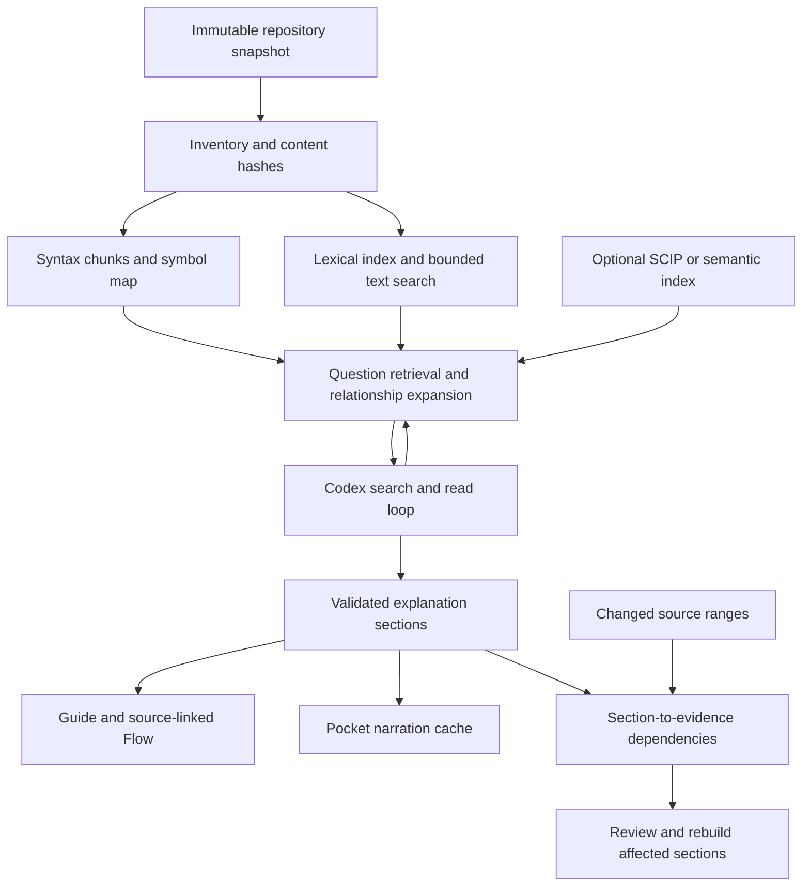
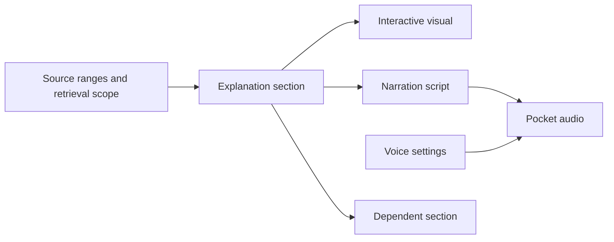

# How code tools understand entire repositories

Research date: 17 October 2026; expanded review against primary documentation on the same date. Historical app observations distinguish the `be49e35` [Fontdone acceptance run](../acceptance/2026-10-17-fontdone.md) from the `94ff754` [native retrieval checkpoint](../acceptance/2026-10-17-range-retrieval.md). Native structural tools have a [separate checkpoint](../acceptance/2026-10-17-structural-context.md). The subsequent [owned Codex investigation report](../acceptance/2026-10-17-codex-owned-retrieval.md) records implemented tool use, successful synthetic/focused investigations and failed broad attempts. This research is not a broad-generation acceptance pass.

## Recommendation

Build a shared, local repository context service: an immutable inventory, syntax-aware source ranges, lexical search, and confidence-labelled relationships. Let the existing Codex app-server search and read those ranges through narrowly scoped tools. Generate independently saved explanation sections from the retrieved evidence, then attach visuals and Pocket narration.

Use our existing Tree-sitter parsers, **Tantivy** for ranked text search, and the ripgrep project's Rust search libraries for bounded fallback searches. Evaluate **Serena/LSP or imported SCIP** before building broader semantic navigation ourselves. Keep embeddings as an optional improvement evaluated against retrieval failures. The architecture below includes recommendations beyond the implemented [local retrieval service](../acceptance/2026-10-17-range-retrieval.md) and [owned Codex loop](../acceptance/2026-10-17-codex-owned-retrieval.md). Broad repository explanation and packaged parent acceptance remain unqualified.

The studied systems offer repository-wide retrieval or exploration; their documentation does not establish exhaustive understanding of every file or execution path. Exclusions, language coverage, stale indexes and generated summaries still require explicit treatment.

## How Codex Desktop investigates a question

The desktop app, CLI and IDE experiences share the open Codex harness. It manages the conversation, tools, sandbox/approval policy and continued work. App-server exposes this runtime so a product can start and resume conversations, stream events, interrupt work and provide its own tools. [Official integration explanation](https://developers.openai.com/blog/codex-as-a-platform), [app-server protocol](https://learn.chatgpt.com/docs/app-server).

Repository investigation is iterative: search names/content, read relevant ranges, follow references and adjust the next query using those results. The official prompting guide recommends repository search tools such as `rg`, parallel independent reads and context compaction for longer work. It also discusses custom semantic/MCP tools as options requiring tuning. These sources do not establish a mandatory vector index or exhaustive preloading of every repository file. [Codex prompting guide](https://developers.openai.com/cookbook/examples/gpt-5/codex_prompting_guide).

For Code Atlas, reuse that agent loop and let Codex choose evidence. Our app supplies the captured-code tools, handles the source grant, and turns independently validated output into the explanation, graph and narration. Its scoped MCP-only, ephemeral-question integration has different permissions and lifecycle from a general desktop coding session. The observed search/transport/budget failures belong to this adapter; they are not evidence of a desktop Codex restriction or a reason to ask readers to choose fewer files.

## What established products actually do

These are vendor-documented mechanisms, not an independent product benchmark. Internal algorithms that the vendor does not publish remain unknown. Windsurf documentation currently redirects to Devin Desktop documentation; the names below preserve that relationship.

| System | Published approach | Lesson for Code Atlas |
| --- | --- | --- |
| **Cursor** | Its January article describes Merkle trees, syntactic chunks and content-cached embeddings. The March article describes local regex indexes, based on a Git commit plus a changes overlay, which narrow candidates before exact matching. [Semantic indexing](https://cursor.com/blog/secure-codebase-indexing), [local regex indexing](https://cursor.com/blog/fast-regex-search). | Reuse changed content and provide fast exact searches. The January cloud-embedding design is not evidence that every current Cursor workflow requires that design. |
| **GitHub Copilot** | Automatically builds a repository semantic search index. Its cloud agent can use semantic search when exact names are unknown. Index creation and updates run in the background. [Repository indexing](https://docs.github.com/en/copilot/concepts/context/repository-indexing). | Natural-language discovery needs more than filename matching. Background preparation can serve several questions. |
| **Claude Code** | Uses an iterative context-gathering loop with file reads, pattern/regex search and optional definition/reference tools through code intelligence plugins. [How it works](https://code.claude.com/docs/en/how-claude-code-works). | An agent can progressively inspect code; a vector index is not a prerequisite for this workflow. The cited page does not establish the absence of all internal indexing. |
| **Codex** | The official OpenAI documentation describes app-server as an agent harness supporting conversation state, tools, streamed events and application-owned MCP services. [Platform architecture](https://developers.openai.com/blog/codex-as-a-platform). | Keep the existing account-backed integration and give it useful repository tools. Reuse its agent loop. |
| **Sourcegraph** | Deep Search iteratively uses code search/navigation and reports searched/read sources. Cody's Enterprise FAQ says Sourcegraph Search replaced embeddings. Precise navigation uses SCIP with search-based fallback. [Deep Search](https://sourcegraph.com/docs/deep-search), [FAQ](https://sourcegraph.com/docs/cody/faq), [SCIP navigation](https://sourcegraph.com/docs/code-navigation/precise-code-navigation). | Search, inspect and refine; expose evidence provenance. Precise links and heuristic links need different confidence labels. |
| **Windsurf / Devin Desktop** | Documents indexed RAG context. Fast Context uses a specialized retrieval agent and parallel searches to return relevant code sections. [Context engine](https://docs.devin.ai/desktop/context-awareness/overview), [Fast Context](https://docs.devin.ai/desktop/context-awareness/fast-context). | Separate retrieval from answer construction. The advertised speedups are vendor claims and are not transferable to our app or model. |
| **Augment** | Publishes a personal, changing-code-aware index and embedding retrieval. Its scale article describes quantized candidate search followed by full-vector scoring, with handling for recent changes. [Personal index](https://www.augmentcode.com/blog/a-real-time-index-for-your-codebase-secure-personal-scalable), [Retrieval architecture](https://www.augmentcode.com/blog/repo-scale-100M-line-codebase-quantized-vector-search). | Retrieval must match the actual branch and source version. Enterprise-scale ANN machinery is not a necessary first step for a desktop app. |
| **Aider** | Sends a compact repository map of declarations and signatures. A dependency graph ranking algorithm selects relevant map portions within a token budget. [Repository map](https://aider.chat/docs/repomap.html). | A small, question-relevant structural map helps orientation without copying every implementation into the prompt. |
| **Continue** | Current documentation deprecates its old `@Codebase` provider and recommends file/search tools, rules and MCP. Custom RAG remains an advanced option for large internal codebases. [Current awareness guide](https://docs.continue.dev/guides/codebase-documentation-awareness). | Older articles describing its embedding pipeline are not the current recommended integration. Expose context through reusable tools. |
| **DeepWiki** | Generates repository summaries, architecture diagrams and source-linked pages. Its docs describe default cluster-based planning, hierarchical page configuration and known missing-component limits. [Repository wikis](https://docs.devin.ai/work-with-devin/deepwiki). | This is the closest product reference for a repository explainer. Combine a persistent overview with deeper exploration; do not infer its private indexing algorithm from the wiki output. |
| **Serena** | Provides symbol lookup, file outlines and references through MCP, using language servers by default or a separate JetBrains backend. It documents Codex and Claude clients. [Project and capabilities](https://github.com/oraios/serena), [client integration](https://oraios.github.io/serena/02-usage/030_clients.html). | A concrete reuse candidate for semantic navigation. Its LSP capabilities differ from vector similarity; validate language setup, snapshot isolation and bounded read-only operation before adoption. |
| **Sourcebot** | A self-hosted context layer exposes search, source reads, symbol definitions and references to agents over MCP; its setup uses Node and Docker. [Project](https://github.com/sourcebot-dev/sourcebot), [MCP](https://docs.sourcebot.dev/docs/features/mcp-server). | A useful future shared-service option. The deployment requirements are a poor default for our single-user Mac experience. |

### What “entire repository” actually means

These are three separate promises:

| Promise | What must be available | What it does not establish |
| --- | --- | --- |
| Repository inventory | Captured paths, packages, manifests, source hashes, exclusions and unavailable-file reasons. | That the model has read or understood every file. |
| Repository-wide investigation | Search/read access to eligible ranges; definitions/references when supported; the ability to refine searches and follow neighbours. | Exhaustive branch coverage from the first top-k result set. |
| A completed repository guide | A saved outline, independently usable sections, evidence links, completed/pending/omitted coverage and evaluated behaviour journeys. | That indexing alone produced a coherent narrative or a correct runtime trace. |

The app needs all three. Inventory can be prepared locally; expensive explanation work should be scoped to the user's question or an explicitly requested full guide. Documentation can suggest concepts and terminology, but implementation claims must be checked against captured code. A contradiction should identify the document and the code evidence; age alone cannot establish that a document is obsolete.

### Current evidence versus historical descriptions

Cursor's [current learning page](https://cursor.com/learn/understanding-your-codebase) describes agentic grep and search by meaning together. Its March engineering article gives a detailed local text-index design; the January article gives a semantic-index design. These establish different mechanisms, not a stable specification of every shipped configuration. This review does not assert either that Cursor requires embeddings or that all semantic retrieval has disappeared.

Continue explicitly marks the old `@Codebase` provider deprecated and now documents tool-driven exploration and MCP. Sourcegraph's embeddings statement is specific to Cody Enterprise. Neither statement establishes that embeddings are ineffective for every product. Product documentation is evidence of a documented design, not an independent performance or completeness result.

### The common pattern

Across these different implementations, repository context is assembled for the current task. An index locates candidates, tools inspect actual code, and the answer uses a bounded evidence set. Semantic similarity locates candidates; it does not establish control flow or prove an explanation.

For Code Atlas, repository-wide availability, question retrieval coverage and completed explanation coverage should be measured separately. The reader should be able to ask about any captured code without selecting references manually. That does not require pre-generating a video for every file.

## Why our Fontdone workflow failed

The following are confirmed observations of the generation path. Native range search was subsequently added at `94ff754`, but that does not replace the Codex generation path:

| Current implementation | Consequence |
| --- | --- |
| [Discovery eligibility](../../src-tauri/src/source_discovery.rs) rejects files above 250,000 bytes. | Fontdone's captured, indexed 375,700-byte `src/font.rs` cannot even be proposed. |
| Discovery ranks question words against paths and advertises only the first 18 symbols and ten high-confidence links per file, inside a 96,000-byte record budget. | A relevant function late in a large file can be absent from the model's choices. There is no content search in this selector. |
| [Workspace jobs](../../src/workspace/store.ts) run a discovery inference, then send whole selected files to a separate chapter inference. | Every question pays for two serial model operations. Attaching a line range adds focus metadata but does not reduce the whole-file source bytes. |
| [Codex adapter](../../src-tauri/src/codex_agent.rs) disables shell and inherited MCP tools and rejects tool execution events. | We are using the account-backed Codex harness as a bounded structured-output generator. It cannot investigate missing implementation through tools. |
| The chapter is admitted only after complete structured output and native validation. | The reader waits for the whole answer artifact. Streaming arbitrary unvalidated text would bypass the current evidence contract. |
| No persistent per-stage timing trace is available. | We cannot attribute the ten-minute observation to search, reasoning, output generation or validation. A vector database would not by itself diagnose this. |
| [Answer UI](../../src/workspace/Workspace.tsx) stores its section index in component-local state. | Back, view changes and restart can lose the selected section. This is independent of indexing. |

The broad Fontdone run selected nine files and 247,956 source bytes, omitted `src/font.rs` and `src/api.rs`, and was manually stopped at 606 seconds. `src/api.rs` was eligible; its omission is a selection/budget outcome, not the per-file exclusion. This was a failed usability run, not a completed latency benchmark or a native timeout.

## Indexing options and the decision

| Layer / existing solution | What it gives us | Tradeoff / decision |
| --- | --- | --- |
| **Content search using ripgrep libraries** | Exact identifiers, error messages and regex matches; parser-independent fallback. [grep-searcher](https://docs.rs/grep-searcher/latest/grep_searcher/). | Repeated broad scans cost work. Search immutable captured text with byte, match and time budgets; preserve existing exclusions. Use now. |
| **Tantivy** | Embedded Rust full-text engine with BM25 ranking and incremental indexing. [Project documentation](https://docs.rs/crate/tantivy/latest). | Requires a code-aware tokenization policy and explicit commit/reload lifecycle. Recommended first persistent lexical engine for this Rust app. |
| **SQLite FTS5** | Embedded full-text search, BM25 and optional trigram tokenization. [Official reference](https://www.sqlite.org/fts5.html). | Strong alternative if we adopt SQLite for durable jobs/content too. External-content indexes require explicit consistency maintenance. Do not ship two lexical engines initially. |
| **Tree-sitter** | Incremental syntax trees and language-specific declaration boundaries. [Introduction](https://tree-sitter.github.io/tree-sitter/). | Already used here for Rust and JS/TS. Syntax does not resolve dynamic dispatch or prove execution. Use for chunks; keep text fallback for unsupported/oversized inputs. |
| **ast-grep** | Structural pattern search using syntax trees. [Official project](https://ast-grep.github.io/). | Useful for finding implementation patterns across supported grammars. It is not a type checker, general reference resolver or complete architecture graph. Reuse when a concrete pattern query warrants it; no additional parser framework now. |
| **SCIP / language servers** | Language-aware definitions, references and type-aware navigation where supported. [SCIP indexers](https://sourcegraph.com/docs/code-navigation/precise-code-navigation). | Requires language/toolchain setup and can depend on build configuration. SCIP is an interchange format, not a resolver by itself. Import qualified indexes later; keep revision identity and distinguish unresolved relationships. |
| **Serena over MCP** | Existing symbol-oriented navigation backed by language servers, usable from several agents. [Capabilities](https://github.com/oraios/serena). | Evaluate as an optional adapter before expanding custom semantic resolution. The current project declares SolidLSP MIT and the application GPL-3.0-or-later; pin and review the actual distribution and language-server dependencies before packaging. No installation or licence compatibility conclusion is made here. |
| **Embeddings + LanceDB** | Optional semantic candidate retrieval; LanceDB also supports combining vector and full-text results. [Hybrid search](https://docs.lancedb.com/search/hybrid-search). | Requires an embedding model and an update pipeline. A vector store does not create embeddings itself. Evaluate later against questions that lexical/graph retrieval misses. No local model is required by the proposed baseline. |
| **Zoekt** | Existing trigram code-search engine, supporting local command-based indexing/search and larger service deployments. [Project](https://github.com/sourcegraph/zoekt). | Strong candidate if repeated regex scans become a measured bottleneck. Its Go tools add packaging work beside our Rust runtime; a web service is not mandatory. Do not build a custom trigram engine or replace Tantivy without a comparison. |
| **Repomix** | Packages repository content for AI use. [Guide](https://repomix.com/guide/). | Useful for controlled exports and investigations. Packaging alone does not provide incremental question-specific retrieval or resolve context limits. |

**Selected baseline:** existing snapshot store + existing Tree-sitter + Tantivy + bounded fallback search + Codex app-server. Preserve Pocket for local narration. Search/index work has no per-query model charge; Codex generation still consumes the connected account's quota. Hosted embeddings, additional agent providers and a hosted search service are optional future decisions.

The word “semantic” is overloaded: embedding search finds similar meaning, while language intelligence identifies symbols/types and references. Neither produces an observed execution trace. Tree-sitter syntax links, LSP/SCIP links and model-inferred relationships must retain their distinct provenance and uncertainty in the context service.

### Build versus integrate

| Need | Reuse | Code Atlas still owns |
| --- | --- | --- |
| Ranked search, parsing, exact matching | Tantivy, Tree-sitter, ripgrep libraries already adopted. | Eligibility, snapshot binding, source coordinates and bounded results. |
| Broader precise navigation | Evaluate Serena/LSP and SCIP imports on representative languages. | Read-only scope, revision checks, dependency lifecycle and honest fallback labels. |
| Agent orchestration | Existing Codex app-server and account; standard MCP transport. | Owned context tools, evidence budgets, cancellation, durable jobs and output validation. |
| Repository explanation | Learn from Aider's compact map and DeepWiki's hierarchical pages. | Automatic journey planning, concrete teaching, source-linked visuals, interactive pacing and section history. |
| Team-wide shared context | Evaluate Sourcebot or Sourcegraph when a shared service is actually requested. | Connection once, authorization and consistent citations across local/shared contexts. |

Do not introduce a general RAG framework, graph database or second agent harness merely to join these pieces. A provider-neutral context contract is useful now; shipping several unqualified backends is not a prerequisite to fixing Codex. Claude remains deferred as requested. An MCP-compatible product's existence does not prove that Code Atlas already supports it.

### Cost and deployment

| Work | Recommended placement | Main cost / constraint |
| --- | --- | --- |
| Hashing, chunking, lexical search, graph traversal | Native local process; cache by source and policy identity. | CPU, disk and implementation maintenance; no inference needed. |
| Question interpretation, explanation and chapter planning | The saved Codex account using GPT-6 Luna/max. | Account quota and latency; exact usage is recorded only when the runtime supplies it. |
| Optional semantic candidates | Deferred until the frozen benchmark shows a benefit. | An embedding model is required as well as a vector store. A hosted embedding service adds a connection/cost; the selected baseline requires neither. |
| Narration and visuals | Cache Pocket audio separately; render grounded diagrams locally. | Local synthesis/render time and storage; regenerated text or voice settings invalidate only affected audio. |
| Shared organization search | Optional later deployment. | Hosting, permissions, upgrades and provider charges; not part of the default Mac installation. |

No price estimate, free-tier allowance or vendor speed claim is treated as an app guarantee.

## What our measurements change

The native checkpoint indexed **1,621 eligible text files / 19,296,074 bytes / 3,422 ranges**. Its frozen twelve-declaration Fontdone set achieved **8/12** named global, **12/12** named file-scoped, and **2/12** broad lexical retrieval recall. A warm in-memory `memory_face` query took **256 ms** in the recorded native run. These are single-workload observations, with caps, truncation and parser gaps detailed in the [acceptance report](../acceptance/2026-10-17-range-retrieval.md).

This supports retaining the local foundation while improving question investigation. A single broad query misses too much; names and file scopes help materially. The next comparison must measure map-guided and relationship-guided agent retrieval. It must not assume that either a vector store or more top-k results will fix the missing evidence. Native search availability has improved; the broad narrated explanation still fails its acceptance gate.

The subsequent [structural checkpoint](../acceptance/2026-10-17-structural-context.md) finds all eight syntax-backed expected declarations, while the four oversized FFI/C adapter cases remain text fallback. Its first 32 outgoing `memory_face` links are all unresolved. Reusing precise language intelligence warrants evaluation; a saved parser graph must not be advertised as a complete execution flow. No agent-generated answer is established by that checkpoint.

## Proposed architecture

### 1. Make every captured implementation range discoverable

Keep per-file inventory independent of parser and model request limits. Represent each chunk with snapshot ID, original path, full-file hash, absolute byte and line range, chunk hash, symbol/parent identity when known, and parser version. Split oversized functions into bounded pieces retaining enclosing signature/context. Use bounded line windows when parsing is unavailable. Report unavailable text; never call it understood.

Index identifiers in both their original spelling and searchable components. Preserve exact-match preference for `Font::memory_face`, snake_case, camelCase and paths. Search code contents as well as symbol names. Rank caller/callee and import neighbours with explicit confidence. Deduplicate overlapping windows before spending the request budget. A compact module map helps broad questions reach the correct subsystem.

### 2. Let Codex retrieve evidence progressively

Expose app-owned tools such as `search_code`, `read_source_range`, `find_definition`, `find_references` and `repo_map`. Each result carries immutable coordinates and coverage/truncation information. The native service enforces snapshot/account grant, exclusions, aggregate byte budget, result limits, cancellation and deadlines on **every call**. It cannot read arbitrary live files, execute repository code or widen its own permission.

Prefer a private local MCP integration because the same retrieval contract can later serve Claude or other qualified agents. Keep inherited unrelated MCP servers disabled. Only permit the owned tool/event surface. App-server dynamic tools are an alternative, but the official docs currently mark that interface experimental; validate against the installed runtime before selecting it. [Protocol documentation](https://learn.chatgpt.com/docs/app-server).

Use the existing Codex installation and account, GPT-6 Luna with max reasoning. The recommendation changes context access, not the user's selected model. Persist the retrieved evidence ledger in Code Atlas rather than relying on a hidden model transcript. Multi-call retrieval must remain bounded and stops when evidence is sufficient or the budget is exhausted.

### 3. Generate a complete repo guide in independently usable parts

For a broad tour, derive a package/module map and entry points, identify behaviour journeys, then build a hierarchical outline. Each section declares its learning question, prerequisites, exact evidence and unresolved boundaries. Generate a short direct answer first; expand detail sections when requested or through the explicit whole-guide job. This is automatic planning, not a manual file picker.

Use complete, independently validated section artifacts as publication units. Keep the current validators authoritative. A useful partial guide may contain completed sections plus explicit pending/failed sections; it must never be labelled a completed repository tour. Avoid generating prose that the presentation layer will discard. Visuals should show evidenced branches, data movement or state, with links to code and unknown edges labelled. TTS follows the final narration script and is cached separately.

For the original Git-like editing requirement, store dependencies from each section to source ranges, prerequisite sections, visual inputs and narration-script/voice identity. A source edit invalidates dependent outputs and their affected dependants; unrelated sections and recordings remain usable. A new explanation revision preserves earlier versions. PR mode compares base/head evidence and affected journeys. Source proximity alone is insufficient to claim complete impact analysis.

The planned full-guide job should work in this order:

1. Capture the inventory and discover packages, public interfaces and candidate entry points from manifests and code. Use docs as search hints, then verify their implementation claims.
2. Build a compact package/module map; classify implementation, tests, configuration, generated/vendor and unavailable contents. Preserve counts outside the model prompt.
3. Plan a small orientation and concrete journeys, such as Fontdone's font bytes → face/format dispatch → glyph loading → optional hinting → rasterization → bitmap. Each arrow needs inspected evidence; unsupported format and ABI boundaries remain explicit.
4. For each learning question, use exact lookup, varied lexical queries and bounded neighbour expansion; inspect the actual source ranges. Search can refine before the answer is generated. Do not require the reader to choose supporting files.
5. Validate and save complete sections as they become usable. A section explains inputs, decisions, state, outputs and failures relevant to its question, rather than listing files. A full-guide job records pending and failed sections and resumes without repeating completed work.
6. Derive interactive visuals and narration from the validated section. Source clicks open the exact code; Next/Back and nested exploration keep the selected section and playback state, without autoplay on navigation.
7. Record direct evidence plus retrieval scope/index identity and prerequisite dependencies. A newly added implementation may invalidate an earlier answer even if none of its cited lines changed. Recheck discovery/relationship changes as well as direct source edits; do not claim complete impact analysis from citations alone.
8. On a source or explanation edit, create a revision and rebuild only affected admitted sections/visuals/audio. Reuse unaffected assets; keep old evidence and output versions inspectable. An uncertain dependency produces an explicit review state.

This dependency structure is our proposed solution for editable explanations. None of the reviewed documentation proves a ready-made, drop-in system for Code Atlas's complete interactive-video and selective-regeneration requirements.

### Language support needs separate layers

Text search and source-range citations can work without a grammar. Declarations and syntax chunks need a maintained grammar. Type-aware references need a qualified compiler/LSP/indexer configuration. Framework entry points, generated bindings, runtime dispatch and cross-language calls need additional evidence. Adding a grammar or connecting a language server does not automatically qualify a coherent narrative.

Code Atlas currently ships Rust and JavaScript/TypeScript grammar variants; the Fontdone FFI/C adapter measurement used text fallback above the parser cap. Keep a per-operation language matrix. Evaluate Python/Go expansion and mixed-language cases through existing tooling before claiming support. LSP startup, build configuration and missing dependencies must degrade to useful captured-text exploration rather than blocking the entire repository.

### 4. Measure latency before changing models

Record queue wait, connection preparation, local index load/build, retrieval, each inference, first validated section, validation, publication and total elapsed time. Keep request identity, model/settings, context bytes, output bytes, tool counts and terminal outcome. Record token usage only when the runtime actually exposes it. Do not log source text, credentials or reasoning by default.

The official OpenAI latency guide recommends reducing unnecessary output and model requests, parallelizing independent work and making results useful sooner. Our bottleneck and any speedup must be measured in this app. [Latency guidance](https://developers.openai.com/api/docs/guides/latency-optimization).

Local searches can run independently without launching multiple Codex processes. A warm index should serve repeat questions without rebuilding unchanged content. Publish validated sections progressively, show one compact working state, distinguish queued work, and keep Stop responsive. Detailed timings belong in diagnostics, not the reader's main interface.

## Delivery and qualification

1. [Local range index and retrieval](../kata-tasks/69-local-range-retrieval.md), Kata `a699`: remove large-file discovery blindness while keeping bounded requests.
2. [Codex retrieval tools](../kata-tasks/70-codex-retrieval-tools.md), Kata `gk46`, blocked by `a699`: qualify the existing account-backed harness with the owned read-only context service.
3. [Generation timing traces](../kata-tasks/71-generation-timing-traces.md), Kata `ps02`: establish the first useful answer and the slow stage before tuning. This measurement work can proceed independently of the retrieval replacement.
4. Existing [repository narratives](../kata-tasks/38-repository-narratives.md), [background jobs](../kata-tasks/60-background-generation.md) and [route batches](../kata-tasks/56-route-chapter-batch.md) own progressive whole-guide generation, restart and selective updates. Research does not close these gates.
5. Fix [reading-position persistence](../kata-tasks/68-exploration-reading-position.md) independently; no indexing change will repair component-local navigation state.
6. In [language qualification](../kata-tasks/39-language-capability-tiers.md), compare Serena/LSP and SCIP import before expanding custom semantic resolution. Record installation/runtime requirements, language coverage, revision matching, read-only enforcement, cancellation, packaging/licences and a useful fallback. This is an evaluation requirement, not an instruction to install a new dependency now.

Compare the existing selector, lexical ranges, lexical+relationship expansion, agentic retrieval and any later semantic candidate retrieval against the **same frozen question set**. Establish expected source ranges by independent code review, not the retriever's own answers. Include Fontdone's font-bytes-to-bitmap route, `Font::memory_face`, a name-free broad question, files above the parser limit, unsupported syntax, and a TypeScript project.

Measure candidate and evidence recall, citation correctness, answer usefulness, missing branches, first validated answer latency, total time, source/output bytes and index size/update work. Preserve failed runs and partial coverage. Measure warm/cold paths separately with the same model/reasoning and no concurrent build. A proposed product target is a first useful validated answer within two minutes for the agreed Fontdone questions; this is a **target, not a measured capability or industry guarantee**.

No new Codex inference, application test or package build was run for the research itself. Subsequent native retrieval tests and measurements are recorded separately in the [implementation checkpoint](../acceptance/2026-10-17-range-retrieval.md). The original broad-answer and navigation failures remain open until their full acceptance contracts pass.

## Evidence scope and remaining unknowns

The twelve product/toolkit rows above were checked against primary project/vendor sources on 17 October. They cover multiple retrieval designs, not every vendor in the market. Search-engine crawl times and undated vendor pages do not establish when a feature shipped. No competitor was installed or benchmarked in this review, and private ranking, chunking, planning and model-routing algorithms remain unknown unless documented.

The implementation diagnosis is supported by source inspection and the separately recorded Fontdone run; it does not attribute the ten-minute wait to a measured runtime stage. Recommendations, cost placement and the proposed section dependency graph are engineering judgments. A documentation/link audit verifies the report's local consistency, not the proposed retrieval or narrative capability. Kata remains open until the relevant implementation and acceptance evidence exists.
